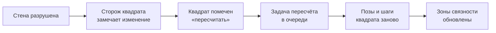

# Д2. Навигация

← [Д1 Здания и разрушение](<Д1 Здания и разрушение.md>) · дальше [Д3 Выстрел, укрытие, пробитие](<Д3 Выстрел, укрытие, пробитие.md>)

> [!summary] Суть
> Игра сама вычисляет, где можно пройти, проползти и перелезть, прямо из геометрии уровня. Дизайнер ничего не размечает. Когда стену взорвали, карта проходимости пересчитывается кусками, не останавливая игру.

## Сетка

Пространство разбито на клетки по 0,625 м. Клетка хранит высоту, этаж и четыре набора разрешённых направлений: для ходьбы, приседа, ползания и перелезания.

Здания многоэтажные, поэтому на одной вертикали может быть несколько клеток: до 8 этажей, до 3 поверхностей на этаж. Здание, повёрнутое под углом к карте, получает собственную повёрнутую сетку, связанную переходами с основной.

## Как игра узнаёт, где можно пройти

Для каждой клетки выполняется проверка шаром. Радиус шара 0,31 м — это «толщина» бойца.

1. **Поверхности.** Вниз пускается 9 вертикальных лучей на клетку. Они находят все «полы» на этой вертикали. Щель ниже 0,72 м полом не считается.
2. **Позы.** Шар ставится на трёх высотах. Поместился на 1,59 м — можно стоять; на 0,975 м — можно сидеть; на 0,41 м — можно лежать.
3. **Шаги.** Шар протягивается к соседней клетке. Прошёл без столкновений и перепад меньше 0,55 м — шаг разрешён.
4. **Особые переходы.** Перепад от 0,55 до 2,8 м — перелезание (окно, забор, уступ). Лестницы и двери добавляются по данным уровня.

> [!example] Пример: окно
> В стене окно с подоконником на высоте 1 м. Проверка шага не проходит: перепад больше 0,55 м. Зато выше подоконника помещаются два шара — значит, здесь переход «перелезание». Он дороже обычного шага и разрешён только по четырём основным направлениям.

## Что происходит после взрыва

Карта разбита на квадраты 8 × 8 клеток. У каждого квадрата есть «сторож», который следит за геометрией в своём объёме.

Пересчёт идёт порциями: на всё «думание» отводится около 10 мс за шаг мира. Пока пересчёт не закончен, поиск пути в этом месте отвечает «пути пока нет».

## Поиск пути

Состояние в поиске — не просто клетка. Это клетка, этаж, направление и поза. Цена шага измеряется в очках действия: ползти дороже, чем идти, диагональ дороже прямой, перелезание дороже всего.

Поиск — волна от цели без подсказок направления. Чтобы волна не заливала всю карту, есть второй уровень: клетки собраны в зоны по 8 × 8, между зонами построен граф. Сначала ищется маршрут по зонам, и подробный поиск идёт только в коридоре вокруг него.

Тот же расчёт без цели даёт «куда я дойду на оставшиеся очки» — подсветку доступных клеток для игрока.

> [!example] Пример: лёжа нельзя развернуться где угодно
> Стоя и сидя боец поворачивается бесплатно, направление в поиске не учитывается. Лёжа — учитывается: ползти можно только вперёд, а разворот проверяет, что вытянутое тело помещается. Поэтому путь ползком вдоль узкого коридора может оказаться длиннее, чем кажется.

## Что нужно от движка

| Что | Зачем |
|---|---|
| Доступ к своей геометрии столкновений | лучи со всеми пересечениями и протяжка шара; обычного «первое попадание» мало |
| Сообщение «геометрия здесь изменилась» | запуск пересчёта квадратов |
| Больше ничего | сетка, поиск и зоны — чистая логика |

Готовая навигация движков (навигационные сетки) здесь не подходит: она не знает о позах, этажах внутри разрушаемых зданий и цене в очках действия.

## Подробнее

- Полные описания: `Каталог решений/ИИ и навигация.md`, записи 1–8.
- Поправка к старым заметкам: BSP-деревья игра не использует, их строит только редактор. Столкновения считаются по готовым битовым сеткам «поместится ли шар».
