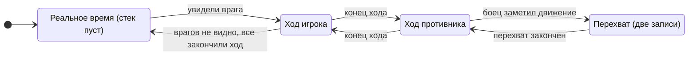

# Д5. Время и ход

← [Д4 Взрыв и зрение](<Д4 Взрыв и зрение.md>) · дальше [Д6 Карта и редактор](<Д6 Карта и редактор.md>)

> [!summary] Суть
> В игре нет двух отдельных режимов «реальное время» и «пошаговый». Есть один стек: пуст — все действуют одновременно, не пуст — ходит тот, кто наверху. Перехват хода — это просто ещё одна запись в стеке.

## Шаг мира

Мир живёт шагами по 50 мс, независимо от частоты кадров. За один шаг в строгом порядке обрабатываются приказы, бойцы, снаряды, обломки, взрывы, зрение и сценарии.

Картинка от шагов не зависит. Мир ведёт список «что изменилось с прошлого раза», и рендер, звук и навигация забирают из него только новое. Именно это разделение позволяет вынести расчёты в отдельную библиотеку.

## Стек ходов

- **Стек пуст** — реальное время, приказы принимаются от всех.
- **В стеке одна запись** — чей-то ход.
- **Две записи** — перехват: наверху тот, кто перехватил, под ним прерванный ход. Больше двух не бывает.
- **Запись без владельца** — сценарная сцена: игра идёт как в реальном времени, но перехваты запрещены.

> [!example] Пример: перехват
> Идёт ход противника. Вражеский солдат выбегает из-за угла в поле зрения вашего бойца. Игра считает шанс перехвата: базовое значение, плюс разница навыков реакции, минус штраф за потраченные в свой ход очки действия. Бросок удачен — в стек кладётся запись «ваш боец». Противник замирает, вы стреляете. Когда запись снимается, противник продолжает ход с того же места.

Возврат в реальное время происходит сам, когда никто никого не видит и все закончили ход.

## Очки действия

Мир очки действия не хранит и не считает. Он только сообщает «ход начался» и «ход закончился». Запас и цены ведёт слой правил ([Д7 Правила и кампания](<Д7 Правила и кампания.md>)). Это удобное разделение: механику хода можно менять, не трогая правила.

## «Что-то ещё происходит»

Пока летит пуля, падает здание или открывается дверь, новые приказы не принимаются. Мир знает об этом через счётчики действий: каждое действие держит счётчик, пока не завершится.

Счётчиков два вида:
- **важные** — стрельба, взрывы, обрушения;
- **пропускаемые** — перемещения.

> [!example] Пример: ход противника, которого не видно
> Противник за стеной перебегает из комнаты в комнату. Игрок его не видит и не слышит. Мир замечает: идёт только пропускаемое действие, и оно скрыто от игрока. Тогда за один кадр прокручивается сразу много шагов мира, пока не истечёт бюджет в 30 мс. Ход противника пролетает за секунду, а не тянется минуту.

## Приказы

Приказы человека, противника и сценария идут одним путём: в очередь командира. Приказ превращается в исполнителя — объект, который живёт несколько шагов и привязан к анимации.

У анимации есть метки. Выстрел происходит не «когда нажали», а когда анимация дошла до метки «выстрел»; дверь меняет проходимость на метке «открылась».

Если бойцу не хватает очков действия посреди пути, он доходит шаг и останавливается. Приказ не стирается — его можно продолжить в следующий ход.

## Камера

Камера получает заявки с приоритетом: звук, действие, взрыв, попадание по своему, смерть, сценарий. Более важное перебивает менее важное. Для показа события она сама подбирает положение: перебирает несколько расстояний и поворотов и берёт то, где цель в кадре и ничем не закрыта.

## Что нужно от движка

| Что | Зачем |
|---|---|
| Анимации с метками событий | привязка выстрелов и дверей ко времени |
| Тонкий слой «изменение → объект сцены» | рендер получает только изменившееся |
| Таймер | бюджет перемотки |
| Больше ничего | стек, счётчики и приказы — чистая логика |

## Подробнее

- Полные описания: `Каталог решений/Симуляция мира.md`, записи 1–12 и 23.
- Не дочитано: исполнение атак во времени (4 тысячи строк), выбор анимаций.
