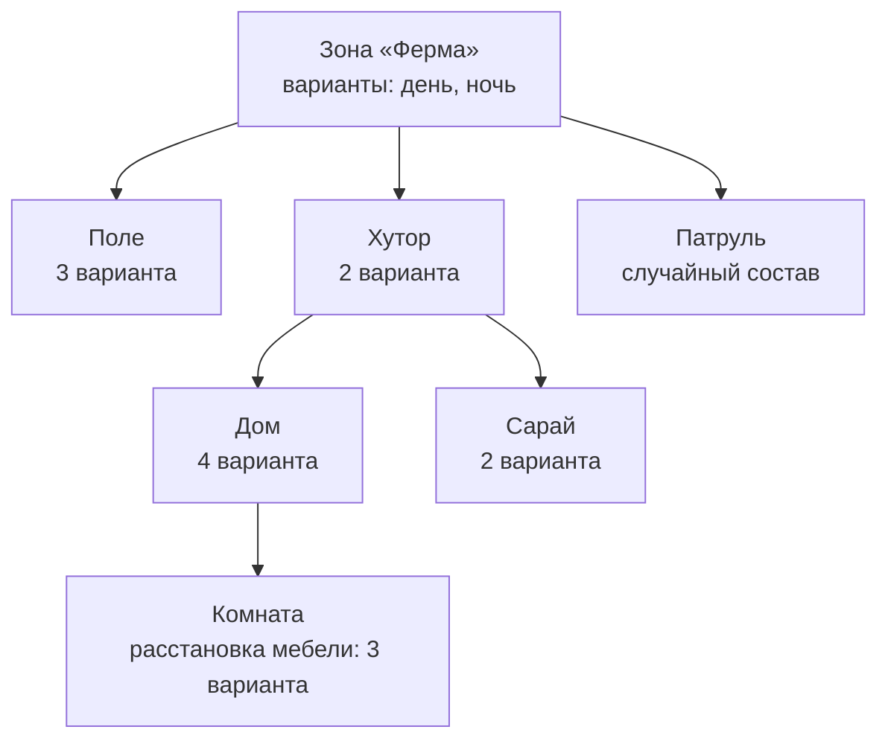

# Д6. Карта и редактор

← [Д5 Время и ход](<Д5 Время и ход.md>) · дальше [Д7 Правила и кампания](<Д7 Правила и кампания.md>)

> [!summary] Суть
> Карта — не один большой файл, а дерево шаблонов: поле, на нём хутор, в хуторе дом, в доме комната с мебелью. У каждого шаблона несколько вариантов, и игра выбирает их случайно. Здания дизайнер не моделирует, а рисует по сетке из готовых деталей.

## Карта как дерево шаблонов

Шаблон — прямоугольный кусок мира. У него есть варианты, у каждого варианта — вес. Вариант содержит рельеф, здание, объекты, бойцов, сценарий и **вложенные шаблоны**, расставленные внутри. На схеме — условный пример.

При загрузке игра идёт по дереву сверху вниз и в каждом узле выбирает вариант. Выбор случаен, но воспроизводим: одно и то же стартовое число даёт одну и ту же карту.

Три способа управлять случайностью:
- **вес** — как часто выпадает вариант;
- **флаги** — условия вроде «день» или «ночь»; спускаются сверху вниз по дереву;
- **закрепление** — дизайнер может зафиксировать конкретный вариант в конкретном месте.

> [!example] Пример: рельеф вложенного шаблона
> Дом стоит на холме, но шаблон дома нарисован на ровной площадке. При сборке рельеф шаблона «впечатывается» в рельеф поля: высоты заменяются, прибавляются или вычитаются по маске. Вокруг дома получается ровная площадка, плавно переходящая в склон. Трава, покрытие и ямы под подвал переносятся так же, с учётом поворота.

Заранее взорванные руины делаются тем же расчётом, что в игре: дизайнер ставит «взрывы» в редакторе, а при загрузке здание прогоняется через расчёт устойчивости, пока не устоится.

## Как дизайнер строит здание

Редактор показывает здание тем же кодом, что и игра, поэтому результат виден сразу.

| Инструмент | Как работает |
|---|---|
| **Стены** | дизайнер выбирает деталь-стену и тянет мышью; стена ложится отрезками по сетке, только вдоль осей; направление движения задаёт, где у стены «внутри» |
| **Перекрытия и крыша** | закрашиваются клетками на выбранном этаже; отдельной «крыши» нет, это такие же плиты |
| **Двери и окна** | не вырезаются: это отдельная деталь с готовым проёмом и встроенной створкой |
| **Комнаты** | закрашиваются вручную, клетка за клеткой; автоматически игра комнаты не находит |
| **Подвал** | рисуется маской; по её границе в рельефе вырезается яма |
| **Лестницы** | ставятся точкой: этаж, поворот, число ступеней |
| **Материалы** | наборы из четырёх материалов наносятся кистью на детали |

Углы и стыки стен появляются сами — см. [Д1 Здания и разрушение](<Д1 Здания и разрушение.md>).

> [!example] Пример: дом за пять минут
> Выбрать «кирпичная стена 0,2 м», обвести мышью прямоугольник 8 × 6 клеток. Выбрать «стена с окном», кликнуть в три места. Выбрать «стена с дверью», кликнуть один раз. Выбрать «деревянное перекрытие», закрасить прямоугольник на этаже выше. Здание готово: его можно обстреливать, по нему можно ходить, оно умеет падать.

Для расчёта устойчивости есть ручная поправка: дизайнер может добавить «невидимые связи» между кусками, если здание должно держаться крепче, чем следует из геометрии.

## Что редактор готовит для игры

Редактор сохраняет описания зданий, рельеф и расстановку. Для моделей он дополнительно считает объёмы кусков и связи между соседними кусками — то, на чём строится схема устойчивости.

Карту проходимости редактор **не** сохраняет: её строит сама игра при загрузке ([Д2 Навигация](<Д2 Навигация.md>)).

## Свойства и таблицы

Всё содержимое игры — записи в таблицах. Редактор показывает их деревьями с папками, а справа — окно свойств. Какие у записи поля и как их править, задано коротким описанием: «поле такое-то, тип такой-то, выбирается из такого-то дерева». По этому описанию окно свойств строится само. Так одним механизмом обслуживается около ста видов данных.

## Что нужно от движка

| Что | Зачем |
|---|---|
| Плагины редактора с инструментами в окне сцены | рисование стен, закраска этажей |
| Свои типы ресурсов | описание здания, шаблон карты |
| Вложенные заготовки с вариантами | дерево шаблонов; в готовом виде такого обычно нет |
| Составной рельеф | впечатывание рельефа шаблона в родительский; готовые ландшафты этого не умеют |
| Шаг подготовки данных | расчёт объёмов и связей кусков при импорте моделей |

Редактор — самая большая часть работы после самих расчётов: в оригинале это 73 тысячи строк.

## Подробнее

- Полные описания: `Каталог решений/Редактор, данные, скрипты, интерфейс.md`, записи 1–13; `Каталог решений/Здания, сцена, рендер.md`, запись 9.
- Не установлено: как комнаты используются в игре; каркас редактора прочитан по заголовкам.
