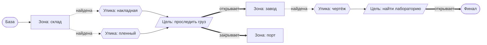

# Д7. Правила и кампания

← [Д6 Карта и редактор](<Д6 Карта и редактор.md>) · дальше [Д8 Данные, скрипты, сохранения](<Д8 Данные, скрипты, сохранения.md>)

> [!summary] Суть
> Правила — обычные для жанра, но с несколькими удачными находками: навыки растут от использования, тяжесть ранения считается по шкале, а кампания-расследование каждый раз собирается заново и проверяется на проходимость.

## Персонаж

У бойца три основные характеристики (сила, ловкость, интеллект) и 17 навыков. Каждый навык считается от характеристик и может временно меняться: ранение, перк или силовая броня добавляют свой множитель, который исчезает вместе с причиной.

**Рост от использования.** Очки навыков игрок не распределяет. Стреляешь — растёт стрельба и заодно ловкость. Опыт задаёт только потолок, до которого навык может дорасти.

> [!example] Пример
> Снайпер и медик прошли одну миссию и получили одинаковый опыт. Потолки навыков у обоих поднялись одинаково. Но снайпер весь бой стрелял, а медик лечил — поэтому у первого выросла стрельба, у второго медицина.

**Перки** — дерево способностей по классам, одно очко за уровень. Чтобы взять перк, нужны все его «родители».

## Очки действия

У каждого действия своя цена. Шаг стоит по-разному в зависимости от позы, диагональ в полтора раза дороже. Выстрел стоит столько, сколько записано у оружия, прицельный — дороже.

## Что бывает после попадания

- **Зона.** Голова — полуторный урон, тело — обычный, рука — 0,7, нога — 0,85.
- **Запас «ниже нуля».** При нуле здоровья боец теряет сознание, а умирает, только когда здоровье ушло в минус на заданную долю. Порог зависит от сложности.
- **Перевязка.** Лечение в бою даёт «перевязанное» здоровье — отдельный запас, который считается за половину и первым принимает следующий урон.

**Ранения.** Шанс тяжёлого ранения растёт с каждым попаданием по цели за ход. Тяжесть — число на шкале: для каждой зоны тела последствия выстроены от лёгких к тяжёлым. Чем больше выпало, тем дальше по шкале.

> [!example] Пример: шкала для руки (последствия условные, порядок — как в игре)
> Малая тяжесть — боец выронил оружие. Средняя — рука работает хуже, штраф к меткости до конца миссии. Большая — кровотечение, которое отнимает здоровье каждый ход, пока не перевяжут.

Всего 15 видов последствий: от случайного выстрела и глухоты до слепоты и смерти.

## Кампания как расследование

Кампания — это граф из трёх видов узлов: **зоны** (миссии), **улики** и **цели**. На схеме — условный пример.

В зонах лежат улики. Найденные улики выполняют цели. Выполненная цель открывает одни зоны и закрывает другие.

**Каждый раз заново.** В начале игры улики случайно раскладываются по подходящим зонам. Потом игра проверяет, что от базы до финала есть путь не короче шести зон. Если пути нет — раскладывает снова, до одиннадцати попыток.

Сложность зон растёт вдоль найденного пути: ближе к финалу — сильнее враги.

> [!example] Пример: улика — человек
> Улика может быть предметом или человеком. Если это человек, он подменяет обычного солдата на карте. Его нужно оглушить и вынести живым; убил — улика потеряна. Игра не даст покинуть зону, если без её улик дойти до финала уже невозможно.

## Между миссиями

Отряд до шести человек ходит по карте главы. По дороге возможны случайные встречи: раз в несколько секунд игра бросает кубик, и рядом с отрядом может появиться точка боя. База — обычная зона без врагов, где работает магазин и найм.

Магазин открывает новые товары по мере продвижения: что доступно, зависит от сложности самой трудной открытой зоны.

## Что нужно от движка

Ничего. Вся глава — чистая логика и таблицы.

## Подробнее

- Полные описания: `Каталог решений/Правила и кампания.md`.
- Поведение противников (выбор позиции, оружия, режимы охраны и засады): `Каталог решений/ИИ и навигация.md`, записи 20–22.
- Не найдено в коде: перегруз по весу, цены и деньги — поля в данных есть, логики нет.
