# Доклад: что забираем из Silent Storm и куда переносим

← [00 Главная](<../00 Главная.md>)

> [!summary] Коротко
> - **Цель.** Забрать технические решения Silent Storm и повторить их на другом движке, чтобы результат был свой и ни от кого не зависел.
> - **Что сделано.** Код игры прочитан по пяти областям, составлен каталог из 123 решений. Самые ценные 23 описаны в этом докладе простым языком, с примерами и схемами.
> - **Главный вывод.** Самое ценное почти не зависит от движка: это расчёты на процессоре, которым нужна только собственная геометрия. Поэтому их стоит писать отдельной библиотекой, а движок использовать как «экран и редактор».
> - **Рекомендация.** Godot 4 как носитель, библиотека решений на C++. Это вывод по документам; руками не проверено.

## Как читать

Доклад состоит из восьми глав. Каждая отвечает на три вопроса: что это, как работает на примере, что понадобится от движка.

| Глава | О чём | Чем интересно |
|---|---|---|
| [Д1 Здания и разрушение](<Д1 Здания и разрушение.md>) | из чего собрано здание и почему оно падает | обрушение считается как инженерная задача, без физики |
| [Д2 Навигация](<Д2 Навигация.md>) | как игра узнаёт, где можно пройти | карта проходимости строится сама и чинится после взрыва |
| [Д3 Выстрел, укрытие, пробитие](<Д3 Выстрел, укрытие, пробитие.md>) | что происходит между нажатием и попаданием | укрытие и промах честно следуют из геометрии |
| [Д4 Взрыв и зрение](<Д4 Взрыв и зрение.md>) | ударная волна и «кто кого видит» | волна затекает в проёмы, трава мешает видеть |
| [Д5 Время и ход](<Д5 Время и ход.md>) | реальное время, пошаговый режим, перехваты | один механизм на оба режима |
| [Д6 Карта и редактор](<Д6 Карта и редактор.md>) | как дизайнер собирает карту и здание | карта — дерево вложенных шаблонов со случайными вариантами |
| [Д7 Правила и кампания](<Д7 Правила и кампания.md>) | персонаж, ранения, расследование | кампания каждый раз собирается заново |
| [Д8 Данные, скрипты, сохранения](<Д8 Данные, скрипты, сохранения.md>) | база контента, моды, сценарии | сценарий можно сохранить посреди ожидания |

Справочные материалы:
- [22 Каталог решений](<../22 Каталог решений.md>) — полная сводка с приоритетами;
- папка `Каталог решений/` — подробные описания всех 123 решений;
- [23 Выбор движка](<../23 Выбор движка.md>) — сравнение кандидатов с источниками.

## Что именно ценно

Решения разделились на три группы.

**Группа А — то, ради чего всё затевается.** 23 решения, которых нет в готовых движках и которые делают игру собой: разрушаемые здания, навигация по ним, выстрел через преграды, воксельный взрыв, перехваты хода, карта из шаблонов, процедурная кампания.

**Группа Б — логика жанра.** Навыки, перки, ранения, инвентарь, поведение противников. Техника здесь обычная, ценность в правилах и числах.

**Группа В — то, что движок даёт сам.** Рендер, свет, рельеф, частицы, анимация, интерфейс, звук. Повторять не нужно.

## Как это ляжет на новый движок

```mermaid
flowchart LR
  subgraph core["Своя библиотека на C++"]
    B[Здания и устойчивость]
    N[Навигация]
    S[Выстрел и пробитие]
    V[Взрыв и зрение]
    T[Время, ход, приказы]
    R[Правила и кампания]
    L[Скрипты и состояние]
  end
  subgraph host["Движок-носитель"]
    G[Рендер и свет]
    E[Редактор с плагинами]
    I[Импорт моделей]
    U[Интерфейс и звук]
  end
  core -- "готовые меши, события,<br/>что изменилось" --> host
  host -- "ввод игрока,<br/>геометрия уровня" --> core
```

Библиотека хранит мир и считает всё, что в нём происходит. Движок рисует то, что ему передали, и даёт редактор. Такое разделение уже есть в оригинале: симуляция отдаёт картинке только список изменившихся объектов (подробнее в [Д5 Время и ход](<Д5 Время и ход.md>)).

Плюс разделения — свобода: если выбранный движок чем-то не устроит, библиотека переедет на другой без переписывания логики.

## Какой движок

Подробное сравнение — в [23 Выбор движка](<../23 Выбор движка.md>). Суть:

| | Вывод |
|---|---|
| Unreal, Unity, Flax | не подходят: у каждого есть правообладатель с отчислениями или правом менять условия |
| Stride, Bevy | не подходят технически: не C++, нет расширяемого редактора |
| **Godot 4** | **рекомендация**: свободная лицензия, плагины редактора, C++ через расширения |
| O3DE | запасной вариант: C++ везде, но выше порог и больше непроверенного |
| Свой движок | не сейчас: пришлось бы начинать с редактора и импорта |

> [!warning] Что не доказано
> Сравнение сделано по документам. Три вопроса решает только проверка на одном здании:
> 1. выдержит ли Godot несколько тысяч блоков с пересборкой десятков мешей за шаг;
> 2. как ведут себя 50–100 источников света с тенями при меняющейся геометрии;
> 3. удобно ли в плагине редактора рисовать стены по сетке.

## Что будет трудно

- **Редактор.** В оригинале это 73 тысячи строк. Инструменты зданий и вложенные шаблоны придётся делать плагинами; это самая большая часть работы после самих расчётов.
- **Модели с разметкой кусков.** Здание разрушается по кускам, которые художник нарезал заранее. Нужна своя договорённость о разметке в Blender и свой импортёр.
- **Сохранение посреди сценария.** Штатные средства движков этого не умеют; нужна своя скриптовая машина или библиотека, которая сохраняет выполняющиеся сценарии.
- **Числа.** Пределы материалов, параметры оружия и сложности лежат в базе игры, а не в коде. Для своей игры их всё равно подбирать заново.

## Чего в докладе нет

Не всё дочитано до конца; полный список пробелов — в конце [22 Каталог решений](<../22 Каталог решений.md>). Главное:

- исполнение атак во времени (4 тысячи строк) разобрано только по заголовкам;
- редактор, скриптовые команды и интерфейс прочитаны выборочно;
- часть поведения в изученном коде — правки автора Reconstruction, а не оригинал.
