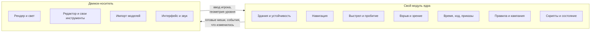

# Доклад: что забираем из Silent Storm и куда переносим

← [00 Главная](<../00 Главная.md>)

> [!summary] Коротко
> - **Цель.** Забрать технические решения Silent Storm и повторить их на другом движке максимально близко и с минимальными затратами, чтобы результат не зависел от Nival.
> - **Что сделано.** Код игры прочитан по пяти областям, составлен каталог из 123 решений. Самые ценные 23 описаны в этом докладе простым языком, с примерами и схемами.
> - **Главный вывод.** Самое ценное почти не зависит от движка: это расчёты на процессоре, которым нужна только собственная геометрия. Ни один движок эту часть не сокращает. Поэтому её стоит писать отдельным модулем, а движок использовать как «экран и редактор».
> - **Рекомендация.** Unreal Engine 5 как основная гипотеза, Unity 6 — близкий второй вариант; решает прототип на одном здании. Это вывод по документам; руками не проверено.

## Как читать

Доклад состоит из восьми глав. Каждая отвечает на три вопроса: что это, как работает на примере, что понадобится от движка.

| Глава | О чём | Чем интересно |
|---|---|---|
| [Д1 Здания и разрушение](<Д1 Здания и разрушение.md>) | из чего собрано здание и почему оно падает | обрушение считается как инженерная задача, без физики |
| [Д2 Навигация](<Д2 Навигация.md>) | как игра узнаёт, где можно пройти | карта проходимости строится сама и чинится после взрыва |
| [Д3 Выстрел, укрытие, пробитие](<Д3 Выстрел, укрытие, пробитие.md>) | что происходит между нажатием и попаданием | укрытие и промах честно следуют из геометрии |
| [Д4 Взрыв и зрение](<Д4 Взрыв и зрение.md>) | ударная волна и «кто кого видит» | волна затекает в проёмы, трава мешает видеть |
| [Д5 Время и ход](<Д5 Время и ход.md>) | реальное время, пошаговый режим, перехваты | один механизм на оба режима |
| [Д6 Карта и редактор](<Д6 Карта и редактор.md>) | как дизайнер собирает карту и здание | карта — дерево вложенных шаблонов со случайными вариантами |
| [Д7 Правила и кампания](<Д7 Правила и кампания.md>) | персонаж, ранения, расследование | кампания каждый раз собирается заново |
| [Д8 Данные, скрипты, сохранения](<Д8 Данные, скрипты, сохранения.md>) | база контента, моды, сценарии | сценарий можно сохранить посреди ожидания |

Справочные материалы:
- [Спецификации](<../Спецификации/00 Оглавление.md>) — 14 полных описаний механик уровня «можно воссоздать, не видя исходников», со сводками всех прихватов и открытых вопросов;
- [22 Каталог решений](<../22 Каталог решений.md>) — полная сводка с приоритетами;
- папка `Каталог решений/` — подробные описания всех 123 решений;
- [23 Выбор движка](<../23 Выбор движка.md>) — сравнение кандидатов с источниками.

## Что именно ценно

Решения разделились на три группы.

**Группа А — то, ради чего всё затевается.** 23 решения, которых нет в готовых движках и которые делают игру собой: разрушаемые здания, навигация по ним, выстрел через преграды, воксельный взрыв, перехваты хода, карта из шаблонов, процедурная кампания.

**Группа Б — логика жанра.** Навыки, перки, ранения, инвентарь, поведение противников. Техника здесь обычная, ценность в правилах и числах.

**Группа В — то, что движок даёт сам.** Рендер, свет, рельеф, частицы, анимация, интерфейс, звук. Повторять не нужно.

## Как это ляжет на новый движок

Модуль ядра хранит мир и считает всё, что в нём происходит. Движок рисует то, что ему передали, и даёт редактор. Такое разделение уже есть в оригинале: симуляция отдаёт картинке только список изменившихся объектов (подробнее в [Д5 Время и ход](<Д5 Время и ход.md>)).

Плюс разделения — страховка: если выбранный движок чем-то не устроит, переносить придётся тонкий слой, а не всю игру.

## Какой движок

Подробное сравнение — в [23 Выбор движка](<../23 Выбор движка.md>).

Критерий: повторить игру максимально близко при минимальных затратах. Отчисления и мультиплатформа допустимы; независимость нужна только от Nival.

Главное наблюдение: ядро игры движок не сокращает, его писать самим в любом случае. Движок определяет цену картинки, света, редактора, импорта и рельефа.

| Движок | Что даёт готовым | Чем придётся заплатить | Вывод |
|---|---|---|---|
| **Unreal Engine 5** | полностью динамический свет без запекания; самую богатую картинку и анимацию; систему способностей для правил; ядро на C++, как в оригинале | инструменты редактора на C++ дороже; правки проверяются медленнее; рельеф делать своим; удаление тысяч кусков нужно проверить | **основная гипотеза** |
| **Unity 6** | самые дешёвые инструменты редактора и импорт; рельеф меняется в запущенной игре; удобные расчёты на процессоре | динамический свет при разрушении пока не готов; ядро писать на C#; исходники движка закрыты | близкий второй вариант |
| Unreal Engine 4.27 | по отзывам, на порядок быстрее удаляет тысячи кусков со столкновениями; заморожен и предсказуем | нет динамического отражённого света; меньше инструментов; платформа доживает: компиляторы, консоли, macOS | запасной вариант, если пятая версия не потянет удаление кусков |
| Godot 4 | дешёвые инструменты, быстрые правки | слабый отражённый свет, потолок производительности, нет игр такого класса | третий |
| Flax, O3DE, свой движок | — | малое сообщество, высокий порог или годы лишней работы | не рассматриваются |

> [!warning] Что не доказано
> Сравнение сделано по документам и отзывам; ни один движок не запускался. Выбор между Unreal и Unity решает опыт на одном здании из двух–трёх тысяч блоков:
> 1. сколько стоит убрать сотню кусков за шаг и перерисовать блоки;
> 2. как ведут себя свет и тени, пока здание осыпается, при 30–50 источниках в помещениях;
> 3. сколько времени занимает инструмент «нарисовать стену по сетке».
>
> В первой редакции доклада здесь стояла рекомендация Godot: движки сравнивались по чистоте лицензии, а не по затратам. Это была ошибка в понимании задачи.

## Что будет трудно

- **Редактор.** В оригинале это 73 тысячи строк. Инструменты зданий и вложенные шаблоны придётся делать своими расширениями редактора; это самая большая часть работы после самих расчётов.
- **Рельеф.** Карта собирается при загрузке, и каждый шаблон вносит свой рельеф, подвалы режут в нём ямы. Штатный ландшафт Unreal так не умеет — рельеф понадобится свой.
- **Модели с разметкой кусков.** Здание разрушается по кускам, которые художник нарезал заранее. Нужна своя договорённость о разметке в Blender и свой импортёр.
- **Сохранение посреди сценария.** Штатные средства движков этого не умеют; нужна своя скриптовая машина или библиотека, которая сохраняет выполняющиеся сценарии.
- **Числа.** Пределы материалов, параметры оружия и сложности лежат в базе игры, а не в коде. Для своей игры их всё равно подбирать заново.

## Чего в докладе нет

Не всё дочитано до конца; полный список пробелов — в конце [22 Каталог решений](<../22 Каталог решений.md>). Главное:

- исполнение атак во времени (4 тысячи строк) разобрано только по заголовкам;
- редактор, скриптовые команды и интерфейс прочитаны выборочно;
- часть поведения в изученном коде — правки автора Reconstruction, а не оригинал.
