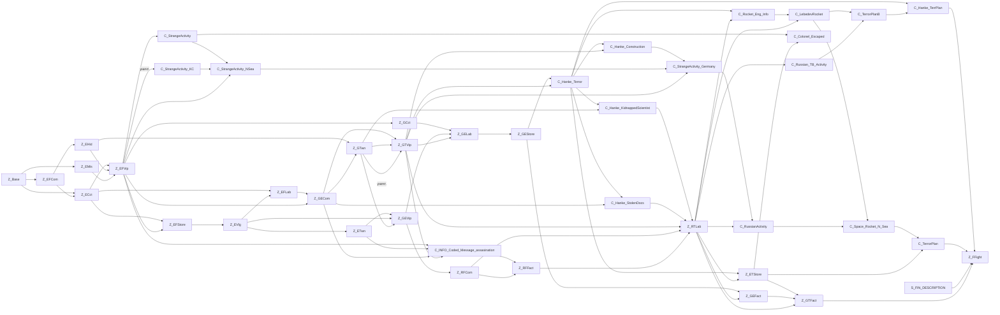
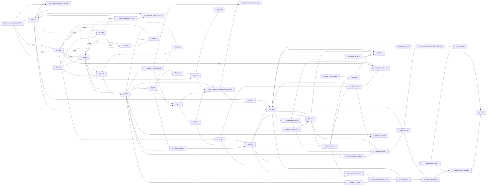

# Кампания 1 — Сценарий и кампания

Источник: `reconstruction\Main` (scFlowChart*, scFlowChartItems*, scScenarioTracker*, scCommands*, rpgGlobal*, scriptScenario*, iChapterMap*, iGlobalMap*, ChapterInfo*, GlobalInfo*, iMission.cpp/iMissionBase.cpp в части входа/выхода из зоны, iShowObjectives, iCluesMenu, iTeamMngMenu, iSideMenu, iMainMenu, iFaceGen, iLoseFake, iShowHint, wHintsFunc, RPGMedals, RPGStore в части открытия, wMain.cpp в части раскладки улик и встреч), `reconstruction\DBFormat` (DataScenario, DataDifficulty, DataMap, DataMisc), база `A5GAME.sqlite` (таблицы `Scenario*`, `ChapterMaps`, `GlobalMaps`, `Sides`, `DifficultyConstants`, `Hints`, `Medals`, `RPGPers`, `Scripts`), ресурсы `Complete\Chapters\*`, `Complete\Globals\*`, библиотеки `Complete\Scripts\*.l` и релизная `Versions\Current\scripts\Common.l`, ролики `Versions\Current\cfg\*.seq`.

## Суть

Кампания Silent Storm — это расследование, которое при каждом новом прохождении собирается заново. В базе данных для каждой стороны (Союзники, Ось) описан граф: около 25 зон-миссий, около 80 улик (документы, люди, абстрактные выводы) и «цели» улик — что откроется, если улику взять или уничтожить. При старте кампании генератор раскладывает улики по зонам случайно, с учётом ёмкости зон, затем поиском по состояниям проверяет, что от базы можно дойти до финальной зоны `FFight` и что путь не короче 6 зон, и раскладывает по найденному пути сложность зон от 1 до 15. В миссии улики-предметы лежат на карте или в карманах врагов, улики-люди заменяют специальных персонажей; их нужно подобрать или оглушить и вынести за границу карты. При выходе из зоны трекер засчитывает вынесенное, открывает новые зоны, выдаёт выводы, а выйти из зоны нельзя, пока без невынесенных улик финал недостижим (если же нужная улика уничтожена — немедленное поражение). Между миссиями игрок ходит по картам глав (там же случайные встречи и лагерь), по глобальной карте и по базе (найм, магазин, лазарет). Сложность игры (три записи) влияет на сохранения, лечение при выходе, живучесть людей-улик и уровень врагов; подсказки выдаются по одной (книжки на картах дают опыт); медали выдаются при выходе из зоны; победа — сценарный ролик в финальной зоне.

## Термины и единицы

| Термин | Значение |
|---|---|
| Сценарий | Граф одной кампании (`Scenarios`): 1 — Союзники, 2 — Ось, 3 — демо, 4 — обучение. |
| Зона | Запись `ScenarioZones` = миссия (1–3 карты-шаблона). Кодовое имя — `SmallDescription` (`Base`, `FFight`, `ECct` …), сравнивается без учёта регистра. Первая буква — страна (E — Англия, G — Германия/Швейцария, R — Россия). |
| Улика | Запись `ScenarioClues`: `item` (предмет), `person` (человек), `conclusion` (вывод, без физического носителя). |
| Цель | Запись `ScenarioObjectives`: `capture` (взять) или `destroy` (уничтожить); открывает до 3 зон, блокирует до 3 зон, даёт производные улики. |
| Производная улика (вывод) | Улика, которую выдаёт цель через `ScenarioObjective2Clues`, когда найдено достаточно её родителей. |
| Найдена (улика) | Выполнена хотя бы одна её цель. |
| Расклад | Результат генерации: какие улики участвуют, в какой зоне и на какой карте зоны лежат. |
| Размещена | Улика участвует в раскладе (`bPlaced`). |
| Открыта / заблокирована / доступна (зона) | Открыта — в списке открытых; заблокирована — в списке блокировок; доступна = открыта и не заблокирована. |
| Пройдена (зона) | В зону уже входили (`bPassed`), ставится при входе. |
| Сложность зоны | Целое 1..15 (0 — не рассчитана), задаётся при генерации, используется скриптами, встречами, магазином, рекомендацией. |
| Запись сложности | Строка `DifficultyConstants` (1 Easy, 2 Normal, 3 Hard) — уровень сложности игры, не путать со сложностью зоны. |
| Глава | Карта региона (`ChapterMaps` + ресурс `Complete\Chapters\<id>`), на ней — значки зон, области встреч, выход. |
| Пиксели | Координаты карт глав и глобальной карты — пиксели экрана 1024 × 768. |
| Слот улики | Место на карте шаблона: маркер-предмет №188 (предмет на земле) или юнит с флагом `ClueSlot`/`ClueInventorySlot`. |
| `random.Get(a, b)` | Общий генератор ISAAC, целое из [a, b). |
| `rand(n)` | Локальный генератор `SRand` (линейный конгруэнтный 214013/2531011), целое из [0, n). |
| «Только что найдена» | Флаг улики, по которому карта главы покажет окно улики (один раз). |

---

## 1. Модель графа сценария

### Назначение
Кампания — это «расследование»: набор зон (миссий), в которых лежат улики. Улика, взятая или уничтоженная, выполняет одну из своих «целей» (objective), а цель открывает новые зоны, блокирует другие и может дать «производную улику» (вывод), если собрано достаточно её родителей. Граф статичен (задан в БД), но **какие улики в каких зонах окажутся — решается случайно при старте каждой новой кампании**, поэтому путь от базы к финальной зоне каждый раз свой.

### Данные (БД, только чтение)

| Таблица | Поля, которые читает код | Смысл |
|---|---|---|
| `Scenarios` | `Name`, `Description` | Сценарий (граф) целиком. Каждая сторона ссылается на свой сценарий через глобальную карту (`GlobalMaps.Scenario`). |
| `ScenarioZones` | `Scenario`, `TemplateID1..3` (3 шаблона карт; 0 = нет), `ItemSlots`, `PersonSlots`, `CluesMaxNumber`, `SmallDescription` (кодовое имя зоны, сравнивается без учёта регистра), `CanBeRevealed`, `CanPKBeUsed`, `TimeOfDay`, `PWLImageID`, `Name`, `MaxDifficulty` | Зона = одна миссия (или серия связанных карт). |
| `ScenarioClues` | `Type` (`person`/`item`/`conclusion`, регистр и пробелы игнорируются), `Scenario`, `State`, `ZoneToPlace1..3`, `Objective1..2`, `SmallDescription` (кодовое имя), `ItemID` (предмет-носитель), `PersID` (персонаж-носитель), `Permanent`, `MinParentToOpen`, `Description`, `GiveImmediately`, `GiveByScript`, `GoalID` | Улика. Тип «person» — человек (его надо оглушить и вынести), «item» — предмет (подобрать и вынести), «conclusion» — абстрактный вывод без физического носителя. |
| `ScenarioObjectives` | `Type` (`capture`/`destroy`), `ZoneToOpen1..3`, `ZoneToBlock1..3`, `Description`, `Scenario` | «Цель» улики: что произойдёт, если улику взять (capture) или уничтожить (destroy). |
| `ScenarioObjective2Clues` | `ObjectiveID`, `ClueID` | Связь «цель → производная улика». Одна цель может давать несколько производных улик, одна производная улика может иметь несколько родительских целей. |
| `ScenarioGoals` | `GoalName`, `Task1..Task6` | Именованный набор задач (журнал заданий в миссии). Привязывается к улике (`GoalID`) или к зоне скриптом. |
| `ScenarioTasks` | `Tag`, `Description` | Задача: «Find item», «Destroy item carrier», «Take item», «Carry out item», «Find person», «Stun person», «Take person», «Carry out person», «Complete by script»; любая другая строка → «Find item». |
| `ScenarioStates` | `Description` | Только описание, логикой не используется. |

Ровно две зоны обязаны существовать в каждом сценарии: с кодовым именем **`BASE`** (база, корень графа) и **`FFIGHT`** (финальный бой). Если хотя бы одной нет — граф не строится вовсе (сообщение «incorrect data for scenario graph»).

### Данные времени выполнения
**Зона** (`CScenarioZone`): `nInnerID` (порядковый номер среди зон сценария в порядке чтения таблицы, 0..N−1), `nDifficulty` (целое!), `bDifCalculated`, `bInaccessible` (изначально `true`), `nDistance` (номер на кратчайшем пути), `nOpenOrder` (порядок открытия игроком), `bInitial` (изначально `true`; сбрасывается, если зону открывает хоть одна размещённая цель), `bInShortestPath`, список размещённых в ней улик, список «блокировщиков» (целей, которые её закрывают), словарь шаблонов `templateID → {зерно случайности, выбранный вариант карты, число слотов предметов/людей/инвентарей и сколько из них ещё свободно}`, `bPassed` (зона пройдена), список скриптовых заданий.

**Улика** (`CScenarioClue`): `bPlaced` (участвует в этой кампании), `bCompound` (производная, получена через цель), `bInaccessible`, `bJustFound` (надо показать игроку на карте главы), `nOpenOrder`, `nInnerID`, `bInShortestPath`, `nTemplateID` (на какой карте зоны лежит; 0 — ни на какой), список дочерних целей (не более двух — `Objective1/2`), список родительских целей (через `ScenarioObjective2Clues`), список зон-родителей (фактически одна), `bDestroyed`, задание (`GoalID`, создаётся в конструкторе), `bDetected` (замечена игроком).

**Цель** (`CScenarioObjective`): `bPlaced`, родительская улика (та, у которой эта цель в `Objective1/2`), список открываемых зон, список производных улик, список блокируемых зон, список «возможных родителей» (все улики сценария, у которых эта цель указана в `Objective1/2`, размещённые или нет).

Внутренние списки поиска (`CScenarioFlowChartItemsList`) хранят и порядок вставки, и битовую маску по `nInnerID` (32 бита на слово, размер `N/32+1` слов) — сравнение и «содержит ли» идут по маске.

### Отношения (сводка)
1. Зона содержит улики (размещаются случайно, раздел 3).
2. Улика имеет до двух целей. Взятие улики выполняет её **первую цель типа capture**, уничтожение — **первую цель типа destroy**.
3. Цель при выполнении: блокирует свои `ZoneToBlock*`, открывает свои `ZoneToOpen*` (если они не открыты и не заблокированы), проверяет свои производные улики.
4. Производная улика выдаётся, когда число её родительских целей, чья родительская улика уже «найдена», ≥ `MinParentToOpen` (если в БД −1 — равно числу всех возможных родителей). Выданная производная улика сразу выполняет свою первую цель (раздел 7).
5. Улика считается **найденной**, если выполнена хотя бы одна её цель. Улика без целей найденной не становится никогда.

### Что нужно от движка-носителя
Хранилище записей с ссылками между таблицами; детерминированный порядок перебора записей (порядок `nInnerID` и все «первые найденные» зависят от него); строковый поиск по кодовым именам без учёта регистра.

## 2. Реальные данные сценария в БД

### 2.1 Обзор

| Сценарий (`Scenarios`) | Зон | Улик (предмет / человек / вывод) | Постоянных | «Сразу» | «Скриптом» | Производных | Целей (взять / уничтожить) | Целей с блокировкой |
|---|---|---|---|---|---|---|---|---|
| 1 «Allies» | 26 | 78 (39 / 17 / 22) | 16 | 33 | 3 | 18 | 81 (78 / 3) | 0 |
| 2 «Axis» | 25 | 86 (42 / 13 / 31) | 18 | 39 | 5 | 26 | 87 (85 / 2) | 3 |
| 3 «DemoAxis» | 2 (`DemoCity`, `DemoBridge`) | 0 | — | — | — | — | 0 | 0 |
| 4 «Tutorial» | 0 | 0 | — | — | — | — | 0 | 0 |

Столбец `Scenarios.FullGraph` (1/0/1/1) кодом игры не читается: трекер всегда строит граф в режиме «не полный». Режим «полный» (все улики во все свои зоны, без случайности и без проверок) существует только для отладочной отрисовки. Столбец `ScenarioClues.State` (таблица `ScenarioStates`: GermanEnemy, UnknowEnemy, TerrorEnemy, AllKnow) у всех улик 0 и логикой не используется. `CluesMaxNumber` у всех зон 255 (ограничения нет), фактическую ёмкость задают `ItemSlots`/`PersonSlots`.

**Типы зон по кодовому имени.** Первая буква — страна: `E` — Англия, `G` — Германия (и Швейцария для `GTFact`), `R` — Россия. Вторая буква у Союзников: `F` — «свои» британские объекты, `E` — вражеские немецкие, `T` — объекты террористической «Организации»; у Оси вторая буква «своих/чужих» не ставится (`GCom`, `GLab`, `ECom`, `ELab` …), `T` — «Организация». Окончание — тип миссии: `Com` — комендатура/штаб, `Lab` — лаборатория, `Store` — склад, `Vip` — усадьба важной персоны, `Fact` — завод, `Twn` — город, `Vlg` — деревня, `Cct` — сельский дом/полигон, `Hid` — тайник, `Mis` — роща. Служебные: `Base` (база, корень графа), `FFight` (финал), `EFirst`/`GFirst` (вводные миссии, вне графа: их никто не открывает), зона 121 Союзников — пустая запись.

Каждая цель принадлежит ровно одной улике (общих целей и целей без улики в данных нет, все связи «цель → вывод» внутри своего сценария), поэтому полный список целей с тем, что они открывают и блокируют, приведён в таблицах улик.

**Как читать таблицы ниже.** «Где может лежать» — `ZoneToPlace1..3`. «Пост.» — `Permanent` (кладётся без учёта ёмкости). `MinPar` — `MinParentToOpen`, если не −1. «Сразу» — `GiveImmediately` (засчитывается в момент подбора/смерти). «Скрипт» — `GiveByScript` (выдаётся скриптом миссии; на логику трекера этот флаг не влияет — он только справочный). Цели: `C` — capture (взять), `D` — destroy (уничтожить), «откр.» — `ZoneToOpen`, «блок.» — `ZoneToBlock`, «→» — производные улики (`ScenarioObjective2Clues`).

Столбцы «Достижима», «На пути», «Сложность» получены **моделированием** алгоритма разделов 3–5 на этих данных (300 раскладов на сторону, генератор Python вместо ISAAC — распределения, а не точные значения игры): доля раскладов, в которых зона достижима из базы, доля, в которых она на кратчайшем пути к финалу, и сложность.

**Сводка моделирования.** Союзники: 85 % раскладов принимаются с первой попытки, отказы — только «пути нет» (ни разу «путь короче 6»); длина кратчайшего пути 7–12 зон (чаще 8–9); первая зона после базы — `EFCom` или `ECct` (по 39 %), `EMis` (22 %; эта ветка чаще даёт тупик и отказ). Ось: отказов не было; путь 8–9 зон; первая зона — `GVip` 30 %, `ECom` 26 %, `GStore` 24 %, `ELab` 20 %. Физических улик в раскладе: Союзники 38–40 из 56, Ось 43–45 из 55.

### 2.2 Союзники (сценарий 1)

**Зоны**

| ID | Код | Название (Strings) | Глава | Предм./люд. слоты | Шаблоны | Время | ПК | MaxDifficulty | Достижима, % | На пути, % | Сложность: медиана (мин–макс) |
|---|---|---|---|---|---|---|---|---|---|---|---|
| 1 | `Base` | Squad Base. | — | 1 / 1 | 3126 | Day | да | 255 | 100 | 100 | 1 (1–1) |
| 2 | `ECct` | English rural house. | 22 England 1 | 1 / 1 | 2240 | Night | да | 255 | 78 | 41 | 2 (1–6) |
| 3 | `EFCom` | UK commandant's office. | 23 England 2 | 1 / 1 | 2631 | Day | да | 255 | 39 | 39 | 2 (1–2) |
| 4 | `EFLab` | UK laboratory. | 22 England 1 | 1 / 1 | 3056 | Day | нет | 255 | 76 | 23 | 5 (3–10) |
| 5 | `EFStore` | UK military warehouse. | 23 England 2 | 1 / 1 | 2276 | Day | да | 255 | 90 | 15 | 4 (2–11) |
| 6 | `EFVip` | Old English Manor. | 23 England 2 | 1 / 1 | 2996 | Night | нет | 7 | 75 | 39 | 4 (2–14) |
| 7 | `EHid` | Abandoned house. | 22 England 1 | 1 / 1 | 2632 | Day | да | 255 | 39 | 37 | 4 (3–5) |
| 8 | `EMis` | Secluded Grove. | 23 England 2 | 1 / 1 | 2633 | Day | да | 255 | 22 | 22 | 1 (1–2) |
| 9 | `ETStore` | "Organization's" storehouse. | 23 England 2 | 2 / 1 | 2292, 2291 | Day | да | 255 | 75 | 6 | 12 (9–13) |
| 11 | `ETwn` | A small English town. | 23 England 2 | 2 / 1 | 2636 | Day | да | 255 | 90 | 4 | 7 (4–13) |
| 12 | `EVlg` | Small English Village. | 22 England 1 | 1 / 1 | 3289 | Day | да | 255 | 90 | 15 | 5 (3–12) |
| 13 | `FFight` | Island in North sea. | 28 Terror Island | 1 / 1 | 3127, 3715 | Day | да | 255 | 100 | 100 | 15 (15–15) |
| 14 | `GCct` | German testing site. | 25 Germany 2 | 0 / 1 | 2899 | Night | да | 255 | 60 | 22 | 6 (4–14) |
| 15 | `GECom` | German Intelligence HQ. | 24 Germany 1 | 2 / 1 | 2901 | Day | да | 255 | 88 | 36 | 6.5 (3–13) |
| 16 | `GEFact` | German Weapon Factory. | 25 Germany 2 | 1 / 1 | 3330 | Night | да | 255 | 94 | 26 | 11 (10–14) |
| 17 | `GELab` | German Laboratory. | 24 Germany 1 | 1 / 1 | 3120, 3122 | Day | нет | 255 | 89 | 38 | 9 (6–14) |
| 18 | `GEStore` | German Store. | 24 Germany 1 | 1 / 1 | 3031 | Day | да | 255 | 89 | 38 | 10 (8–14) |
| 19 | `GEVip` | General Bauer's Headquarters. | 24 Germany 1 | 1 / 1 | 2903 | Night | да | 255 | 97 | 10 | 8 (5–12) |
| 20 | `GTFact` | Berger's Factory. | 27 Switzerland | 1 / 1 | 3252, 3253 | Night | да | 255 | 100 | 63 | 13 (12–14) |
| 21 | `GTVip` | German Manor. | 25 Germany 2 | 1 / 1 | 3261 | Day | да | 255 | 90 | 65 | 8.5 (5–14) |
| 22 | `GTwn` | German Town. | 25 Germany 2 | 1 / 1 | 2640 | Night | да | 255 | 76 | 43 | 6 (3–10) |
| 108 | `RFCom` | Local Russian Commandant's Office. | 26 Russia | 1 / 1 | 3316 | Day | да | 255 | 45 | 7 | 9 (6–12) |
| 109 | `RFFact` | Russian Military Factory. | 26 Russia | 1 / 1 | 3324 | Night | нет | 255 | 26 | 6 | 10 (7–13) |
| 110 | `RTLab` | Unknown complex. | 26 Russia | 1 / 1 | 3453 | Night | да | 255 | 91 | 67 | 12 (8–14) |
| 121 | `—` |  | — | 0 / 0 | — | — | да | 255 | 0 | 0 | — |
| 122 | `EFirst` |  | — | 0 / 0 | 3646 | Day | да | 255 | 0 | 0 | — |

**Улики**

| Улика | Тип | Носитель | Где может лежать | Пост. | MinPar | Сразу | Скрипт | Цели (C — взять, D — уничтожить) |
|---|---|---|---|---|---|---|---|---|
| `Find_Coded_Message` | item | предмет 316 | GECom, GTVip |  |  | да |  | C5604: → INFO_Coded_Message_assasination |
| `Rocket_Eng_Info` | conclusion | — | — |  |  |  |  | C5605: → LebedevRocket |
| `Find_about_Research` | item | предмет 327 | GCct |  |  | да |  | C5606: откр. GELab |
| `Lab_Note` | item | предмет 321 | GTVip |  |  | да |  | C5607: откр. GELab |
| `Find_address` | item | предмет 313 | EVlg |  |  | да |  | C5608: откр. ETwn |
| `TerrorPlan` | conclusion | — | — |  |  |  |  | C5609: откр. FFight |
| `INFO_German_recruitment` | item | предмет 337 | Base |  |  |  |  | C5610: откр. ECct |
| `Find_note` | item | предмет 307 | GTwn |  |  | да |  | C5611: откр. GEVip |
| `DiscoverRadioEquipment` | item | предмет 325 | EHid |  |  |  |  | C5612: откр. EFVip, GTwn |
| `CapturedBritScientist` | person | персонаж 257 | — | да |  |  |  | C5613: откр. FFight |
| `Shipment_Docs` | item | предмет 323 | GTFact |  |  | да |  | C5614: откр. FFight |
| `Find_HankeDiary` | item | предмет 331 | GTVip |  |  |  |  | C5615: откр. RTLab |
| `Find_German_Intel_Officer` | person | персонаж 261 | GTwn |  |  |  |  | C5616: откр. GTVip, GEVip; → Hanke_KidnappedScientist D5617: откр. GTVip |
| `Russian_TB_Activity` | conclusion | — | — |  |  |  |  | C5618: → TerrorPlanB |
| `Find_note_about_TerrAttack` | item | предмет 309 | RFCom |  |  | да |  | C5619: откр. RFFact |
| `Find_report` | item | предмет 308 | GTwn |  |  | да |  | C5620: откр. GEVip |
| `RussianActivity` | conclusion | — | — |  |  |  |  | C5621: → Space_Rocket_N_Sea |
| `LebedevRocket` | conclusion | — | — |  | 2 |  |  | C5622: → TerrorPlanB, Space_Rocket_N_Sea |
| `Hanke_KidnappedScientist` | conclusion | — | — |  |  |  |  | C5623: откр. RTLab |
| `Find_Helenas_Letter` | item | предмет 339 | GTVip | да |  | да |  | C5624: → Hanke_Terror |
| `Hanke_TerrPlan` | conclusion | — | — |  |  |  |  | C5625: откр. FFight |
| `Space_Rocket_N_Sea` | conclusion | — | — |  |  |  |  | C5626: → TerrorPlan |
| `Recapture_Scientist` | person | персонаж 265 | GELab |  |  |  |  | C5627: откр. GEStore |
| `StrangeActivity` | conclusion | — | — |  | 2 |  |  | C5628: → Colonel_Escaped, StrangeActivity_NSea |
| `Defend_Russian_Engineer` | person | персонаж 259 | RFFact |  |  |  |  | C5629: откр. RTLab |
| `Delivery_Request` | item | предмет 300 | RTLab | да |  | да |  | C5630: → Russian_TB_Activity, RussianActivity |
| `Docs_about_terr_ops` | item | предмет 311 | RFCom |  |  | да |  | C5631: откр. RTLab |
| `INFO_Coded_Message_assasination` | conclusion | — | — |  |  |  |  | C5632: откр. RFFact |
| `Find_TheftPlans` | item | предмет 324 | ECct |  |  | да |  | C5633: откр. EFStore |
| `StrangeActivity_Germany` | conclusion | — | — |  | 2 |  |  | C5634: → RussianActivity |
| `INFO_Spy_Activity` | item | предмет 340 | Base |  |  |  |  | C5635: откр. EFCom |
| `Obtain_German_Pk` | conclusion | предмет 329 | GEFact | да |  |  | да | C5636: ничего |
| `Defend_Informer` | person | персонаж 254 | EFLab |  |  |  |  | C5637: откр. GECom |
| `Hanke_Construction` | conclusion | — | — |  |  |  |  | C5638: → StrangeActivity_Germany |
| `INFO_Stolen_TopSecretDocs` | item | предмет 336 | Base |  |  |  |  | C5639: откр. EMis |
| `Find_dossier` | item | предмет 306 | GECom |  |  | да |  | C5640: откр. GTwn |
| `Find_G_Technician` | person | персонаж 264 | GCct |  |  |  |  | C5641: откр. GELab |
| `FIN_DESCRIPTION` | conclusion | предмет 342 | FFight | да |  |  |  | C5642: откр. FFight |
| `Find_german_experimental_equipment` | item | предмет 314 | GEStore |  |  | да |  | C5643: откр. GEFact |
| `Find_StolenDocs_Note` | item | предмет 341 | GECom |  |  | да |  | C5644: откр. GTVip; → Hanke_StolenDocs |
| `Helena_Exchange_Letter` | item | предмет 305 | RTLab |  |  | да |  | C5645: → Rocket_Eng_Info |
| `Find_Stolen_Docs` | item | предмет 318 | — | да |  | да |  | C5646: ничего |
| `Capture_General` | person | персонаж 258 | GEFact |  |  |  |  | C5647: откр. GTFact |
| `Find_BritLetter` | item | предмет 304 | EFVip | да |  | да |  | C5648: → StrangeActivity |
| `Hanke_Terror` | conclusion | — | — |  |  |  |  | C5649: откр. ETStore; → Hanke_TerrPlan, Rocket_Eng_Info, Hanke_Construction, Hanke_StolenDocs, Hanke_KidnappedScientist |
| `Rocket_Eng_Notes` | item | предмет 319 | RTLab |  |  | да |  | C5650: → LebedevRocket |
| `Free_our_agent` | person | персонаж 255 | ECct, EVlg |  |  |  |  | C5651: откр. EFLab |
| `Letter_from_H` | item | предмет 301 | GTVip | да |  | да |  | C5652: → StrangeActivity_Germany, Hanke_Construction |
| `Draft_Letter_to_Andersen` | item | предмет 303 | ETStore | да |  | да |  | C5653: → Colonel_Escaped |
| `Capture_Officer_traitor` | person | персонаж 270 | EFVip |  |  |  |  | D5654: → StrangeActivity_KC C5655: откр. GECom; → StrangeActivity |
| `StrangeActivity_KC` | conclusion | — | — |  |  |  |  | C5656: → StrangeActivity_NSea |
| `Obtain_Pk_prototype` | conclusion | предмет 328 | ETStore | да |  |  | да | C5657: ничего |
| `Colonel_Escaped` | conclusion | — | — |  |  |  |  | C5658: ничего |
| `Capture_Stielmann` | person | персонаж 200 | GTFact | да |  |  |  | C5659: откр. FFight |
| `Capture_G_ThftLeader` | person | персонаж 269 | ETwn, EVlg |  |  |  |  | C5660: откр. GEVip |
| `T_Boss_Documents` | item | предмет 322 | RTLab |  |  | да |  | C5661: откр. ETStore, GEFact |
| `PK_R_D_Docs` | item | предмет 333 | GEFact |  |  | да |  | C5662: откр. GTFact |
| `Capture_Hanke` | person | персонаж 267 | GTVip, GEStore |  |  |  |  | C5663: → Hanke_Terror |
| `Capture_G_Diversant` | person | персонаж 256 | EFStore |  |  |  |  | C5664: откр. EVlg |
| `Capture_Double_Agent` | person | персонаж 263 | EFVip |  |  |  |  | D5665: → StrangeActivity_KC C5666: откр. EFStore; → StrangeActivity |
| `Find_Empty_Containers` | item | предмет 326 | GCct |  |  | да |  | C5667: откр. GELab |
| `TerrorPlanB` | conclusion | — | — |  |  |  |  | C5668: → Hanke_TerrPlan |
| `Orbital_Weapon_Programm_Docs` | item | предмет 335 | GTFact |  |  | да |  | C5669: откр. FFight |
| `Capture_G_Agent2` | person | персонаж 262 | EMis, ECct |  |  |  |  | C5670: откр. EFVip |
| `Obtain_Terror_Pk` | conclusion | предмет 330 | GTFact | да |  |  | да | C5671: ничего |
| `Capture_G_Agent3` | person | персонаж 268 | EFCom |  |  |  |  | C5672: откр. ECct, EHid |
| `StrangeActivity_NSea` | conclusion | — | — |  | 2 |  |  | C5673: → StrangeActivity_Germany |
| `Find_Microfilm` | item | предмет 320 | EFVip |  |  |  |  | C5674: откр. GCct |
| `Find_Steinberg_LogBook` | item | предмет 334 | ETStore | да |  | да |  | C5675: → TerrorPlan |
| `Hanke_StolenDocs` | conclusion | — | — |  |  |  |  | C5676: откр. RTLab |
| `British_PK_Transfer` | item | предмет 312 | ETStore |  |  | да |  | C5677: откр. GTFact |
| `Find_Lebedev_ReserchDocs` | item | предмет 332 | RTLab | да |  | да |  | C5678: → LebedevRocket |
| `Find_Pass` | item | предмет 317 | GEStore |  |  | да |  | C5679: откр. GEFact |
| `LostShipNote` | item | предмет 302 | EFVip | да |  | да |  | C5680: → StrangeActivity_NSea |
| `Defend_russian_docs` | item | предмет 310 | GEVip |  |  | да |  | C5681: откр. RFCom |
| `Find_BritScientist_TranferDocs` | item | предмет 338 | GEVip |  |  | да |  | C5682: откр. GELab |
| `Find_Cipher_key` | item | предмет 315 | ETwn, EFVip |  |  | да |  | C5683: → INFO_Coded_Message_assasination |
| `Capture_T_Boss` | person | персонаж 284 | RTLab | да |  |  |  | C5684: откр. GTFact; → Russian_TB_Activity |

**Производные улики (выводы)** — «−1 (= N)»: в БД −1, поэтому нужны все N возможных родителей.

| Производная улика | MinParentToOpen (БД) | Родители (цель ← улика) |
|---|---|---|
| `Colonel_Escaped` | −1 (= 2) | C5628 ← `StrangeActivity`; C5653 ← `Draft_Letter_to_Andersen` |
| `Hanke_Construction` | −1 (= 2) | C5649 ← `Hanke_Terror`; C5652 ← `Letter_from_H` |
| `Hanke_KidnappedScientist` | −1 (= 2) | C5616 ← `Find_German_Intel_Officer`; C5649 ← `Hanke_Terror` |
| `Hanke_StolenDocs` | −1 (= 2) | C5644 ← `Find_StolenDocs_Note`; C5649 ← `Hanke_Terror` |
| `Hanke_TerrPlan` | −1 (= 2) | C5649 ← `Hanke_Terror`; C5668 ← `TerrorPlanB` |
| `Hanke_Terror` | −1 (= 2) | C5624 ← `Find_Helenas_Letter`; C5663 ← `Capture_Hanke` |
| `INFO_Coded_Message_assasination` | −1 (= 2) | C5604 ← `Find_Coded_Message`; C5683 ← `Find_Cipher_key` |
| `LebedevRocket` | 2 | C5605 ← `Rocket_Eng_Info`; C5650 ← `Rocket_Eng_Notes`; C5678 ← `Find_Lebedev_ReserchDocs` |
| `Rocket_Eng_Info` | −1 (= 2) | C5645 ← `Helena_Exchange_Letter`; C5649 ← `Hanke_Terror` |
| `RussianActivity` | −1 (= 2) | C5630 ← `Delivery_Request`; C5634 ← `StrangeActivity_Germany` |
| `Russian_TB_Activity` | −1 (= 2) | C5630 ← `Delivery_Request`; C5684 ← `Capture_T_Boss` |
| `Space_Rocket_N_Sea` | −1 (= 2) | C5621 ← `RussianActivity`; C5622 ← `LebedevRocket` |
| `StrangeActivity` | 2 | C5648 ← `Find_BritLetter`; C5655 ← `Capture_Officer_traitor`; C5666 ← `Capture_Double_Agent` |
| `StrangeActivity_Germany` | 2 | C5638 ← `Hanke_Construction`; C5652 ← `Letter_from_H`; C5673 ← `StrangeActivity_NSea` |
| `StrangeActivity_KC` | −1 (= 2) | D5654 ← `Capture_Officer_traitor`; D5665 ← `Capture_Double_Agent` |
| `StrangeActivity_NSea` | 2 | C5628 ← `StrangeActivity`; C5656 ← `StrangeActivity_KC`; C5680 ← `LostShipNote` |
| `TerrorPlan` | −1 (= 2) | C5626 ← `Space_Rocket_N_Sea`; C5675 ← `Find_Steinberg_LogBook` |
| `TerrorPlanB` | −1 (= 2) | C5618 ← `Russian_TB_Activity`; C5622 ← `LebedevRocket` |

**Смежность (Союзники): откуда → что может открыть**

| Источник | Открывает зоны / даёт выводы |
|---|---|
| зона `Base` | ECct, EFCom, EMis |
| зона `ECct` | EFLab, EFStore, EFVip |
| зона `EFCom` | ECct, EHid |
| зона `EFLab` | GECom |
| зона `EFStore` | EVlg |
| зона `EFVip` | EFStore, GCct, GECom, вывод INFO_Coded_Message_assasination, вывод StrangeActivity, вывод StrangeActivity_KC (D), вывод StrangeActivity_NSea |
| зона `EHid` | EFVip, GTwn |
| зона `EMis` | EFVip |
| зона `ETStore` | GTFact, вывод Colonel_Escaped, вывод TerrorPlan |
| зона `ETwn` | GEVip, вывод INFO_Coded_Message_assasination |
| зона `EVlg` | EFLab, ETwn, GEVip |
| зона `GCct` | GELab |
| зона `GECom` | GTVip, GTwn, вывод Hanke_StolenDocs, вывод INFO_Coded_Message_assasination |
| зона `GEFact` | GTFact |
| зона `GELab` | GEStore |
| зона `GEStore` | GEFact, вывод Hanke_Terror |
| зона `GEVip` | GELab, RFCom |
| зона `GTFact` | FFight |
| зона `GTVip` | GELab, RTLab, вывод Hanke_Construction, вывод Hanke_Terror, вывод INFO_Coded_Message_assasination, вывод StrangeActivity_Germany |
| зона `GTwn` | GEVip, GTVip, GTVip (D), вывод Hanke_KidnappedScientist |
| зона `RFCom` | RFFact, RTLab |
| зона `RFFact` | RTLab |
| зона `RTLab` | ETStore, GEFact, GTFact, вывод LebedevRocket, вывод Rocket_Eng_Info, вывод RussianActivity, вывод Russian_TB_Activity |
| вывод `Hanke_Construction` | вывод StrangeActivity_Germany |
| вывод `Hanke_KidnappedScientist` | RTLab |
| вывод `Hanke_StolenDocs` | RTLab |
| вывод `Hanke_TerrPlan` | FFight |
| вывод `Hanke_Terror` | ETStore, вывод Hanke_Construction, вывод Hanke_KidnappedScientist, вывод Hanke_StolenDocs, вывод Hanke_TerrPlan, вывод Rocket_Eng_Info |
| вывод `INFO_Coded_Message_assasination` | RFFact |
| вывод `LebedevRocket` | вывод Space_Rocket_N_Sea, вывод TerrorPlanB |
| вывод `Rocket_Eng_Info` | вывод LebedevRocket |
| вывод `RussianActivity` | вывод Space_Rocket_N_Sea |
| вывод `Russian_TB_Activity` | вывод TerrorPlanB |
| вывод `Space_Rocket_N_Sea` | вывод TerrorPlan |
| вывод `StrangeActivity` | вывод Colonel_Escaped, вывод StrangeActivity_NSea |
| вывод `StrangeActivity_Germany` | вывод RussianActivity |
| вывод `StrangeActivity_KC` | вывод StrangeActivity_NSea |
| вывод `StrangeActivity_NSea` | вывод StrangeActivity_Germany |
| вывод `TerrorPlan` | FFight |
| вывод `TerrorPlanB` | вывод Hanke_TerrPlan |
| скрипт: `FIN_DESCRIPTION` | FFight |

**Граф кампании Союзников.** `Z_` — зона, `C_` — вывод, `S_` — вывод, выдаваемый скриптом. Стрелка зона → X означает: какая-то улика, которая **может** лежать в этой зоне, своей целью открывает X или даёт вывод X (попадёт ли улика именно сюда — решает генератор). «уничт.» — цель destroy, пунктир «блок» — блокировка.

### 2.3 Ось (сценарий 2)

**Зоны**

| ID | Код | Название (Strings) | Глава | Предм./люд. слоты | Шаблоны | Время | ПК | MaxDifficulty | Достижима, % | На пути, % | Сложность: медиана (мин–макс) |
|---|---|---|---|---|---|---|---|---|---|---|---|
| 56 | `ELab` | UK laboratory. | 12 England 1 | 1 / 1 | 3058 | Day | да | 6 | 86 | 24 | 6 (1–12) |
| 57 | `ECom` | UK commandant's office. | 16 England 2 | 1 / 1 | 2954 | Day | да | 6 | 89 | 42 | 5 (1–14) |
| 58 | `EVip` | Old English Manor. | 16 England 2 | 1 / 1 | 2280 | Night | нет | 7 | 100 | 25 | 7 (1–14) |
| 59 | `ETStore` | "Organization's" storehouse. | 16 England 2 | 2 / 1 | 2292, 2291 | Day | да | 255 | 100 | 26 | 10 (9–13) |
| 61 | `GTwn` | German Town. | 18 Germany 2 | 1 / 0 | 2279 | Night | да | 255 | 54 | 44 | 5 (2–5) |
| 64 | `GStore` | German Store. | 17 Germany 1 | 1 / 1 | 2968 | Day | да | 255 | 54 | 32 | 2 (1–5) |
| 65 | `GFact` | German Weapon Factory. | 18 Germany 2 | 1 / 1 | 3331 | Day | да | 255 | 100 | 18 | 8 (6–13) |
| 66 | `GLab` | German Laboratory. | 17 Germany 1 | 2 / 1 | 3121 | Night | нет | 255 | 54 | 38 | 7 (5–10) |
| 67 | `GCom` | German Intelligence HQ. | 17 Germany 1 | 2 / 1 | 2900 | Day | да | 255 | 54 | 22 | 3 (1–8) |
| 68 | `GVip` | Intelligence Headquarters. | 17 Germany 1 | 1 / 1 | 2902 | Night | да | 255 | 30 | 30 | 2 (2–2) |
| 69 | `GTVip` | German Manor. | 18 Germany 2 | 2 / 1 | 2289 | Day | нет | 11 | 100 | 64 | 8 (6–14) |
| 70 | `RCom` | Local Russian Commandant's Office. | 21 Russia | 1 / 1 | 3456 | Day | да | 255 | 99 | 35 | 8 (4–14) |
| 71 | `RFact` | Russian Military Factory. | 21 Russia | 1 / 1 | 3487 | Night | да | 255 | 64 | 7 | 9 (6–14) |
| 72 | `GTFact` | Berger's Factory. | 19 Switzerland | 1 / 1 | 3252, 3253 | Night | да | 255 | 100 | 100 | 12 (12–13) |
| 73 | `RTLab` | Unknown complex. | 21 Russia | 2 / 1 | 3453 | Night | да | 255 | 100 | 57 | 10 (8–14) |
| 76 | `FFight` | Island in North sea. | 20 Terror Island | 1 / 1 | 3127, 3715 | Day | да | 255 | 100 | 100 | 15 (15–15) |
| 77 | `EHid3` | Document's tranfer place. | 12 England 1 | 1 / 0 | 3151 | Day | да | 255 | 100 | 1 | 6 (1–14) |
| 78 | `EHid2` | Agent's cache. | 16 England 2 | 1 / 1 | 2288 | Night | да | 255 | 99 | 21 | 7 (3–13) |
| 79 | `EHid1` | Place marked on the map. | 12 England 1 | 1 / 1 | 2632 | Day | да | 255 | 62 | 2 | 7 (4–14) |
| 80 | `Base` | Squad Base. | — | 1 / 1 | 3242 | Night | да | 255 | 100 | 100 | 1 (1–1) |
| 111 | `ECct` | English rural house. | 12 England 1 | 1 / 1 | 2274 | Night | да | 5 | 78 | 3 | 7 (2–14) |
| 112 | `EVlg` | Small English Village. | 12 England 1 | 1 / 1 | 3288 | Day | нет | 6 | 100 | 26 | 7 (1–14) |
| 113 | `ETwn` | A small English town. | 16 England 2 | 1 / 1 | 2287 | Day | нет | 5 | 99 | 21 | 6 (2–13) |
| 114 | `EStore` | UK military warehouse. | 16 England 2 | 1 / 1 | 2277 | Day | да | 255 | 73 | 0 | 6 (2–13) |
| 123 | `GFirst` |  | — | 0 / 0 | 3689 | Night | да | 255 | 0 | 0 | — |

**Улики**

| Улика | Тип | Носитель | Где может лежать | Пост. | MinPar | Сразу | Скрипт | Цели (C — взять, D — уничтожить) |
|---|---|---|---|---|---|---|---|---|
| `Find_Coded_Message` | item | предмет 291 | EVip |  |  | да |  | C5517: → INFO_Coded_Message_assasination, Colonel_CodedMessage |
| `Assault_Agent` | person | персонаж 190 | GCom, GStore |  |  |  |  | C5518: откр. ECom |
| `Docs_OperationFailure` | item | предмет 284 | EVlg |  |  | да |  | C5519: откр. ECct |
| `Common_operation_details` | item | предмет 295 | EHid2 |  |  | да |  | C5520: откр. RCom |
| `Docs_about_Ironmen` | item | предмет 275 | RCom |  |  | да |  | C5521: откр. RTLab |
| `Delivery_T_Boss` | conclusion | — | — | да |  |  |  | C5522: → RocketConstruction_PlaceUnknown |
| `Assault_Plan` | item | предмет 273 | GStore |  |  | да |  | C5523: откр. GCom |
| `Hanke_Pass` | conclusion | — | — |  |  |  |  | C5524: откр. RTLab; → Hanke_GeneralKilled |
| `Shipment_Docs` | item | предмет 269 | GTFact |  |  | да |  | C5525: откр. FFight |
| `Find_HankeDiary` | item | предмет 292 | GTVip |  |  |  |  | C5526: откр. RTLab |
| `Free_Captured_Agent` | person | персонаж 195 | ETwn | да |  |  |  | C5527: откр. EHid2 |
| `Capture_Colonel` | person | персонаж 194 | EVip |  |  |  |  | C5528: откр. EVlg; → Colonel_CodedMessage, Colonel_Courier, Colonel_LostShip, Colonel_Hanke_Terror, Colonel_Escaped |
| `Find_note_about_TerrAttack` | item | предмет 296 | RCom |  |  | да |  | C5529: откр. RFact |
| `Hanke_GeneralKilled` | conclusion | — | — |  |  |  |  | C5530: → TechnologyExchange |
| `INFO_E_COUNTER_ACTIVE` | item | предмет 253 | Base |  |  | да |  | C5531: откр. ECom |
| `ShipContent` | conclusion | — | — | да |  |  |  | C5532: → RocketConstruction |
| `INFO_E_SCIENTIST_DEFENCE` | item | предмет 254 | Base |  |  | да |  | C5533: откр. ELab |
| `Find_Helenas_Letter` | item | предмет 293 | GTVip | да |  | да |  | C5534: → Hanke_Terror |
| `RocketConstruction` | conclusion | — | — |  |  |  |  | C5535: → TerrorsPlan_and_location |
| `TechnologyExchange` | conclusion | — | — |  |  |  |  | C5536: откр. GFact; → RocketTechnology |
| `Captured_Officer` | person | персонаж 202 | ECom |  |  |  |  | C5537: откр. ETwn |
| `TerrorsPlan` | conclusion | — | — |  |  |  |  | C5538: ничего |
| `Defend_Russian_Engineer` | person | персонаж 193 | RFact |  |  |  |  | C5539: откр. RTLab |
| `Delivery_Request` | item | предмет 274 | RTLab | да |  | да |  | C5540: → Delivery_T_Boss, ShipContent |
| `Docs_GeneralDead` | item | предмет 279 | ECom | да |  | да |  | C5541: блок. GTwn, GVip; → General_Killed_On_GVIP, General_Killed_On_GTWN |
| `INFO_Coded_Message_assasination` | conclusion | — | — |  |  |  |  | C5542: откр. RFact; → Colonel_DecodedMessage |
| `Shattered_Weapon` | item | предмет 267 | GTwn |  |  |  |  | C5543: откр. GLab |
| `Docs_InquiryRocketFuel` | item | предмет 281 | ELab |  |  | да |  | C5544: откр. EStore |
| `Message_Delivery` | item | предмет 259 | EHid1 |  |  | да |  | C5545: откр. GTVip |
| `R_General_Killed_On_GVIP` | conclusion | — | — |  |  |  |  | C5546: ничего |
| `Obtain_German_Pk` | conclusion | предмет 260 | GFact | да |  |  | да | C5547: откр. GFact |
| `Hanke_Construction` | conclusion | — | — |  |  |  |  | C5548: → Construction_ColonelInfo |
| `General_Killed_On_GVIP` | conclusion | — | — |  |  |  |  | C5549: откр. RCom; → R_General_Killed_On_GVIP |
| `Docs_DefendProfB` | item | предмет 278 | EHid3 |  |  | да |  | C5550: откр. ELab |
| `Construction_ColonelInfo` | conclusion | — | — |  |  |  |  | C5551: → ShipContent |
| `Colonel_Courier` | conclusion | — | — |  |  |  |  | C5552: откр. GTVip |
| `Save_E_Scientist` | person | персонаж 198 | ELab |  |  |  |  | C5553: откр. EVip |
| `FIN_DESCRIPTION` | conclusion | предмет 289 | FFight | да |  |  |  | C5554: ничего |
| `General_Unordinary_Killed` | person | персонаж 191 | GTwn | да |  |  | да | D5555: откр. ECom; → General_Killed_On_GTWN, Hanke_GeneralKilled |
| `R_General_Killed_On_GTWN` | conclusion | — | — |  |  |  |  | C5556: ничего |
| `Helena_Exchange_Letter` | item | предмет 251 | RTLab | да |  | да |  | C5557: → TechnologyExchange |
| `General_Killed_On_GTWN` | conclusion | — | — |  |  |  |  | C5558: откр. RCom; → R_General_Killed_On_GTWN |
| `Capture_General` | person | персонаж 196 | GFact |  |  |  |  | C5559: откр. GTFact; → RocketTechnology |
| `Colonel_CodedMessage` | conclusion | — | — |  |  |  |  | C5560: откр. ECct; → Colonel_DecodedMessage |
| `SpaceRocket` | conclusion | — | — |  |  |  |  | C5561: → RocketConstruction, RocketConstruction_PlaceUnknown |
| `DocsRussian_GeneralDead` | item | предмет 287 | RCom | да |  | да |  | C5562: блок. GTwn, GVip; → R_General_Killed_On_GVIP, R_General_Killed_On_GTWN |
| `Hanke_Terror` | conclusion | персонаж 137 | — |  |  |  |  | C5563: откр. ETStore; → Hanke_Pass, Colonel_Hanke_Terror, Hanke_Construction |
| `Docs_ReportBetaVersion` | item | предмет 285 | ELab, EHid3 |  |  | да |  | C5564: откр. EVip |
| `Letter_from_H` | item | предмет 256 | GTVip | да |  | да |  | C5565: → Hanke_Construction |
| `Draft_Letter_to_Andersen` | item | предмет 288 | ETStore | да |  | да |  | C5566: → Colonel_Escaped |
| `INFO_G_GENERAL_ASSASINATION` | item | предмет 255 | Base |  |  | да |  | C5567: откр. GVip |
| `RocketConstruction_PlaceUnknown` | conclusion | — | — |  |  |  |  | C5568: → TerrorsPlan |
| `Colonel_Escaped` | conclusion | — | — |  |  |  |  | C5569: ничего |
| `INFO_E_AGENTS_NEAR_G_STORE` | item | предмет 252 | Base |  |  | да |  | C5570: откр. GStore |
| `Obtain_Pk_prototype` | conclusion | предмет 261 | ETStore | да |  |  | да | C5571: откр. ETStore |
| `Docs_CapturePlaman` | item | предмет 276 | ECom |  |  | да |  | C5572: откр. EVlg |
| `LaserWeapon_Theory` | conclusion | — | — |  |  |  |  | C5573: → TerrorsPlan_and_location, TerrorsPlan |
| `Capture_Stielmann` | person | персонаж 200 | GTFact |  |  |  |  | C5574: откр. FFight |
| `Docs_CongratulationsonDefence` | item | предмет 277 | EVlg |  |  | да |  | C5575: откр. EStore |
| `T_Boss_Documents` | item | предмет 271 | RTLab | да |  | да |  | C5576: откр. GFact |
| `Docs_ListOfScientists` | item | предмет 283 | ECom |  |  | да |  | C5577: откр. ELab |
| `TerrorsPlan_and_location` | conclusion | — | — |  |  |  |  | C5578: откр. FFight |
| `PK_R_D_Docs` | item | предмет 265 | GFact |  |  | да |  | C5579: откр. GTFact |
| `Capture_Hanke` | person | персонаж 199 | GTVip, GFact |  |  |  |  | C5580: → Hanke_Terror |
| `Docs_LetteronGermanResearch` | item | предмет 282 | EVip |  |  | да |  | C5581: откр. ECom |
| `StrangeEncounter` | conclusion | предмет 270 | ELab | да |  |  |  | C5582: ничего |
| `Orbital_Weapon_Programm_Docs` | item | предмет 263 | GTFact |  |  | да |  | C5583: откр. FFight |
| `MapX` | item | предмет 258 | ECct |  |  | да |  | C5584: откр. EHid1 |
| `Colonel_LostShip` | conclusion | — | — |  |  |  |  | C5585: → Construction_ColonelInfo |
| `Saved_Courier` | person | персонаж 197 | EVlg |  |  |  |  | C5586: откр. EHid3; → Colonel_Courier |
| `Docs_ReportStolenItems` | item | предмет 286 | EStore |  |  | да |  | C5587: откр. ETwn |
| `Obtain_Terror_Pk` | conclusion | предмет 262 | GTFact | да |  |  | да | C5588: откр. GTFact |
| `Shattered_weapon_saved` | item | предмет 268 | GLab |  |  |  | да | C5589: → LaserWeapon_Theory |
| `Colonel_Hanke_Terror` | conclusion | — | — |  |  |  |  | C5590: → RocketTechnology |
| `General_Survived` | person | персонаж 192 | GVip |  |  |  |  | D5591: откр. GStore; блок. GTwn; → General_Killed_On_GVIP C5592: откр. GTwn |
| `Find_Lebedev_ResearchDocs` | item | предмет 294 | RTLab |  |  | да |  | C5593: → SpaceRocket |
| `Find_Steinberg_LogBook` | item | предмет 297 | GTVip |  |  | да |  | C5594: → LaserWeapon_Theory |
| `British_PK_Transfer` | item | предмет 272 | ETStore |  |  | да |  | C5595: откр. GTFact |
| `Pass_To_Lab` | item | предмет 264 | GLab |  |  | да |  | C5596: откр. GTVip; → Hanke_Pass |
| `Colonel_DecodedMessage` | conclusion | — | — |  |  |  |  | C5597: ничего |
| `LostShipNote` | item | предмет 257 | EVip | да |  | да |  | C5598: → Colonel_LostShip |
| `RocketTechnology` | conclusion | — | — |  | 2 |  |  | C5599: → SpaceRocket |
| `Docs_GeneralsInspection` | item | предмет 280 | GCom |  |  | да |  | C5600: откр. GTwn |
| `PK_Workline_Completion` | item | предмет 266 | GTVip |  |  | да |  | C5601: откр. GFact |
| `Find_Cipher_key` | item | предмет 290 | ECct, EHid1, ETwn |  |  | да |  | C5602: → INFO_Coded_Message_assasination |
| `Capture_T_Boss` | person | персонаж 284 | RTLab |  |  |  |  | C5603: откр. GTFact; → Delivery_T_Boss |

**Производные улики (выводы)**

| Производная улика | MinParentToOpen (БД) | Родители (цель ← улика) |
|---|---|---|
| `Colonel_CodedMessage` | −1 (= 2) | C5517 ← `Find_Coded_Message`; C5528 ← `Capture_Colonel` |
| `Colonel_Courier` | −1 (= 2) | C5528 ← `Capture_Colonel`; C5586 ← `Saved_Courier` |
| `Colonel_DecodedMessage` | −1 (= 2) | C5542 ← `INFO_Coded_Message_assasination`; C5560 ← `Colonel_CodedMessage` |
| `Colonel_Escaped` | −1 (= 2) | C5528 ← `Capture_Colonel`; C5566 ← `Draft_Letter_to_Andersen` |
| `Colonel_Hanke_Terror` | −1 (= 2) | C5528 ← `Capture_Colonel`; C5563 ← `Hanke_Terror` |
| `Colonel_LostShip` | −1 (= 2) | C5528 ← `Capture_Colonel`; C5598 ← `LostShipNote` |
| `Construction_ColonelInfo` | −1 (= 2) | C5548 ← `Hanke_Construction`; C5585 ← `Colonel_LostShip` |
| `Delivery_T_Boss` | −1 (= 2) | C5540 ← `Delivery_Request`; C5603 ← `Capture_T_Boss` |
| `General_Killed_On_GTWN` | −1 (= 2) | C5541 ← `Docs_GeneralDead`; D5555 ← `General_Unordinary_Killed` |
| `General_Killed_On_GVIP` | −1 (= 2) | C5541 ← `Docs_GeneralDead`; D5591 ← `General_Survived` |
| `Hanke_Construction` | −1 (= 2) | C5563 ← `Hanke_Terror`; C5565 ← `Letter_from_H` |
| `Hanke_GeneralKilled` | −1 (= 2) | C5524 ← `Hanke_Pass`; D5555 ← `General_Unordinary_Killed` |
| `Hanke_Pass` | −1 (= 2) | C5563 ← `Hanke_Terror`; C5596 ← `Pass_To_Lab` |
| `Hanke_Terror` | −1 (= 2) | C5534 ← `Find_Helenas_Letter`; C5580 ← `Capture_Hanke` |
| `INFO_Coded_Message_assasination` | −1 (= 2) | C5517 ← `Find_Coded_Message`; C5602 ← `Find_Cipher_key` |
| `LaserWeapon_Theory` | −1 (= 2) | C5589 ← `Shattered_weapon_saved`; C5594 ← `Find_Steinberg_LogBook` |
| `R_General_Killed_On_GTWN` | −1 (= 2) | C5558 ← `General_Killed_On_GTWN`; C5562 ← `DocsRussian_GeneralDead` |
| `R_General_Killed_On_GVIP` | −1 (= 2) | C5549 ← `General_Killed_On_GVIP`; C5562 ← `DocsRussian_GeneralDead` |
| `RocketConstruction` | −1 (= 2) | C5532 ← `ShipContent`; C5561 ← `SpaceRocket` |
| `RocketConstruction_PlaceUnknown` | −1 (= 2) | C5522 ← `Delivery_T_Boss`; C5561 ← `SpaceRocket` |
| `RocketTechnology` | 2 | C5536 ← `TechnologyExchange`; C5559 ← `Capture_General`; C5590 ← `Colonel_Hanke_Terror` |
| `ShipContent` | −1 (= 2) | C5540 ← `Delivery_Request`; C5551 ← `Construction_ColonelInfo` |
| `SpaceRocket` | −1 (= 2) | C5593 ← `Find_Lebedev_ResearchDocs`; C5599 ← `RocketTechnology` |
| `TechnologyExchange` | −1 (= 2) | C5530 ← `Hanke_GeneralKilled`; C5557 ← `Helena_Exchange_Letter` |
| `TerrorsPlan` | −1 (= 2) | C5568 ← `RocketConstruction_PlaceUnknown`; C5573 ← `LaserWeapon_Theory` |
| `TerrorsPlan_and_location` | −1 (= 2) | C5535 ← `RocketConstruction`; C5573 ← `LaserWeapon_Theory` |

**Смежность (Ось): откуда → что может открыть**

| Источник | Открывает зоны / даёт выводы |
|---|---|
| зона `Base` | ECom, ELab, GStore, GVip |
| зона `ECct` | EHid1, вывод INFO_Coded_Message_assasination |
| зона `ECom` | ELab, ETwn, EVlg, GTwn (блок), GVip (блок), вывод General_Killed_On_GTWN, вывод General_Killed_On_GVIP |
| зона `EHid1` | GTVip, вывод INFO_Coded_Message_assasination |
| зона `EHid2` | RCom |
| зона `EHid3` | ELab, EVip |
| зона `ELab` | EStore, EVip |
| зона `EStore` | ETwn |
| зона `ETStore` | GTFact, вывод Colonel_Escaped |
| зона `ETwn` | EHid2, вывод INFO_Coded_Message_assasination |
| зона `EVip` | ECom, EVlg, вывод Colonel_CodedMessage, вывод Colonel_Courier, вывод Colonel_Escaped, вывод Colonel_Hanke_Terror, вывод Colonel_LostShip, вывод INFO_Coded_Message_assasination |
| зона `EVlg` | ECct, EHid3, EStore, вывод Colonel_Courier |
| зона `GCom` | ECom, GTwn |
| зона `GFact` | GTFact, вывод Hanke_Terror, вывод RocketTechnology |
| зона `GLab` | GTVip, вывод Hanke_Pass, вывод LaserWeapon_Theory |
| зона `GStore` | ECom, GCom |
| зона `GTFact` | FFight |
| зона `GTVip` | GFact, RTLab, вывод Hanke_Construction, вывод Hanke_Terror, вывод LaserWeapon_Theory |
| зона `GTwn` | ECom (D), GLab, вывод General_Killed_On_GTWN (D), вывод Hanke_GeneralKilled (D) |
| зона `GVip` | GStore (D), GTwn, GTwn (блок), вывод General_Killed_On_GVIP (D) |
| зона `RCom` | GTwn (блок), GVip (блок), RFact, RTLab, вывод R_General_Killed_On_GTWN, вывод R_General_Killed_On_GVIP |
| зона `RFact` | RTLab |
| зона `RTLab` | GFact, GTFact, вывод Delivery_T_Boss, вывод ShipContent, вывод SpaceRocket, вывод TechnologyExchange |
| вывод `Colonel_CodedMessage` | ECct, вывод Colonel_DecodedMessage |
| вывод `Colonel_Courier` | GTVip |
| вывод `Colonel_Hanke_Terror` | вывод RocketTechnology |
| вывод `Colonel_LostShip` | вывод Construction_ColonelInfo |
| вывод `Construction_ColonelInfo` | вывод ShipContent |
| вывод `Delivery_T_Boss` | вывод RocketConstruction_PlaceUnknown |
| вывод `General_Killed_On_GTWN` | RCom, вывод R_General_Killed_On_GTWN |
| вывод `General_Killed_On_GVIP` | RCom, вывод R_General_Killed_On_GVIP |
| вывод `Hanke_Construction` | вывод Construction_ColonelInfo |
| вывод `Hanke_GeneralKilled` | вывод TechnologyExchange |
| вывод `Hanke_Pass` | RTLab, вывод Hanke_GeneralKilled |
| вывод `Hanke_Terror` | ETStore, вывод Colonel_Hanke_Terror, вывод Hanke_Construction, вывод Hanke_Pass |
| вывод `INFO_Coded_Message_assasination` | RFact, вывод Colonel_DecodedMessage |
| вывод `LaserWeapon_Theory` | вывод TerrorsPlan, вывод TerrorsPlan_and_location |
| вывод `RocketConstruction` | вывод TerrorsPlan_and_location |
| вывод `RocketConstruction_PlaceUnknown` | вывод TerrorsPlan |
| вывод `RocketTechnology` | вывод SpaceRocket |
| вывод `ShipContent` | вывод RocketConstruction |
| вывод `SpaceRocket` | вывод RocketConstruction, вывод RocketConstruction_PlaceUnknown |
| вывод `TechnologyExchange` | GFact, вывод RocketTechnology |
| вывод `TerrorsPlan_and_location` | FFight |
| скрипт: `Obtain_German_Pk` | GFact |
| скрипт: `Obtain_Pk_prototype` | ETStore |
| скрипт: `Obtain_Terror_Pk` | GTFact |

**Граф кампании Оси** (обозначения те же).

### 2.4 Особенности данных, влияющие на игру
- **Одна зацепка на старте.** `BASE` имеет 1 слот предмета, а стартовых донесений несколько (Союзники: `INFO_German_recruitment` → `ECct`, `INFO_Spy_Activity` → `EFCom`, `INFO_Stolen_TopSecretDocs` → `EMis`; Ось: `INFO_E_COUNTER_ACTIVE` → `ECom`, `INFO_E_SCIENTIST_DEFENCE` → `ELab`, `INFO_G_GENERAL_ASSASINATION` → `GVip`, `INFO_E_AGENTS_NEAR_G_STORE` → `GStore`). Какое из них окажется на базе, решает случайный порядок размещения; остальные не участвуют в кампании.
- **Конкуренция за слоты.** Почти у всех зон 1 слот предмета и 1 слот человека (у `ETStore`, `ETwn`, `GECom` Союзников и `ETStore`, `GLab`, `GCom`, `GTVip`, `RTLab` Оси — 2 слота предметов). Улики с несколькими зонами размещения «вытесняют» друг друга, а постоянные улики (`Permanent`) кладутся сверх ёмкости и вытеснить их нельзя.
- **Улики, которые никогда не участвуют.** У Союзников `GCct` имеет 0 слотов предметов, поэтому `Find_about_Research` и `Find_Empty_Containers` (единственная зона — `GCct`) не размещаются никогда; `CapturedBritScientist` и `Find_Stolen_Docs` не имеют ни одной зоны размещения. Их цели не размещаются, и даже выдача скриптом ничего не откроет.
- **Выводы с носителем.** `FIN_DESCRIPTION`, `Obtain_German_Pk`, `Obtain_Pk_prototype`, `Obtain_Terror_Pk`, `StrangeEncounter` записаны как `conclusion`, но имеют `ItemID` и зону. Для трекера это абстрактные улики без зоны (зона и предмет игнорируются при размещении); выдаются они скриптами. Вывод Оси `Hanke_Terror` имеет `PersID 137` — вынос такого персонажа засчитал бы вывод.
- **Неудачные выводы удаляются при генерации.** Большинство выводов требуют **всех** своих родителей (`MinParentToOpen = −1`). Если хотя бы один родитель не попал в расклад, вывод снимается с размещения (раздел 4), а зоны, которые открывал только он, остаются недостижимыми и без сложности (0). Так, `RFFact` Союзников открывается только выводом `INFO_Coded_Message_assasination` или запиской `Find_note_about_TerrAttack` — достижим лишь в 26 % раскладов.
- **Развилка Оси с блокировкой** («генерал»): `Docs_GeneralDead` (`ECom`) и `DocsRussian_GeneralDead` (`RCom`) блокируют `GTwn` и `GVip`; уничтожение `General_Survived` (`GVip`, цель D5591) открывает `GStore` и блокирует `GTwn`; уничтожение `General_Unordinary_Killed` (`GTwn`, D5555, выдаётся скриптом `GTwn`) открывает `ECom`. Выводы `General_Killed_On_GVIP`/`_GTWN` и `R_General_Killed_*` фиксируют, где погиб генерал.
- **`MaxDifficulty`** у части зон (5, 6, 7, 11) задан, но кодом не используется.
- **`CanBeRevealed = 1`** только у служебных зон (`EFirst`, `GFirst`, пустая 121); умолчание столбца 1, но у игровых зон везде 0.

## 3. Генерация расклада: размещение улик по зонам и слотам

### Назначение
При старте новой кампании (команда начала игры с глобальной карты, раздел 12) создаётся трекер сценария, который один раз строит «расклад»: какие улики участвуют, в какой зоне и на какой карте зоны каждая лежит. Расклад сохраняется в сейве целиком и больше не меняется (кроме флагов «размещена» при проверках выхода, раздел 7).

### Данные
См. раздел 1. Генератор случайных чисел — общий `random` (ISAAC), `random.Get(a,b)` = целое из `[a, b)`. Выбор варианта карты — локальный линейный конгруэнтный генератор `SRand` (`seed = seed·214013 + 2531011`, результат `((seed>>16)&0x7FFF)·n/0x8000`, т. е. `[0,n)`).

### Алгоритм (одна попытка, `Generate`)
1. Очистить всё и загрузить из БД зоны, улики, цели сценария (в порядке таблиц; `nInnerID` раздаются подряд). Каждая улика заносится в один из двух словарей: если `PersID ≠ 0` — в «улики-люди» по `PersID`, иначе в «улики-предметы» по `ItemID` (в т. ч. `ItemID = 0` для выводов). Повторный id перезаписывает предыдущую улику.
2. Для каждой зоны и каждого ненулевого `TemplateID1..3` создаётся запись шаблона: зерно = `GetTickCount()` (миллисекунды системного таймера в момент создания); по зерну выбирается вариант шаблона карты (`GetTemplVariant` со своим `SRand`), его id запоминается. Число слотов:
   - если `TemplateID2 = 0` (зона из одной карты) — слоты берутся из БД зоны: предметов = `ItemSlots`, людей = `PersonSlots`, инвентарных = 0;
   - иначе карта **строится целиком** (`BuildMap` с тем же вариантом и зерном) и считаются её «слоты улик»: слот-человек → +1 к людям (и +1 к инвентарным, если это слот «в инвентаре»), иначе +1 к предметам. Свободные = все.
3. Загрузить связи «цель → производная улика». Дубликат связи — ошибка БД, пропускается.
4. Проверить наличие зон `BASE` и `FFIGHT` (иначе — выход без графа).
5. **Размещение улик.** Список всех улик; пока он не пуст: взять улику по случайному индексу `random.Get(0, размер)`, разместить (ниже), удалить из списка. Т. е. улики размещаются в случайном порядке — это важно, потому что ёмкость зон расходуется по мере размещения.
   Размещение одной улики:
   - уже размещена → ничего;
   - тип `conclusion` → помечается размещённой, шаблон 0, зоны нет;
   - кандидаты = те из `ZoneToPlace1..3`, которые есть в сценарии и для которых: улика постоянная (`Permanent`) **или** зона «может принять» улику этого типа;
   - кандидатов нет → улика **не участвует** в этой кампании;
   - иначе выбрать кандидата равновероятно `random.Get(0, n)` и положить улику туда (ниже).
   «Может принять»: среди уже лежащих в зоне **непостоянных** улик посчитать всего `A` и того же типа `T`; ёмкость типа = `ItemSlots` для предметов, `PersonSlots` для людей, 0 для выводов; можно, если `T < ёмкость` и `A < CluesMaxNumber`. Постоянные улики ёмкость не тратят и ей не ограничены.
   Положить в зону: добавить в список улик зоны, пометить размещённой, выбрать шаблон карты (ниже), запомнить зону как родителя.
   Выбор шаблона карты для улики:
   - зона из одной карты (`TemplateID2 = 0`) → всегда `TemplateID1`;
   - иначе `nMax` = сумма свободных слотов нужного вида (люди — для `person`, предметы — для остальных) по всем ненулевым шаблонам; если `nMax ≤ 0` → шаблон 0 (улика «размещена», но ни на одной карте не появится); иначе `n = random.Get(0, nMax)`, идём по шаблонам k = 0,1,2, вычитая из `n` свободные слоты шаблона, пока `n` не станет отрицательным — выбран шаблон k (взвешенный выбор пропорционально свободным слотам; шаблон с 0 слотов пропускается). У выбранного шаблона свободных слотов становится на 1 меньше.
6. **Размещение целей, проход 1** (цели в порядке таблицы). Для каждой цели перебрать все улики (в порядке загрузки): если у улики эта цель записана в `Objective1/2` — добавить улику в «возможные родители» цели; если улика размещена — «повесить» цель на улику: цель размещена, родитель = эта улика, цель добавляется в конец списка целей улики; **все производные улики этой цели помечаются размещёнными и производными** (`bCompound`).
7. **Проход 2:** то же для целей, которые после прохода 1 остались неразмещёнными (их улики-родители стали размещёнными только как производные позже по порядку). Третьего прохода нет.
8. **Связи:** для каждой размещённой цели — список открываемых зон (существующих в сценарии; каждая такая зона получает `bInitial = false`) и список блокируемых зон (каждая такая зона запоминает цель как блокировщика).

### Особые случаи и прихваты
- Если две размещённые улики ссылаются на одну и ту же цель, цель «вешается» на обе (в оба списка целей), а родителем цели остаётся последняя по порядку загрузки.
- Цепочки производных улик глубже двух уровней при неудачном порядке записей в таблице могут остаться неразмещёнными (только два прохода).
- Зерно шаблона — системный таймер; при пересоздании графа в ту же миллисекунду вариант карты повторится.
- Для многокартовых зон генератор строит каждую карту целиком только ради подсчёта слотов — это дорого (секунды).
- Улика-вывод не лежит ни в одной зоне и не имеет шаблона.

### Что нужно от движка-носителя
Возможность «сухой» сборки карты из шаблона по зерну с подсчётом размещённых на ней слотов улик (интерфейс к «Карта 1 — Сборка карты и рельеф.md»); глобальный ГСЧ и локальный ГСЧ с явным зерном.

## 4. Проверка расклада поиском в ширину

### Назначение
Убедиться, что в данном раскладе финальная зона `FFIGHT` достижима от `BASE`, и что путь не слишком короткий. Тот же поиск используется во время игры для запрета выхода из зоны (раздел 7) и для расчёта сложности (раздел 5).

### Данные
**Состояние поиска**: упорядоченный список посещённых зон (он же «путь»), список «ветвящихся» зон, список заблокированных зон, множество доступных улик, множество использованных улик, флаг «финальное».
**Проход** (passage): откуда, куда, список улик и целей, через которые он идёт.
**Число родителей для открытия** `minParentToOpen(улика)` = `MinParentToOpen` из БД, если ≥ 0; иначе — число различных «возможных родителей» по всем целям, дающим эту улику (считается один раз при создании поисковика).

### Алгоритм
**Дочерние зоны зоны Z в состоянии S** (если S не задано — без учёта блокировок):
1. Если Z заблокирована в S — нет детей.
2. Для каждой улики зоны (в порядке размещения): если улика не размещена, или (S задано и улика не входит в доступные S) — пропустить; иначе для каждой цели улики (в её порядке): если цель не размещена — пропустить; каждая открываемая целью зона, которая (при заданном S) ещё не посещена и не заблокирована, даёт проход «Z → зона» с записью (цель, улика); каждая производная улика цели рекурсивно даёт проходы своих целей (с той же проверкой «доступна ли в S»), к ним дописывается текущая цель и улика.
3. Результат — список проходов; список детей — их конечные зоны без повторов, в порядке появления.

**Ветвящаяся зона** — зона, у которой есть хоть один ребёнок (считается без учёта блокировок), ещё не посещённый в состоянии.

**Добавление зоны в состояние**: зона дописывается в путь; если ветвящаяся — в список ветвящихся; все улики зоны (включая неразмещённые) становятся доступными, и рекурсивно: для каждой цели доступной улики каждая её производная улика становится доступной, если число её **размещённых** родительских улик, доступных в состоянии, ≥ `minParentToOpen`.

**Использование прохода**: улики прохода → в «использованные»; все зоны, блокируемые целями прохода, → в «заблокированные» состояния.

**Следующие состояния** (`GetNextStates`):
1. Убрать из ветвящихся зоны, у которых не осталось непосещённых детей.
2. «Фронт» = **последняя** по порядку добавления ветвящаяся зона. Нет фронта → тупик.
3. Дети фронта (с блокировками, если поиск с блокировками). Для каждой ещё не посещённой дочерней зоны: копия состояния; применить **первый** проход, ведущий в эту зону; если поиск с блокировками и зона после этого заблокирована — отбросить; иначе добавить зону; если зона финальная — пометить состояние финальным.

**Поиск** (`FindPathA`):
1. Стартовое состояние = {старт}. Если старт сам финальный — пустой результат.
2. Слой за слоем: для каждого состояния слоя получить следующие; новое состояние отбрасывается, если уже встречалось состояние с **тем же множеством зон** (сравнение только по набору зон, без учёта порядка, блокировок и улик; первое встреченное побеждает); иначе запоминается; финальное — в список финальных (дальше не раскрывается), остальные — в следующий слой.
3. Флаг «путь найден» никогда не ставится — поиск идёт до исчерпания всех состояний.
4. Результат — финальное состояние с **наименьшим числом посещённых зон**; при равенстве — первое найденное.

**Проверка расклада (`CheckCorrectness`)**: путь `BASE → FFIGHT` с блокировками существует **и** в нём ≥ 6 зон (включая `BASE` и `FFIGHT`).

**Удаление «неполноценных» улик (`RemoveIncorrectClues`)**, до стабилизации: каждая размещённая улика, у которой число размещённых родительских улик (родители — улики тех её родительских целей, которые действительно содержат её как производную) меньше `minParentToOpen`, снимается с размещения (остаётся в списках зоны, но больше нигде не учитывается).

**Цикл попыток (конструктор графа):**
1. `Generate` (раздел 3) → создать поисковик → удалить неполноценные улики → проверить.
2. Успех → выход из цикла. Неудача → счётчик +1; если счётчик > 10 → выход (всего **11 попыток**), иначе полностью заново (все зоны, улики, цели и зёрна шаблонов создаются заново).
3. После цикла, если расклад корректен: расчёт сложности (раздел 5), разметка расстояний (номер зоны в найденном пути `BASE → FFIGHT`, считая `BASE` = 0), разметка «на кратчайшем пути» (зоны пути и все доступные в финальном состоянии улики), разметка достижимости (все зоны и улики всех состояний, посещённых последним поиском, получают `bInaccessible = false`). Если расклад некорректен и после 11 попыток — пишется ошибка, **сложности не считаются** (все зоны остаются со сложностью 0), игра продолжается.

### Особые случаи и прихваты
- Раскрывается только последняя ветвящаяся зона. Ветвящесть считается **без** блокировок, а дети — **с** блокировками. Поэтому если фронт ведёт дальше только через вывод, для которого ещё не собраны все родители, состояние становится тупиком, даже если в другой ранее посещённой зоне есть доступный ход. Вывод, требующий улики из двух «параллельных» зон, находится поиском только если одна из этих зон открывается из другой (цепочкой). Это свойство алгоритма, а не данных.
- Поиск оптимистичен: из улики с двумя целями (взять/уничтожить) доступны обе ветви, хотя игрок может выполнить только одну; блокировки учитываются лишь для использованного прохода.
- Дедупликация по множеству зон теряет состояния с другими блокировками.
- Перебор полный (экспоненциальный по числу зон); в оригинале это приемлемо на малых графах.
- Порог «≥ 6 зон» — единственная мера «интересности» расклада.
- На реальных данных ограничение «раскрывать только последнюю ветвящуюся зону» результат не меняет: в модели на 150 раскладах Союзников длина кратчайшего пути и все отказы совпали с вариантом, раскрывающим все ветвящиеся зоны (данные составлены так, что родители выводов лежат в одной зоне или в цепочке зон). При переносе на свои данные это ограничение нужно либо повторить, либо осознанно заменить полным раскрытием.

### Что нужно от движка-носителя
Ничего специального: чистая логика над графом. Для повторения поведения важен порядок перебора (зоны — в порядке размещения улик, улики — в порядке целей, цели — в порядке таблицы).

## 5. Сложность зон вдоль пути

### Назначение
Каждой зоне присваивается целая сложность 1..15. Она используется: скриптами миссий (Lua-функция `GetCurrentZoneAILevel` отдаёт сложность текущей зоны — по ней скрипты выбирают уровень и снаряжение врагов); для уровня врагов случайных встреч (средняя сложность зон главы, раздел 11); для «технологического уровня» магазина (максимум сложностей открытых незаблокированных зон, раздел 13); для выбора рекомендуемой зоны (раздел 10).

### Алгоритм (`CalculateDifficulties`)
1. **Начальные значения** (каждое присваивание делает зону «рассчитанной»):
   - каждая зона, у которой нет детей (без учёта блокировок) и которая не начальная (её открывает какая-то цель), — **тупик, сложность 13**;
   - `FFIGHT` — **15**;
   - `BASE` перестаёт считаться начальной.
2. **Основной путь**: найти путь `BASE → FFIGHT` (с блокировками) и разложить сложность по нему с учётом начала (`bCheckBegin = true`): начало = текущая сложность `BASE` (обычно 0, т. к. не рассчитана), конец = 15.
3. **Начальные зоны** (не открываемые никакой целью, кроме `BASE`): для каждой найти путь (без блокировок) до ближайшей уже рассчитанной зоны и разложить сложность **без учёта начала**.
4. **Остальные**: пока есть рассчитанная зона (первая по порядку зон) с нерассчитанным ребёнком: путь (без блокировок) от этого ребёнка до ближайшей рассчитанной зоны; в начало пути дописать саму рассчитанную зону-родителя; разложить с учётом начала. Не более 100 итераций (потом — выход, оставшиеся зоны так и остаются со сложностью 0).

**Раскладка по пути** из `L` зон (`SetPathDifficulty`):
- `конец` = сложность последней зоны пути;
- `начало` = сложность первой зоны (с учётом начала) **или** `max(1, конец − L + 1)` (без учёта начала);
- `шаг = (конец − начало) / (L − 1)` (вещественное);
- зона i (0..L−1) получает `trunc(max(1, начало + i·шаг))` (отбрасывание дробной части);
- последняя зона снова получает ровно `конец`.

Путь здесь — **весь список посещённых поиском зон** в порядке посещения (включая боковые зоны, зашедшие за уликами), а не только цепочка до финала.

### Формулы
- Основной путь длиной L: `сложность_i = trunc(max(1, 15·i/(L−1)))`, последняя = 15.
- Путь без учёта начала: `начало = max(1, конец − L + 1)`; если `конец − L + 1 ≥ 1`, шаг = 1 (сложность растёт на 1 за зону).

### Константы

| Имя | Значение | Смысл | Источник |
|---|---|---|---|
| сложность тупика | 13 | зона без продолжения | `InitDifficulties`, код |
| сложность финала | 15 | зона `FFIGHT` | код |
| мин. сложность | 1 | нижняя граница при раскладке | `SetPathDifficulty`, код |
| мин. длина пути | 6 зон | условие корректности расклада | `CheckCorrectness`, код |
| число попыток | 11 | генераций расклада до отказа | конструктор графа, код |
| итераций доразметки | 100 | предел шага 4 | `CalculateDifficulties`, код |

### Особые случаи и прихваты
- Сложность хранится целым, промежуточная арифметика — вещественная; округление — отбрасыванием дробной части.
- В шаге 4 сложность может **убывать** вдоль пути, если родитель сложнее цели (например, ветка от зоны 12 к тупику 13 растёт, а ветка от зоны 14 к зоне 9 — убывает).
- Поле `MaxDifficulty` зоны читается из БД, но в расчёте сложности не участвует (не установлено, где используется; см. «Не установлено»).
- При некорректном раскладе все сложности 0.
- Шаги 3–4 используют поиск **без блокировок**, в котором выводы доступны без родителей. Зона, чьи улики начинают длинную цепочку выводов к финалу, оказывается «в одном шаге» от `FFIGHT` и получает 13–14, а вся боковая ветка за ней — тоже 14 (пример 1: `EFVip`, `GCct`, `GELab`, `GEStore`, `GEFact`, `GTFact` = 14). Это видно и в модели: максимумы 13–14 у многих зон.
- `FFIGHT` сначала попадает в тупики (13), затем перезаписывается на 15.
- Сложность получают и недостижимые в этом раскладе зоны (начальные, не открываемые никем), например 13 у `EMis` в примере 1; зоны, которые открывают только снятые выводы, остаются 0.
- Порядок доразметки (первая по `nInnerID` рассчитанная зона) влияет на результат: зона может получить значение из одной ветки и затем служить концом пути для другой.

### Что нужно от движка-носителя
Тот же поиск, что в разделе 4, в режиме «без блокировок» и с условием финала «зона уже рассчитана»; 32-битная вещественная арифметика для совпадения округлений.

## 6. Трекер сценария: улики-персоны и улики-предметы во время миссии

### Назначение
Трекер (`CScenarioTracker`) — живое состояние расследования поверх неизменного графа: какие зоны открыты и заблокированы, какие цели выполнены, какие улики «в пути» (взяты или уничтожены в текущей миссии, но ещё не засчитаны). Он же раскладывает улики по карте при входе в зону и засчитывает их при выходе.

### Данные (сохраняются)

| Поле | Смысл |
|---|---|
| `bScenarioAvailable` | граф построен (иначе все запросы возвращают «нет»/0) |
| граф | раздел 1 |
| `availableZones` | открытые зоны в порядке открытия (заблокированные остаются в списке, но скрываются при выдаче) |
| `finishedObjectives` | выполненные цели |
| `blockedZones` | заблокированные зоны |
| `takenClues` | улики, взятые в текущей миссии, ещё не засчитанные |
| `destroyedClues` | улики, уничтоженные в текущей миссии, ещё не засчитанные |
| `nZonesOpenOrder`, `nCluesOpenOrder` | счётчики порядка открытия (для сортировки на карте и в журнале) |
| кэш проверки выхода | не сохраняется: последний результат, флаг «конец игры», три списка-входа (раздел 7) |

В глобальной игре (`CGlobalGame`): текущая зона `pCurrentZone`, текущий шаблон `nCurrentTemplateID`, сложность `pDifficulty`, средняя сложность главы `nCurrentChapterDifficulty`.

### Алгоритм
**А. Старт кампании** (`PostCreateScenario`, сразу после построения графа):
1. Открытые зоны = [`BASE`]; списки выполненных целей и блокировок очищаются.
2. Для каждой размещённой улики зоны `BASE`, у которой есть цели, выполняется её **первая** цель (раздел 7). Так стартовые «донесения» на базе сразу открывают первые зоны.
3. Прихват данных: у `BASE` обеих сторон `ItemSlots = 1`, а «донесений» несколько (у Союзников 3, у Оси 4), и у каждого единственная зона размещения — `BASE`. Поэтому размещается **ровно одно** случайное донесение, и кампания начинается с одной случайной зацепки (раздел 2).
4. Стартовое донесение засчитывается **без** флага «только что найдена» (счётчик `nCluesOpenOrder` не растёт), поэтому окно улики на карте главы не появляется; его показывает скрипт базы при первом разговоре с командиром (`ClueIsFound` + `ClueShow` по списку возможных донесений).

**Б. Вход в зону** (`CMission::Initialize`):
1. Сбросить текущую зону. Если миссия — зона сценария и граф есть: шаблон = `TemplateID1`, если не указан; список улик = размещённые, не уничтоженные улики зоны **с этим шаблоном**; зона помечается пройденной (`bPassed = true`) **уже при входе**; текущая зона = эта; зерно карты = зерно шаблона из раздела 3; уровень врагов = сложность зоны.
2. Иначе (случайная встреча, лагерь, зона без графа) — уровень врагов по формуле случайной встречи (раздел 11).
3. `nCurrentTemplateID` = шаблон (для зон и для случайных встреч).
4. Вариант карты: если не задан — выбирается по шаблону генератором `SRand` с тем же зерном (поэтому карта зоны в этой кампании всегда одна и та же).
5. Если есть файл повторного входа `«ID зоны»_«ID шаблона».sav` (раздел 13, «повторный вход») — мир восстанавливается из него, иначе строится заново.

**В. Раскладка улик по слотам карты** (при постройке мира, `DistributeClues`):
1. Слоты карты: (а) особый предмет-маркер на карте (RPG-предмет №188, `CLUE_SLOT_ID`) — слот предмета на земле; (б) юнит карты с флагом `ClueSlot` — слот человека; (в) юнит с флагом `ClueInventorySlot` — слот «в инвентаре этого юнита». Флаги (б) и (в) могут стоять вместе.
2. Слоты людей = все (б). Для каждой улики-человека зоны (тип `person`, `PersID > 0`, по порядку списка улик зоны), пока есть свободные слоты: выбрать слот равновероятно `random.Get(0, свободных)`, закрепить, убрать из свободных. Если у слота есть и флаг (в), он же добавляется в слоты предметов с персонажем улики (предмет-улика может оказаться в кармане этого человека).
3. Слоты предметов = добавленные на шаге 2 + все слоты без флага «человек» (предметы на земле и инвентари юнитов только с флагом (в)). Для каждой улики-предмета (тип `item`, `ItemID > 0`) — так же равновероятно.
4. Улик больше, чем слотов → лишние **молча не появляются** на карте (в отладочный лог пишется число слотов).
5. Предметы на земле: создаётся предмет-улика из `ItemID`, ставится в позицию слота, опущенную лучом вниз на ближайшую поверхность, поворот = угол слота; объект регистрируется под кодовым именем улики (верхний регистр) — скрипты обращаются к нему по имени.
6. Юниты: юнит со слотом человека создаётся **только если** слот занят уликой; тогда его персонаж заменяется персонажем улики (имя — из карты, а если пусто — кодовое имя улики). Юниты незанятых слотов людей не создаются вовсе. Юнит-улика получает «запас смерти» `nDeathVP = −ClueDeathCoeff × максимум VP` (раздел 15) и признак «носитель улики».
7. Предметы в инвентарь: после создания юнитов предмет кладётся в рюкзак юнита с нужным персонажем (первое свободное место); счётчик улик юнита +1 (такие трупы не убираются лимитом трупов — интерфейс к «Мир 1»).

**Г. События во время миссии**

| Событие | Что делает трекер |
|---|---|
| Обновление видимости у игрока-человека (`OnUpdateVisible`) | для улик текущей зоны: улика-предмет, ещё не замеченная, с заданием — если предмет лежит на виду **или** он в инвентаре видимого юнита (или трупа, который тот несёт) → «замечена»; если именно в инвентаре — задача «Destroy item carrier» становится видимой. Улика-человек: если юнит с таким персонажем виден → «замечена»; если он уже без сознания — задача «Stun person» выполнена. Задачи «Find item»/«Find person» отмечаются найденными при тех же условиях. |
| Подбор предмета-улики не-ИИ юнитом (`OnItemTaken`) | только для улик с `GiveImmediately = 1`: улика **сразу** засчитывается (взятие, раздел 7), предмет изымается из инвентаря (папка с документами не занимает места), показывается окно улики, задачи «Find/Take/Carry out item» выполнены. Обычные предметы-улики просто лежат в инвентаре до выхода. |
| Юнит потерял сознание (`OnMakeUnconscious`) | как смерть носителя (ниже) + задача «Stun person», если юнит — улика-человек. |
| Юнит умер (`OnUnitDestroyed`) | для всех улик, которые он несёт (сам, слоты, рюкзак, несомый труп), задача «Destroy item carrier» выполнена. |
| Улика-человек умер (VP ≤ запаса смерти) | `OnScenarioClueDestroyed(PersID)`: при `GiveImmediately` — немедленная обработка уничтожения, иначе — в `destroyedClues`. Если его в этот момент несут — отметка «жив» в записи переноски снимается. |
| Предмет-улика на земле уничтожен (взрыв и т. п.) | `OnScenarioClueDestroyed(ItemID)` — так же. |
| Скрипт `ScenarioGiveClue` | раздел 9. |

**Д. Вынос и засчёт при выходе** (`UpdateScenarioOnLeaveZone`, вызывается при возврате на карту главы, раздел 10):
1. Для каждого игрока собрать «живых, вышедших с отрядом»: живые наёмники; живые временные спутники зоны (`zoneMercs`); каждый **несомый** кем-то не мёртвый человек (из записей «кто кого несёт»), если его ещё нет в списке.
2. Для каждого из них: если его персонаж — улика-человек → улика «взята» (при `GiveImmediately` — сразу, иначе в `takenClues`).
3. Для каждого из них: каждый предмет в слотах экипировки (в реконструкции — во всех слотах; в оригинале, по комментарию, только в слотах 0..1) и в рюкзаке, являющийся уликой-предметом, → «взят» и **изымается** из инвентаря.
4. Засчитать: сначала все взятые (цель capture), потом все уничтоженные (цель destroy); списки очистить.
5. Очистить временных спутников; у всех наёмников сбросить «кого несёт».

### Константы

| Имя | Значение | Смысл | Источник |
|---|---|---|---|
| `CLUE_SLOT_ID` | 188 | RPG-предмет-маркер слота улики на карте | MapBuild.cpp |
| `ClueDeathCoeff` | 3,0 / 1,5 / 0,25 | запас смерти человека-улики (Easy/Normal/Hard) | `DifficultyConstants` |
| шаблон по умолчанию | `TemplateID1` | если миссия зоны начата без указания карты | iMission.cpp |
| файл повторного входа | `«ID зоны»_«ID шаблона».sav` | мир зоны между посещениями | iMission.cpp |

### Особые случаи и прихваты
- Улика-человек засчитывается только если его **вынесли живым** (без сознания, на руках) или он сам ушёл с отрядом (спутник/наёмник). Мёртвый (VP ниже запаса смерти) — это «уничтожение».
- Наёмник, чей персонаж совпадает с уликой-человеком, будет «взят» повторно при каждом выходе из зоны: цель уже не выполнится, но флаг «только что найдена» снова поднимется и окно улики покажется ещё раз (по коду; встречается ли в данных — не подтверждено).
- Если улика и взята, и уничтожена в одной миссии, сначала срабатывает взятие (улика найдена), затем уничтожение помечает её уничтоженной — она пропадает из журнала, хотя её зоны открыты.
- Взятие улики, у которой нет цели capture (или уничтожение без цели destroy), ничего не открывает; уничтожение всё равно ставит флаг «уничтожена».
- Вывод (`conclusion`) с `PersID ≠ 0` попадает в словарь улик-людей: вынос такого персонажа засчитает вывод (в данных Оси: `Hanke_Terror`, PersID 137).

### Что нужно от движка-носителя
Поиск юнитов/предметов по id персонажа и id предмета; событие «видимость игрока обновилась» со списками видимых юнитов и объектов; события «потерял сознание», «умер», «предмет подобран», «предмет на земле уничтожен»; учёт «кто кого несёт»; именованный реестр объектов карты для скриптов.

## 7. Выход из зоны: подсчёт улик, открытие и блокировка зон, выводы

### Назначение
Засчитанная улика выполняет цель; цель открывает/блокирует зоны и выдаёт производные улики. Отдельно — проверка «можно ли уйти из зоны, не сделав финал недостижимым».

### Алгоритм
**Засчёт списка улик** (`ProcessCluesList(список, тип)`, тип = capture или destroy), по порядку списка:
1. Цель = первая цель улики нужного типа. Если есть: улика «только что найдена» (`nCluesOpenOrder += 1`, порядок = счётчик), выполнить цель.
2. Если тип destroy — улика помечается уничтоженной (даже без цели destroy).

**Выполнение цели** (`OnObjectiveComplete`) — только если у цели есть родительская улика и она ещё **не найдена**:
1. Цель → в выполненные.
2. Каждая её блокируемая зона → в заблокированные (без повторов).
3. Каждая открываемая зона, которая не открыта и не заблокирована, → открывается: `nZonesOpenOrder += 1`, порядок зоны = счётчик, в конец списка открытых.
4. Каждая производная улика цели: посчитать её родительские цели, чья родительская улика найдена; если число ≥ `minParentToOpen` — улика «только что найдена» и **для каждой её цели** рекурсивно выполнить цель. Поскольку после первой выполненной цели производная улика уже «найдена», её вторая цель отсекается проверкой из начала — у вывода срабатывает только первая цель (в порядке таблицы целей).

**Открытие/блокировка вне целей**: `OpenZone` (скрипт, консоль, «обнаружение» на карте главы) добавляет зону в открытые без счётчика порядка и **без** проверки блокировки (но заблокированная всё равно не покажется). `RevealZone` = `OpenZone`, если у зоны `CanBeRevealed = 1`. `BlockZone` — в заблокированные.

**Список доступных зон** = открытые минус заблокированные (в порядке открытия). **Список доступных улик** (журнал) = размещённые, не уничтоженные, найденные.

**Окно улики и журнал улик.** Текст окна улики (и пояснение в журнале) — `Description` **первой выполненной цели** улики: у взятой улики это текст цели capture, у уничтоженной — цели destroy, поэтому одна и та же улика «рассказывает» разное в зависимости от того, как с ней поступили; если ни одна цель не выполнена — окно показывает «[ERROR]Description not set». Фон окна — «бумага улик» стороны (`Sides.UICluePaperBackgroundID`). Заголовок строки журнала — `Description` самой улики. Журнал (клавиша «clues» на картах и в миссии) имеет четыре вида: по порядку нахождения (`nOpenOrder`); по зонам, где улика найдена (зоны в порядке открытия, затем раздел «Separator - Result» (строка 19811) для выводов, у которых нет зоны); по зонам, которые улика открывает («куда ведёт»; в разделе 19811 — улики, ни одна из зон которых не открыта); список показанных подсказок.

**Рекомендуемая зона** (`GetRecommendedZone`): среди открытых, не пройденных, не заблокированных зон, в которых ещё есть размещённая, не уничтоженная, не найденная улика, — зона с минимальным `сложность − средний уровень живых наёмников + 0.001`; при равенстве — первая по порядку открытия. Средний уровень вычитается из всех одинаково, поэтому фактически это **самая лёгкая** зона с ненайденными уликами. Если все наёмники мертвы — деление на 0, рекомендации нет.

**Проверка выхода** (`CMission::CanLeaveZone`, опрашивается панелью миссии раз в 500 мс и при нажатии «завершить миссию»):
1. Если миссия — зона сценария: проверка трекера (ниже). Нельзя → причина «You haven't found critical information clue yet.» (строка 17855).
2. Если скрипт запретил выход (`SetLeaveZoneMode(false, id)`) → причина из строки id (по умолчанию 17855).
3. Если игрок проиграл → «Can't leave the area during combat» (17433).
4. Если режим реального времени, или игрок победил, или **все** живые бойцы на границе (центр юнита вне прямоугольника безопасной зоны карты или на его краю) → можно («You can leave the combat area.», 20238).
5. Иначе — нельзя: если хотя бы один на границе — «Not all units at the border» (20239), иначе 17433.

**Проверка трекера** (`CScenarioTracker::CanLeaveZone`):
1. «В руках» = все улики, которые несут юниты игрока: сам персонаж (если улика и не мёртв), слоты экипировки, рюкзак, а также несомый труп/пленник (сам и его вещи).
2. «Осталось найти» = улики зоны: размещённые, не найденные, не в руках.
3. Если входы (три списка: «осталось найти», «в руках», ожидающие уничтожения) не изменились с прошлого раза — вернуть кэш. Любое изменение состояния трекера сбрасывает кэш.
4. Временно снять с размещения все «осталось найти» и искать путь `BASE → FFIGHT` (с блокировками, по **статичному** графу, от самой базы). Путь есть → **можно уйти**. Вернуть размещение.
5. «Конец игры»: временно снять с размещения только те из «осталось найти», которые уничтожены (флаг или в списке ожидающих), снова искать путь; пути нет → флаг «сценарий проигран».
6. Запомнить результат в кэш.

Флаг «сценарий проигран» миссия проверяет каждый кадр: если он поднят — сразу вызывается Lua `OnPlayerLose(1)` (без задержки на падение тела героя), что показывает окно поражения со строкой 20985 «Scenario critical character is dead. You must capture such characters alive.» (библиотека `Common.l` релиза).

**Сценарий выхода игроком:** клавиша/кнопка «завершить миссию» → проверка выхода; нельзя — причина в журнал; можно — Lua `OnExit()` → `ShowLeaveZoneDialog(16837)` («Are you sure you want to leave?»; в `Complete\Scripts\Common.l` — 17041) → окно «Да/Нет» → «Да»: закрыть окно, **автосохранение «AutoSave(End mission)»** (всегда), `CICEndMission` → Lua `OnRealExit()` → `ExitToChapter()` → команда «продолжить главу» → завершение миссии (сохранение мира для повторного входа — раздел 13) → если задана карта главы — возврат на неё (с лечением, засчётом улик и медалями), иначе если задана глобальная карта — на неё (**без** лечения и засчёта), иначе — главное меню.

### Формулы
- Рекомендуемая зона: `argmin` по подходящим зонам величины `сложность − (Σ уровней живых наёмников / их число) + 0,001`, начальный минимум 65535, сравнение строгое.

### Константы

| Имя | Значение | Смысл | Источник |
|---|---|---|---|
| `N_LEAVEZONE_UPDATE_PERIOD` | 500 мс | период опроса проверки выхода панелью миссии | iTopPanel.cpp |
| задержка поражения | 4000 мс | максимум ожидания падения тела героя перед `OnPlayerLose(0)` | iMission.cpp |
| строки | 17855, 17433, 20238, 20239 | причины запрета/разрешения выхода | Strings |
| строки | 16837 («Are you sure you want to leave?»), 16839/16840 (Да/Нет), 20244 «AutoSave(End mission)» | окно выхода | Strings |
| UI-контейнер окна выхода | 379 | — | iLoseFake.cpp |

### Особые случаи и прихваты
- Проверка пути — по статичному графу от `BASE`, а не по текущему состоянию: уже заблокированные в игре зоны и выбранные игроком ветви не учитываются; уничтоженные улики **других** зон тоже считаются доступными.
- Улика, уничтоженная в этой миссии и ещё не засчитанная, попадает в «осталось найти» и в «уничтоженные» одновременно; если она критична для пути, игра объявит проигрыш сценария немедленно — даже если её цель destroy открыла бы путь при выходе (по коду; на данных не проверялось).
- Если улику невозможно вынести (лишняя, не попала в слот), а она критична — выйти из зоны нельзя никогда (кроме скрипта, открывающего путь).
- Пустой «осталось найти» не вызывает поиск только при совпадении с кэшем; иначе два полных поиска на каждую проверку.
- Порядок «только что найденных» задаётся счётчиком и определяет порядок окон улик на карте главы.

### Что нужно от движка-носителя
Прямоугольник «безопасной зоны» карты (границы, за которыми юнит считается у выхода — интерфейс к «Карта 1»); периодический опрос (500 мс); модальные окна; автосохранение с именем.

## 8. Задачи и их триггеры

### Назначение
Журнал заданий миссии: для улик текущей зоны и для скриптовых заданий показывается список задач с состояниями «неизвестно / выполнено / провалено». На засчёт улик задачи не влияют — это только подсказка игроку.

### Данные
Задание (`ScenarioGoals`) = название + до 6 задач (`Task1..6`, пустые пропускаются). Задача (`ScenarioTasks`) = тег + описание. Улика с `GoalID` получает своё задание при создании; задачи «Destroy item carrier» в нём создаются **скрытыми**. Скрипт `ScenarioAddGoal(id)` добавляет задание в текущую зону.

### Состояние задачи (`GetTaskState`)

| Тег | Состояние |
|---|---|
| Find item / Find person | выполнено, если задача «замечена» (раздел 6, Г); иначе — как «прочие» |
| Take item / Take person | провалено, если улика уничтожена (флаг или ожидает уничтожения); иначе — как «прочие» |
| Carry out item / Carry out person | провалено, если улика уничтожена, иначе **всегда «неизвестно»** (внутри миссии вынос не подтверждается) |
| Complete by script | состояние, выставленное скриптом (`ScenarioSetTaskComplete`) |
| прочие (Destroy item carrier, Stun person и «провалились» из строк выше) | выполнено, если задаче выставлено «выполнено» событием (раздел 6, Г) **или** улика сейчас «в руках» отряда; иначе «неизвестно» |

### Состояние задания
1. Перебирать **видимые** задачи по порядку, пока очередная выполнена; первая невыполненная тоже попадает в список, остальные **не показываются** (задачи открываются по одной).
2. Задание выполнено, если все показанные задачи выполнены.
3. Для задания улики (`GetGoalsFromZone`): показываются улики зоны с заданием, размещённые, не уничтоженные и (замеченные **или** зона = база **или** `ShowAllScenarioGoals` сложности). Текст: если зона — база, или улика замечена, или `UseDefaultStringForUnknownGoals = 0` — название задания и задачи; иначе строка «Undiscovered objective» (17776) без задач. Выполнено = все задачи выполнены **и** (улика найдена или в руках). Провалено (все неизвестные задачи → проваленные) = улика размещена, не найдена и уничтожена.
4. Скриптовые задания: состояние = выставленное скриптом (`ScenarioSetGoalComplete`), плюс задачи по правилам выше.

### Константы

| Имя | Значение | Смысл | Источник |
|---|---|---|---|
| теги задач | 0 Find item, 1 Destroy item carrier, 2 Take item, 3 Carry out item, 4 Find person, 5 Stun person, 6 Take person, 7 Carry out person, 8 Complete by script | `ETaskTag` | DataScenario.h |
| задач в задании | до 6 | `Task1..Task6` | DataScenario.cpp |
| «Undiscovered objective» | строка 17776 | текст незамеченного задания | Strings |
| объём данных | 181 задание, 704 задачи (Find item 82, Take item 76, Carry out item 75, Destroy item carrier 74, Complete by script 58, Find person 31, Carry out person 24, Take person 21, Stun person 19, пустых 244) | — | `ScenarioGoals`, `ScenarioTasks` |

### Прихваты
- «Carry out» никогда не загорается выполненным внутри миссии.
- Скрытые задачи «Destroy item carrier» открываются, только когда игрок увидит предмет-улику в инвентаре видимого юнита.
- Задачи открываются строго по очереди — следующая не видна, пока не выполнена предыдущая.

### Что нужно от движка-носителя
Опрос состояния задач при открытии журнала (состояние вычисляется на лету, а не хранится, кроме флагов «замечена/выполнена событием»); доступ к инвентарям юнитов отряда и к несомым телам.

## 9. Lua-функции сценария

Полный каталог скриптовых функций — в «Кампания 2 — Скрипты, данные, сохранения.md»; здесь только то, что меняет состояние кампании. Все функции, получающие имя зоны или улики, ищут его по кодовому имени (`SmallDescription`) без учёта регистра; не нашли — молча ничего не делают.

| Функция (сигнатура) | Действие на кампанию |
|---|---|
| `ScenarioGiveClue( имя, взять = true, сразу = false )` | `взять` → улика «взята» (иначе «уничтожена»). `сразу = true` — засчитывается немедленно (цель выполняется, зоны открываются прямо в миссии; для взятия флаг «только что найдена» с этой улики снимается — окна на карте главы не будет, но производные улики остаются «только что найденными»); `сразу = false` — улика ставится в ожидание и засчитается при выходе. Работает и для неразмещённой улики, но у неё нет целей — эффекта не будет (кроме флага «уничтожена» при `взять = false` и `сразу = true`). |
| `ScenarioOpenZone( имя )` | открыть зону (без счётчика порядка, без проверки блокировки) |
| `ScenarioBlockZone( имя )` | заблокировать зону |
| `ClueIsFound( имя )` | 1, если у улики выполнена хотя бы одна цель, иначе nil |
| `ClueShow( имя )` | показать окно улики (возвращает id ожидания) |
| `ScenarioAddGoal( id задания )` | добавить скриптовое задание (`ScenarioGoals`) в текущую зону |
| `ScenarioSetGoalComplete( id, выполнено = true )` | выставить состояние задания (ищется сначала среди скриптовых заданий зоны, затем среди заданий улик зоны с тем же id); не нашлось — предупреждение в консоль |
| `ScenarioSetTaskComplete( id, индекс задачи, выполнено = true )` | то же для задачи (индекс с 0) |
| `ShowObjectives()` | открыть окно заданий текущей зоны |
| `GetCurrentZoneAILevel()` | сложность текущей зоны (раздел 5), nil вне зоны |
| `GetScenarioNumber()` | id сценария (1 — Союзники, 2 — Ось, 3 — демо, 4 — обучение), 0 если графа нет |
| `ExitToChapter()` | завершить миссию с выходом на карту главы/глобальную карту (раздел 7) |
| `BeginZone( имя )` | сразу начать миссию в зоне сценария, **минуя карты**, с полным «выходом из зоны» (лечение, засчёт улик, медали) — так вводные миссии переходят на базу, а финальная глава — в `FFight` |
| `LeaveToSubZone( n )` | переход отряда между картами многокартовой зоны через «проход» n (без проверки близости к проходу); n < 1 — выход на карту главы. Используется первый живой юнит первого не-ИИ игрока. |
| `EnableFeature( "reenter" )` | разрешить повторный вход в уже пройденную зону (на карте главы) и сохранять её мир при выходе |
| `SetLeaveZoneMode( можно, id строки = −1 )` | запрет/разрешение выхода из зоны скриптом (раздел 7) |
| `SetTutorialMode( b )` | режим обучения: подсказки показываются всегда, даже если отключены в настройках; блокировка камеры действует и на камеру игрока |
| `SetFirstMissionMode( b )` | «режим первой миссии»: закрыть панели медалей и биографии и не открывать их |
| `ShowHint( id )` | показать подсказку по id (один раз за кампанию, раздел 16) |
| `AddHints( n )` | молча продвинуть курсор последовательных подсказок на n шагов |
| `ShowLoseDialog( id = −1 )` | окно поражения со строкой-причиной |
| `ShowLeaveZoneDialog( id )` | окно подтверждения выхода |
| `uiShowStore()` / `uiShowTeamMngMenu()` | открыть магазин / управление отрядом (раздел 13, 14) |
| `GetGlobalGameVar( имя, умолч. )` / `SetGlobalGameVar( имя, значение )` | строковые переменные кампании (переживают миссии; пустое значение при пустом умолчании → nil) |
| `PlayerGetMoney / PlayerGiveMoney / PlayerTakeMoney( игрок, n )` | деньги игрока (выдача без ограничений, списание не ниже 0) |
| `Difficulty( id )` | сменить запись сложности (`DifficultyConstants`) прямо в игре |
| `PlayVideo( файл .seq )` | ролик-последовательность (концовки, раздел 18) |

**Крючки движка, вызываемые в Lua** (определены в общей библиотеке `Versions\Current\scripts\Common.l`, миссия может переопределить): `OnExit()` → `ShowLeaveZoneDialog(16837)`; `OnRealExit()` → `ExitToChapter()`; `OnPlayerLose( bScenarioLose )` → `ShowLoseDialog(20985)` при провале сценария, иначе `ShowLoseDialog(20984)`. В `Complete\Scripts\Common.l` (ранняя версия) есть только `OnExit()` со строкой 17041.

**Консольные команды** (отладка): `scenario list|draw|take <улика>|destroy <улика>|<имя сценария>` (последнее — пересоздать граф), `open_zone <зона>`, `difficulty <id>` (на глобальной карте), `chapter <id>`, `global <id>`; переменная `cheat_zoneautocomplete` — при заходе маркера в видимую зону она «проходится» читом (все её улики засчитываются, раздел 10).

### Что нужно от движка-носителя
Скриптовый язык с регистрацией функций движка, очередью UI-команд миссии и ожиданием их завершения по id (подробно — «Кампания 2»); строковое хранилище переменных кампании в сохранении.

## 10. Карта главы

### Назначение
Двумерная карта региона (Англия-1, Англия-2, Германия-1/2, Швейцария, Россия, остров), по которой отряд-маркер ходит между зонами. Здесь же — случайные встречи, лагерь, выход на глобальную карту, показ найденных улик и медалей.

### Данные
- БД `ChapterMaps`: `CampZone1..4` (шаблоны карт лагеря; нули пропускаются), `Background` (картинка), `ScriptID` (Lua-скрипт карты), `PWLImageID` (заставка загрузки миссий этой главы).
- Ресурс `Complete\Chapters\<id главы>` (сериализованный `CChapterInfo`): `vDeployPos` — точка, где появляется маркер при входе в главу; список секторов `SChapterSector{ nTemplate, nProbability, nDescriptionID, pointsSet, eType, szID }`, тип: `ZONE` (0) — зона сценария (`nTemplate` = id записи `ScenarioZones`; используется первая точка как позиция значка), `RANDOM` (1) — область случайной встречи (`nTemplate` = шаблон карты встречи, `nProbability` в процентах, многоугольник `pointsSet`), `EXITZONE` (2) — выход на глобальную карту.
- В глобальной игре: `nChapterMapID`, `bChapterMapSet`, позиция маркера `vChapterPos` (сохраняется), `nCurrentChapterDifficulty`.

### Алгоритм
**Вход в главу** (`CICBeginChapter(id)`, клик по сектору глобальной карты): `bChapterMapSet = true`, `nChapterMapID = id`, позиция маркера = `vDeployPos` главы; создаётся экран главы. **Возврат в главу** (`CICContinueChapter`, после миссии): сначала лечение при выходе, засчёт улик, медали (разделы 6, 13, 17), затем тот же экран (маркер там, где был).

**Создание экрана главы:** пустой мир, игроки, звук (музыкальный шаблон 15), камера заблокирована; **средняя сложность главы** = среднее сложностей зон всех секторов `ZONE` этой главы, существующих в сценарии, округлённое к ближайшему (`fistp`, режим FPU по умолчанию); если таких нет — 0. Запускается Lua-скрипт главы (подсказка №46 при первом входе — по глобальной переменной `cmapefirstenter`/`cmapgfirstenter`). Минимальный шаг кадра — 5 мс.

**Значки секторов:**
- зона: видна, если зона в списке доступных (открыта и не заблокирована); «пройдена» = `bPassed` (другая текстура); рекомендованная — мигает (период 2 × 500 мс); описание при наведении = строка `nDescriptionID` + «Clues found:» + описания найденных в этой зоне улик (в порядке нахождения), если такие есть; описание показывается в панели на противоположной стороне от курсора (порог x = 512);
- выход: всегда видим; мигает, если рекомендуемая зона существует и **не** находится в этой главе (подсказка «уходи в другую главу»);
- случайная встреча: раздел 11.

**Движение маркера:** клик ЛКМ по карте задаёт цель. Шаг нормируется так, что по большей оси за шаг проходится ровно 1 пиксель (`fXK, fYK`), шагов 20 в секунду (1000/20 = 50 мс на шаг); за кадр выполняется столько шагов, сколько помещается в прошедшее время; движение прекращается, когда до цели ≤ 1 пикселя. «Пройденный путь» копит `fXK + fYK` (со знаком!), и каждые 50 единиц все секторы дополнительно обновляются внутри кадра. Кроме того, все секторы обновляются каждый кадр.

**Обновление сектора-зоны:** если маркер внутри значка зоны (квадрат 69 × 69) — `RevealZone` (открывает зону, если `CanBeRevealed = 1`; в данных так помечены только `EFirst`, `GFirst` и пустая зона 121 Союзников, ни одна из них не стоит на картах глав — механизм фактически не используется, хотя умолчание столбца в БД = 1). Затем видимость/рекомендация/пройденность.

**Действие (клик по маркеру отряда):**
1. Для каждого сектора, в который «можно войти» и внутри которого стоит маркер: зона — если в отряде кто-то в панцеркляйне, а зона не разрешает ПК (`CanPKBeUsed = 0`) — сообщение «Can't enter in Panzerklein!» (20995) и **больше ничего** (лагерь не ставится); иначе **автосохранение «AutoSave(Begin mission)»** и начало миссии в зоне (заставка `PWLImageID` зоны или главы). Выход — переход на глобальную карту. Цикл не прерывается: если маркер стоит в нескольких секторах, сработают все.
2. Если ничего не сработало — **лагерь**: равновероятно один из шаблонов `CampZone1..4`, автосохранение, миссия-лагерь (без зоны сценария, уровень врагов как у случайной встречи).

«Можно войти» в зону: значок виден и (зона не пройдена или скрипт разрешил повторный вход `EnableFeature("reenter")`).

**Показ находок (второй кадр после открытия экрана):** ровно один раз — на втором отрисованном кадре — все доступные улики с флагом «только что найдена» в порядке `nOpenOrder`: для каждой — окно улики, флаг снимается, **каждому наёмнику первого игрока +40 медальных очков** («Gained clue»). Затем для каждого наёмника каждого игрока — окна новых медалей (раздел 17).

### Константы

| Имя | Значение | Смысл | Источник |
|---|---|---|---|
| `N_ZONE_SIZE` | 69 px | размер значка зоны и выхода | iChapterMapUI.cpp |
| `N_RANDOMZONE_SIZE` | 49 px | размер маркера встречи | там же |
| скорость маркера | 20 шагов/с, 1 px по большей оси | — | там же |
| `F_PATH_CHECKLEN` | 50 | период доп. обновления секторов по пути | там же |
| мигание | 500 мс (`N_STANDART_FLASHTIME`), переход 333 мс | — | iCommonUI.h |
| музыка карт | шаблон 15 | — | iChapterMap.cpp |
| тексты | 11123/11124/11126/20253 (подсказки маркера), 7542 (выход), 5343 (встреча), 20277 «Clues found:», 20243 «AutoSave(Begin mission)», 20995 | — | Strings |

### Особые случаи и прихваты
- Зона помечается «пройденной» в момент входа, поэтому повторно войти нельзя даже после неудачной попытки (кроме `reenter`).
- Клик по маркеру вне любой зоны = лагерь (и автосохранение).
- Сумма `fXK + fYK` со знаком: при движении вверх-вправо/вниз-влево она ≈ 0, и дополнительные обновления по пути не происходят (основные — каждый кадр — остаются).
- Поиск кандидатов для «действия» не прерывается после первого совпадения.

### Что нужно от движка-носителя
2D-экран с многоугольниками-секторами, проверка «точка в многоугольнике» (правило чётности по рёбрам, с полуоткрытыми интервалами по y), анимация значков, автосохранение.

## 11. Случайные встречи

### Назначение
Пока отряд идёт по карте главы, в областях `RANDOM` могут появляться маркеры встреч; если маркер отряда наедет на появившийся маркер — начинается миссия-встреча на шаблоне сектора.

### Алгоритм (`CRandomSector::UpdateSector`, вызывается каждый кадр и по пути)
Генератор — **один статический** `SRand` на все секторы (зерно = `GetTickCount()` при первом вызове, первый результат выбрасывается).
1. Если маркер встречи активен (`bVisible`) и маркер отряда внутри его окна (49 × 49): маркер гасится, **автосохранение «AutoSave(Begin mission)»**, миссия на шаблоне `nTemplate` сектора (заставка главы). Конец.
2. Если ещё не пришло время обновления (`sUpdateTime > сейчас`) — конец.
3. Если `nCurrentTemplateID` глобальной игры равен шаблону сектора — сбросить его в 0 (признак «эту встречу уже прошли»).
4. Следующее обновление: `сейчас + 10000 × r`, `r = rand(0.5..1.0)` → через 5–10 с.
5. Маркер не активен: бросок `rand(100)` (0..99); если результат **больше** `nProbability` — конец (шанс появления = (`nProbability` + 1)/100). Иначе 100 попыток: случайная точка в описанном прямоугольнике многоугольника сектора (`rand(x1..x2)`, `rand(y1..y2)`); точка годится, если внутри многоугольника и расстояние до маркера отряда от 32 до 256 пикселей; для **каждой** годной точки маркер становится активным и переставляется туда (цикл не прерывается — остаётся последняя годная из 100).
6. Маркер активен: бросок `rand(100)`; если меньше `nProbability / 4` (целочисленно) — маркер остаётся; иначе гаснет (плавно, 333 мс).

**Уровень врагов встречи и лагеря** (`CMission::Initialize`, когда зоны сценария нет): `R = REDifficulty` сложности; `Δ = (Σ_{k=1..10} random.Get(0, max(1, 2R))) div 10 − R`; уровень = `nCurrentChapterDifficulty + Δ`. Далее уровень каждого врага = `max(0, уровень + относительный уровень юнита на карте + AIUnitsLevel сложности)` (интерфейс к «Карта 1»/«Бой 2»).

### Формулы
- Шанс появления за один бросок: `P = (nProbability + 1)/100` (0..99 ≤ p).
- Шанс сохраниться активным за бросок: `⌊nProbability/4⌋ / 100`.
- Интервал бросков: равномерно 5–10 с реального времени экрана главы.
- При `R = 3` (во всех трёх записях БД): каждое слагаемое 0..5, сумма 0..50, `Δ ∈ [−3, +2]`, среднее ≈ −0,8 (сумма 10 равномерных — почти нормальна около 25 → 25 div 10 = 2 → Δ = −1 чаще всего).

### Константы

| Имя | Значение | Смысл | Источник |
|---|---|---|---|
| `N_RANDOMZONE_TTL` | 10000 мс | база интервала бросков (×0.5..1.0) | iChapterMapUI.cpp |
| `N_RANDOMZONE_MIN_DIST` / `MAX_DIST` | 32 / 256 px | кольцо появления вокруг отряда | там же |
| `N_RANDOMZONE_ROLLTRY_COUNT` | 100 | попыток найти точку | там же |
| `REDifficulty` | 3 / 3 / 3 | Easy / Normal / Hard | `DifficultyConstants` |
| `nProbability` секторов | 1–67 % | см. таблицу ниже | `Complete\Chapters\*` |

### Данные: секторы глав (ресурсы `Complete\Chapters\<id>`)
Точка входа — `vDeployPos` (экранные координаты карты 1024 × 768). Обычный сектор встречи — шестиугольник ≈ 38 × 33 пикселя; у встреч с вероятностью 1–3 % («Katana», «IF(M) Complete», «Rich Estate», «AAUpper») сектор — большой многоугольник на полкарты. В скобках — `nProbability`, %.

| Глава (сторона) | Точка входа | Зоны | Лагерь | Случайные встречи: шаблон (вероятность %) |
|---|---|---|---|---|
| 12 England 1 (Ось) | (130, 210) | ECct, EHid1, EVlg, ELab, EHid3 | 3754 UKz | 2508 EnglandRoadBlock (30); 2583 EnglandBridge (45); 4341 EnglandVillage Part (50); 3447 EnglandKPP (35); 2807 EnglandForestHouse (45); 2744 EnglandWarehouseYard (38); 2806 EnglandForest (58); 2507 EnglandRoad (44); 3918 EnglandSmallFactory (25); 2770 EnglandSlope (48); 2838 EnglandForestBig2 (60); 2496 EnglandSmallWarehouse3 (52); 4390 IF(M)Complete (3) |
| 16 England 2 (Ось) | (145, 191) | EVip, ECom, EStore, ETStore, ETwn, EHid2 | 3754 UKz | 2836 EnglandForestBig1 (44); 4237 EnglandBunker(new) (18); 2808 EnglandForestHouse2 (38); 4244 EnglandChurch (30); 4297 EnglandRoad&Crop (42); 2497 EnglandClearing (50); 4329 EnglandVillage (40); 2835 EnglandStorehouse (56); 2495 EnglandSmallWarehouse2 (47); 2494 EnglandSmallWarehouse1 (50); 2457 EnglandRoadTurn (48); 2463 EnglandCrossroads (52); 4399 Katana (3) |
| 17 Germany 1 (Ось) | (132, 224) | GVip, GCom, GLab, GStore | 3758 GDRz | 3339 GermanDepo (45); 3458 GermanyCity1 (48); 4354 GermanRepairPlace (38); 4346 GermanTownPark (56); 3343 GermanPrison (28); 3461 GermanyCity3 (45); 3342 GermanMilitary Base (20) |
| 18 Germany 2 (Ось) | (180, 212) | GFact, GTVip, GTwn | 3758 GDRz | 4343 GermanLargeDepo (48); 3460 GermanyCity2 (46); 4339 GermanStreet (52); 3351 GermanRefuelingStation (49); 3457 GermanyTownPart (42); 4345 SmallElectricStation (23); 3353 GermanVault (20) |
| 19 Switzerland (Ось) | (164, 225) | GTFact | 3754 UKz | 4307 Rich Estate (3); 4351 AAUpper (1) |
| 21 Russia (Ось) | (293, 285) | RCom, RTLab, RFact | 3755 RUz | 4372 Forest Path (45); 4348 RussiaWoodHouse (38); 3334 RussiaBackofbeyond (48); 4386 Russian Village (40); 3336 RussiaFarm (52); 3332 RussiaSmallBase (29); 3333 RussiaSawMill (49); 3529 RussiaRailway (50); 3337 RussiaRadiostation (19); 4389 Gorge&Bridge (40); 4396 Forest (55) |
| 20 Terror Island (Ось) | (220, 256) | FFight | 1248 completeRoad | — |
| 22 England 1 (Союзники) | (174, 211) | ECct, EHid, EVlg, EFLab | 3754 UKz | 3374 EnglandRoadBlock (40); 3369 EnglandForest (30); 2841 EnglandBridge (40); 2843 EnglandStorehouse (40); 4340 EnglandVillage Part (32); 4241 EnglandBunker (20); 3373 EnglandSlope (42); 2840 EnglandClearing (38); 2842 EnglandWarehouseYard (41); 4331 IF(M) Complete (3) |
| 23 England 2 (Союзники) | (138, 207) | EFVip, EFStore, ETStore, EMis, ETwn, EFCom | 3754 UKz | 3368 EnglandRoad (40); 4240 EnglandChurch (30); 3377 EnglandForestBig1 (56); 3363 EnglandCrossroads (67); 3370 EnglandForestHouse (38); 3446 EnglandKPP (26); 4245 EnglandRoad&Crop (32); 3917 EnglandSmallFactory (28); 3364 EnglandSmallWarehouse1 (44); 4328 EnglandVillage (53); 4399 Katana (3) |
| 24 Germany 1 (Союзники) | (139, 222) | GEVip, GECom, GELab, GEStore | 3758 GDRz | 4338 GermanStreet (47); 2882 GermanyCity1 (58); 4353 GermanRepairPlace (48); 3210 GermanyDepo (20); 3221 GermanyHotel (38); 3360 GermanPrison (26); 2885 GermanyStairway1 (62); 4344 GermanSmallElectricStation (42); 3361 GermanVault (12) |
| 25 Germany 2 (Союзники) | (171, 220) | GEFact, GTVip, GTwn, GCct | 3758 GDRz | 2883 GermanyCity2 (35); 2884 GermanyCity3 (54); 4336 GermanTownPark (25); 2886 GermanyStairway2 (51); 4318 GermanyLargeDepo (22); 3317 GermanyLibrary (25); 3243 GermanyRS (30); 3362 GermanMilitary Base (8); 3244 GermanyTownPart (24) |
| 27 Switzerland (Союзники) | (185, 229) | GTFact | 3754 UKz | 4301 Rich Estate (3); 4351 AAUpper (1) |
| 26 Russia (Союзники) | (288, 291) | RFCom, RTLab, RFFact | 3755 RUz | 4383 Russian Village (30); 3359 RussiaSmallBase (15); 3521 RussiaRailway (22); 3355 RussiaFarm (23); 4371 Forest Path (34); 3354 RussiaBackofbeyond (30); 3356 RussiaRadiostation (19); 3358 RussiaSawMill (28); 4347 RussianWoodHouse (26); 4388 Gorge&Bridge (43); 4391 Forest (55) |
| 28 Terror Island (Союзники) | (251, 313) | FFight | 1248 completeRoad | — |

### Особые случаи и прихваты
- Один генератор на все секторы: порядок вызовов секторов влияет на результаты.
- Цикл подбора точки не останавливается на первой удаче.
- Большие «фоновые» области (Швейцария, часть Англии-2) имеют шанс 1–3 % — встреча там редкость.
- `nCurrentTemplateID` сбрасывается только при очередном броске этого сектора — признак «шаблон встречи текущий» живёт до 10 с.
- Встреча и лагерь — миссии без зоны сценария: улики не раскладываются, зона не помечается, при выходе всё равно работает засчёт (выносимые пленные-улики засчитаются).

### Что нужно от движка-носителя
Таймер экрана главы, генератор с зерном, многоугольники.

## 12. Глобальная карта и переходы между главами

### Назначение
Карта Европы со значками глав; база отряда (кнопка-флаг). Отсюда начинается и сюда возвращается кампания между главами.

### Данные
- БД `GlobalMaps`: `Scenario`, `BaseZoneID` (зона базы), `StartZoneID` (вводная миссия), `Background`, `ScriptID`. Значения: Ось — карта 3 (сценарий 2, база 80, старт 123 `GFirst`, скрипт 91); Союзники — карта 4 (сценарий 1, база 1, старт 122 `EFirst`, скрипт 90); демо — карта 6 (сценарий 3, старт 124).
- Ресурс `Complete\Globals\<id>`: `nMapID`, `nScenarioID`, секторы `SGlobalSector{ nImageID (UI-контейнер значка), nTemplate (id главы, −1 — декоративный), nDescriptionID, vImagePos, pointsSet }`.
- Стороны (`Sides.GlobalMap`): Ось → 3, Союзники → 4.

### Алгоритм
**Начало кампании** (`CICBeginGame(id глобальной карты, игроки, сложность)`):
1. Сценарий = `GlobalMaps.Scenario`; новая глобальная игра: трекер (построение графа, раздел 3–5), сложность (если не задана — запись 1).
2. `bGlobalMapSet = true`, `nGlobalMapID = id`.
3. Очистить слот активного сохранения; начать миссию **стартовой зоны** (`EFirst`/`GFirst`). Её скрипт по окончании делает `BeginZone("Base")` → база (с полным выходом из зоны). Выход с базы → глобальная карта (т. к. карта главы ещё не задана).

**Экран глобальной карты:** пустой мир, игроки, музыка 15; скрипт карты показывает подсказку №47 при первом входе. Значок главы виден, если хотя бы одна зона-сектор этой главы доступна; рекомендован (мигает), если в главе есть рекомендуемая зона; декоративный сектор (`nTemplate = −1`) виден всегда. Клик по видимому значку → вход в главу (раздел 10). Флаг базы мигает, если рекомендуемая зона — база. Кнопка/клавиша «база» → миссия на зоне базы (`BaseZoneID`). Клавиша журнала — журнал улик.

**Выход из главы** (сектор EXIT): `bChapterMapSet = false` → глобальная карта. Окно «показать глобальную карту» из главы (`CICShowGlobal`) — модальный просмотр, флаг главы не сбрасывается, кликать по главам нельзя, текущая глава подсвечена.

**Финальная глава:** у карт глав «Terror Island» (20 для Оси, 28 для Союзников) скрипт главы — `BeginZone("ffight")`: при входе в главу сразу начинается финальная миссия.

### Особые случаи и прихваты
- После вводной миссии и после базы нет экрана главы, а значит и засчёта улик/лечения/медалей при выходе через `ExitToChapter` (`CICContinueGlobal` их не делает); у вводной миссии и базы засчитывать нечего, а переход «вводная → база» идёт через `BeginZone`, который делает полный выход.
- Видимость значков глав считается один раз при построении экрана.
- Скрытый «X-COM режим» глобальной карты (`cheat_global_xcom`) — отладочный.

### Что нужно от движка-носителя
Экран-карта с многоугольниками-значками и UI-шаблонами.

## 13. База, лагерь, лечение между миссиями

### Назначение
База — обычная зона сценария с кодовым именем `BASE` (Союзники: зона 1, шаблон 3126 «Ebase», 96 × 96 клеток; Ось: зона 80, шаблон 3242 «Gbase4», 104 × 72). Все её «сервисы» (найм, магазин, лазарет, ремонт панцеркляйнов) сделаны **Lua-скриптом карты** через несколько движковых функций; движок даёт базе особые свойства.

### Особые свойства базы в движке

| Свойство | Как определяется | Эффект |
|---|---|---|
| «это база» | при старте мира: текущая зона == зона с именем `base` | реальное время всегда разрешено (пошаговый режим не включается даже при видимых врагах) |
| сохранение | каждый кадр | на базе сохраняться можно всегда, независимо от `CanSave` сложности |
| запрет атак | флаг варианта карты `NoAttack` (у базовых вариантов = 1) | атаковать нельзя |
| сохранение мира | при выходе из зоны-базы, многокартовой зоны или при `reenter` | мир пишется в файл `«ID зоны»_«ID шаблона».sav` (перед этим несомые тела убираются из мира, игроки удаляются) и восстанавливается при следующем входе — база «помнит» состояние |
| журнал заданий | на базе | показываются все задания улик базы с полными текстами |

### Сервисы базы (скрипты `EBase` №34, `GBase` №19)
- **Командир** (`BOSS`, разговор): при первом разговоре — диалог, показ найденного стартового донесения (`ClueShow`), задания базы отмечаются выполненными; затем и далее — окно управления отрядом (`uiShowTeamMngMenu`, раздел 14).
- **Медик** (`MED`): каждому бойцу отряда `UnitRegenerateVP(юнит, 1000)` и `UnitHealCriticals` — полное лечение ран и критических повреждений, бесплатно и без ограничений.
- **Интендант** (`STORB`; в ангаре — `STOR`, если отряд владеет панцеркляйном): магазин (`uiShowStore`).
- **Ремонт ПК**: точка `pkrepair` в ангаре — `UnitRegenerateVP(ПК, 1000)`.
- **Ангар**: открыт, если глобальная переменная `PosessPK ≠ "0"` или отряд пришёл в ПК.
- **Выходы** (`LOBEXT`, `HANEXT`): `ExitToChapter()` → глобальная карта.
- Подсказки базы: 49, 56, 53, 54, 55 (один раз).

**Открытие магазина** (`uiShowStore` → `CPlayer::UpdateStore`): уровень магазина = `max(nHotSeatTechLevel, максимум сложностей открытых незаблокированных зон)`. Товар (`RPGStoreItems` своей стороны) становится доступен, когда уровень ≥ `Rating` товара; при росте уровня запас каждой позиции пополняется на `(новый − прошлый уровень) × Quantity`. Сам ассортимент и правила склада — «Бой 2 — Боец, ранения, предметы.md». Следствие для кампании: **магазин «растёт» вместе с открытыми зонами** — открыв сложную зону (даже не пройдя её), игрок сразу получает доступ к лучшему снаряжению.

### Лагерь
Клик по отряду на карте главы вне зон (раздел 10) → миссия на шаблоне лагеря главы (`CampZone1`: «UKz» 3754 для Англии/Швейцарии, «GDRz» 3758 для Германии, «RUz» 3755 для России, «completeRoad» 1248 для острова). Скрипты лагеря (`Camp_uk/ger/rus`) только рассаживают отряд у костра; выход — по `OnExit` → на карту главы (с обычным «выходом из зоны»).

### Лечение и потери при выходе из зоны
При каждом возврате на карту главы и при `BeginZone` (не при выходе на глобальную карту): `HealOnLeaveZone` для всех игроков — формула и семантика «лечения/перевязки» в «Бой 2 — Боец, ранения, предметы.md» (раздел о лечении между миссиями). Для кампании важно: (1) режим = лечение, если `HealOnLeaveZone`, иначе перевязка, если `BandageOnLeaveZone`, иначе ничего; (2) **наёмник без сознания, которого не вынесли на руках, погибает** при `NeedCarryOutUnconscious = 1` (Normal, Hard); (3) флаг «без сознания» снимается у всех; (4) объём лечения зависит от лучшего медика отряда и `GroupMedicalCoeff`.
Флаг глобальной игры `bWasCampOrBase` отменяет лечение и выдачу медалей, но в коде реконструкции **никто его не устанавливает** — лагерь и база лечат и выдают медали как обычная зона (см. «Не установлено»). Функция «отдыха» `HealOnRest` (коэффициент `HealOnRestCoeff`) есть, но не вызывается.

### Константы

| Имя | Значение | Смысл | Источник |
|---|---|---|---|
| имя зоны базы | `base` (без учёта регистра) | признак базы | wMain.cpp |
| лечение у медика | `UnitRegenerateVP(юнит, 1000)` + `UnitHealCriticals` | полное восстановление | скрипты `EBase`/`GBase` |
| ремонт ПК | `UnitRegenerateVP(ПК, 1000)` | — | там же |
| глобальная переменная ангара | `PosessPK` | «0» — ангар закрыт | там же |
| шаблоны лагеря | 3754 «UKz», 3758 «GDRz», 3755 «RUz», 1248 «completeRoad» | `CampZone1` глав | `ChapterMaps` |

### Что нужно от движка-носителя
Флаги варианта карты, сохранение/восстановление мира зоны в отдельный файл, Lua-доступ к разговорам (`OnTalk`), к объектам (`OnClickUsable`, `OnOpenObject`) и к магазину/отряду.

## 14. Команда и найм

### Данные
- `CGlobalPlayer.mercs` — отряд (до 6), `totalMercs` — ростер найма, `zoneMercs` — временные спутники зоны, `deployData` — кто кого несёт и через какой проход вышел, `pSide`, `nMoney`, `pStore`.
- Ростер найма строится при создании игрока стороны: все персонажи `RPGPers` с `CanHired = 1` и `SideID` = сторона игрока (по 20 у каждой стороны: у Оси Toki, Axel, Klaus, Gari, Rocco, Fritz, Gunnar, Dani, Reggie, Paco, Carm, Mike, Tadas, Kenko, Olli, Ahmad, Zail, Holly, Eagle, Javier; у Союзников Gator, Nessie, Arvid, Viper, L.A., Doug, Rowdy, Elf, Bob, Yves, Ramos, Jerzey, Taras, Zinaida, Oleg, Sook, Kate, Oz, Abala, Matt). Герой (созданный игроком) кладётся только в отряд, в ростер найма не входит.

### Алгоритм окна управления отрядом (`CICTeamMngMenu`)
1. При открытии из отряда **удаляются мёртвые**.
2. Показываются 20 портретов ростера (`N_MAX_UNITS = 20`); у мёртвых — табличка «KIA», кнопки серые; у состоящих в отряде — отметка.
3. «Нанять» доступно, если боец не в отряде, не мёртв, не без сознания и **в отряде сейчас ≤ 5** (`N_MAX_PLAYER_UNITS = 5`, проверка «≤», поэтому максимум отряда = 6 вместе с героем). Найм бесплатный.
4. «Уволить»: снимается «без сознания»; если VP ≤ 0 — VP := 1; убрать из отряда (герой формально тоже увольняем — проверки нет; не подтверждено, запрещает ли это интерфейс).
5. При закрытии окна мир синхронизируется: новым членам отряда создаются юниты у точки высадки игрока, уволенные удаляются из мира.

### Константы

| Имя | Значение | Смысл | Источник |
|---|---|---|---|
| `N_MAX_UNITS` | 20 | портретов ростера | iTeamMngMenu.cpp |
| `N_MAX_PLAYER_UNITS` | 5 | порог «в отряде ≤ 5» для найма (итого до 6) | iTeamMngMenu.cpp |
| UI-контейнер окна | 316 | — | iTeamMngMenu.cpp |

### Особые случаи
- Весь ростер доступен с начала кампании (кроме мёртвых) — ограничение только размер отряда.
- Уволенный боец сохраняет опыт, снаряжение и состояние; его можно нанять снова.

### Что нужно от движка-носителя
Создание/удаление юнитов отряда в работающей миссии у точки высадки игрока (интерфейс к «Мир 1»).

## 15. Сложность на уровне кампании

Сложность выбирается в меню стороны (по умолчанию «лёгкая»): кнопка EASY → запись 1, HARD → запись 3, NORMAL → запись 2 таблицы `DifficultyConstants` (по комментарию реконструкции, на экране они подписаны «Normal», «Impossible», «Hard» соответственно — не подтверждено). Обучение и прямой старт без меню берут запись 1. Скриптом и консолью запись можно сменить в игре (`Difficulty(id)`).

| Поле | Easy (1) | Normal (2) | Hard (3) | Где действует | Спецификация |
|---|---|---|---|---|---|
| CanSave | always | realtime | realtime | сохранение в миссии (проверяется каждый кадр): `chapter` — нельзя, `realtime` — только в реальном времени и не в заставке, `always` — всегда; на базе — всегда; на картах главы и глобальной правило не применяется (флаг по умолчанию «можно»); запрещённое быстрое сохранение пишет «Can't save (blocked by difficulty)» (19881) | здесь |
| NeedCarryOutUnconscious | 0 | 1 | 1 | гибель невынесенных бессознательных при выходе | здесь, «Бой 2» |
| HealOnLeaveZone | 1 | 1 | 0 | лечение при выходе | «Бой 2» |
| HealOnLeaveZoneCoeff | 1,5 | 0,5 | 0,0 | множитель (и для перевязки) | «Бой 2» |
| BandageOnLeaveZone | 1 | 1 | 1 | перевязка, если лечения нет | «Бой 2» |
| BandageOnLeaveZoneCoeff | 100 | 100 | 1 | **не читается** | — |
| HealOnRestCoeff | 1 | 1 | 1 | функция не вызывается | — |
| GroupMedicalCoeff | 1,0 | 0,5 | 0,2 | вклад остальных медиков | «Бой 2» |
| REDifficulty | 3 | 3 | 3 | разброс уровня встреч и лагерей (раздел 11) | здесь |
| ClueDeathCoeff | 3,0 | 1,5 | 0,25 | запас смерти улик-людей: умирают при VP ≤ trunc(−коэф × макс. VP) | здесь |
| DeathCoeff | 1,2 | 0,7 | 0,1 | то же для бойцов игрока | «Бой 2» |
| ShowAllScenarioGoals | 1 | 1 | 0 | показывать задания всех улик зоны, а не только замеченных | раздел 8 |
| UseDefaultStringForUnknownGoals | 0 | 1 | 0 | незамеченные задания — «Undiscovered objective» | раздел 8 |
| ShowAllClueIcons | 1 | 1 | 0 | в реконструкции не читается | «Не установлено» |
| AIUnitsLevel | −1 | 0 | +1 | добавка к уровню каждого врага | «Карта 1», «Бой 2» |
| AIAPCoeff / AIVPCoeff | 0,4 / 0,5 | 0,7 / 0,75 | 1,0 / 1,0 | масштаб AP и VP врагов (не ПК) | «Бой 2» |
| HideProbability / AssassinProbability | 15 / 5 | 30 / 10 | 75 / 25 | поведение ИИ | «ИИ 5» |
| EnemyDamageMult / OurDamageMult | 0,66 / 1,33 | 1,0 / 1,0 | 1,0 / 1,0 | урон | «Бой 1» |
| AICheckCorpses | 0 | 1 | 1 | ИИ замечает трупы | «ИИ 5» |
| AlwaysCritical, HeadshotShouldKill | пусто | пусто | пусто | | «Бой 1» |
| BackstabMeleeMult / Min / Max | 2,5 / 0 / 0 | 2,5 / 0 / 0 | 2,5 / 0 / 0 | | «Бой 1» |

Сложность **зоны** (1..15, раздел 5) с записью сложности не связана: она одинакова на всех уровнях для одного расклада.

### Что нужно от движка-носителя
Одна активная запись настроек сложности на кампанию, сохраняемая в сейве и заменяемая на лету.

## 16. Подсказки и обучение

### Данные
Таблица `Hints`: `Sequence`, `TitleID`, `StringID`. Две группы: **последовательные** подсказки (`Sequence` 1..35 без 28, 34 записи: «Hints», «Line of sight», «Switching floors», «Attack modes», «Loot from the enemy», «Clues», «Objectives and ways to get the clues», «Throwing grenades» … «Region map» (33), «Global Map» (34), «Panzerklein» (35)) и **скриптовые** (`Sequence` пусто, при чтении — 0, не подтверждено: подсказки обучения 50–52, 57–61, 67–73, 75–84; базы и миссий 49, 53–56, 62–66, 74, 85, 86). Глобальная игра хранит курсор `nHintSequenceID` (начало 0), множество уже показанных `hintsSet`, флаг `bNoMoreHints`.

### Алгоритм
**Книжки-подсказки на картах:** в шаблонах карт расставлены маркеры (RPG-предмет №438, `HINT_SLOT_ID`). При постройке мира, если `bNoMoreHints = 0`, на каждом маркере лежит предмет-подсказка (RPG-предмет 0x1B6 = 438), опущенный на поверхность. Подбор такого предмета не кладёт его в инвентарь, а вызывает «следующую подсказку»:
1. Среди всех записей `Hints` с `Sequence > курсор`, ещё не показанных, взять запись с минимальным `Sequence`; посчитать, сколько таких кандидатов было.
2. Курсор := её `Sequence`, запомнить её как показанную, показать окно (если не «тихий» режим).
3. Если кандидатов было < 2 (т. е. показана последняя) — `bNoMoreHints = 1`, все книжки удаляются из текущего мира, новые больше не раскладываются.

**Показ подсказки** (`ShowHint(id)` из скрипта или книжка): уже показанная по `ShowHint` не повторяется (проверка по `hintsSet`). Окно показывается, только если опция «ui_showhints» равна ровно 1 **или** включён режим обучения; иначе событие сразу считается закрытым (скрипт, ждущий окно, продолжает). При открытии окна **каждому наёмнику всех игроков начисляется опыт = `Sequence` подсказки** (у скриптовых — 0); если окно не показано (опция выключена), опыта нет, но подсказка всё равно считается показанной. `AddHints(n)` продвигает курсор n раз без окон и без опыта.

**Журнал**: вкладка «подсказки» журнала улик перечисляет все показанные подсказки в порядке показа.

**Обучение** (главное меню → «Tutorial»): новая глобальная игра без сценария (трекера нет), один игрок с единственным героем — персонаж 730, сложность — запись 1; сразу миссия на шаблоне 3589 «Tutorial» с параметром времени суток `Day`. Скрипт обучения (№87) включает `SetTutorialMode(true)` и `SetFirstMissionMode(true)` и ведёт игрока подсказками 50–84. Карт главы и глобальной нет, поэтому выход из миссии ведёт в **главное меню**.

### Константы

| Имя | Значение | Смысл | Источник |
|---|---|---|---|
| `HINT_SLOT_ID` | 438 | RPG-предмет-маркер места книжки на карте | MapBuild.cpp |
| предмет-книжка | RPG-предмет 0x1B6 = 438 | создаётся на маркере | RPGItemSet.cpp |
| порог исчерпания | кандидатов < 2 | `bNoMoreHints` | wMain.cpp |
| опция | `ui_showhints` == 1 | показ окон подсказок | iMissionBase.cpp |
| персонаж обучения | 730 | единственный герой | iMainMenu.cpp |
| шаблон обучения | 3589 «Tutorial», параметр `Day` | миссия обучения | iMainMenu.cpp |
| UI-контейнер окна подсказки | 322 | общий с окном улики | iShowHint.cpp |

### Прихваты
- Опыт за подсказку равен её порядковому номеру: за все книжки — 1 + 2 + … + 35 − 28 = 602 очка опыта каждому бойцу (только при включённой опции подсказок).
- Книжки исчезают из текущего мира и перестают раскладываться, когда выдана последняя подсказка последовательности (на момент выбора кандидатов их оставалось меньше двух); в сохранённых ранее мирах зон (база) книжки могут остаться, но их подбор уже ничего не даёт.
- Подсказка, пропущенная из-за выключенной опции, считается показанной.

### Что нужно от движка-носителя
Маркеры мест книжек в шаблонах карт; предмет, который при подборе не попадает в инвентарь, а вызывает событие; модальное окно с ожиданием закрытия скриптом.

## 17. Медали при выходе из зоны

Правила накопления очков и бросков — в «Бой 2 — Боец, ранения, предметы.md». Связь с кампанией:
1. **Очки за улики**: на втором кадре карты главы за **каждую** показанную «только что найденную» улику каждый наёмник первого игрока получает событие «Gained clue» = **40 очков** (по всем медалям, которые копят очки; медали «только для России» — если текущая зона русская, т. е. кодовое имя зоны начинается на `R`/`r`; на карте главы текущая зона — зона последней миссии, а после случайной встречи или лагеря её нет).
2. **Выдача**: при выходе из зоны с засчётом (`CICContinueChapter`, `BeginZone`) — если `bWasCampOrBase = 0` — у каждого наёмника каждая медаль с успешным броском становится полученной и «только что полученной»; медали, у которых она — предыдущая в цепочке, начинают копить очки.
3. **Показ**: на втором кадре карты главы после окон улик — окна всех «только что полученных» медалей каждого наёмника каждого игрока (снимок экрана карты как фон); флаг снимается при показе.

Данные медалей (`Medals`): Ось — 7 записей (War Merit Cross 2/1, Iron Cross 2/1, German Cross Silver/Gold, «Medal for Combat Service» с 1000 очков и 0 %), Союзники — 6 (Military Medal, Military Cross, DSO, DCM, Legion of Merit, советская «Medal for Combat Service» только в России, старт 20 %).

| Имя | Значение | Смысл | Источник |
|---|---|---|---|
| `MPC_CLUE_GAINED` | 40 очков | за каждую показанную на карте главы улику, каждому наёмнику первого игрока | RPGMedals.cpp, iChapterMapUI.cpp |
| признак «русской» зоны | первая буква кодового имени `R`/`r` | для медалей `IsRussianOnly` | rpgGlobal.cpp |

### Что нужно от движка-носителя
Событие «выход из зоны» для финализации медалей и очередь окон на экране карты главы (сначала улики, потом медали).

## 18. Победа, поражение, концовки

### Победа
1. Финальная зона `FFight` открывается целями улик (раздел 2) и стоит на карте главы «Terror Island» (Ось — глава 20, Союзники — 28). Скрипт этой главы (`FinAxisChapter`/`FinAlliesChapter`) при входе сразу делает `BeginZone("ffight")`.
2. `FFight` — двухкартовая зона (шаблоны 3127 и 3715; скрипты финала — `FF2` и `FF3`, какой к какой карте привязан — не подтверждено). В конце `FF3` после финальной сцены: `ScenarioGiveClue("FIN_DESCRIPTION", true, true)` (вывод-итог, его цель «открыть FFight» уже ничего не меняет), окно улики, `PlayVideo(".\cfg\win.seq")`.
3. `win.seq`: ролик `res\video\Win.bik`, затем команда `credits final` — финальные титры с зацикленным `Credits.bik`; выход из титров → главное меню.

Отдельного «флага победы» в кампании нет — победа целиком сценарная.

### Поражение

| Причина | Проверка | Реакция |
|---|---|---|
| Герой выведен из строя | у игрока нет ни одного юнита-героя, способного сражаться (мёртв **или без сознания**) | Lua `OnPlayerLose(0)`, вызов откладывается до остановки тела героя, но не дольше 4000 мс → `ShowLoseDialog(20984)` «Main hero is dead!» |
| Финал недостижим | флаг «сценарий проигран» проверки выхода (раздел 7), опрос каждые 500 мс | немедленно `OnPlayerLose(1)` → `ShowLoseDialog(20985)` «Scenario critical character is dead. You must capture such characters alive.» |
| В финальной зоне | `FF2`/`FF3` переопределяют `OnPlayerLose` | `PlayVideo(".\cfg\loose.seq")`: `Fail.bik`, затем главное меню |
| Скрипт миссии | `ShowLoseDialog()` (в `EFirst`, `GTFact`, `RTLab`) | окно поражения без причины |
| Hot-seat | меньше двух игроков, способных продолжать | окно поражения |

Окно поражения: «Game Over!» + причина; кнопки «Загрузить», «Перезапустить» (загрузка `restart.sav` — снимка, сделанного при старте миссии) и «Выйти» (в главное меню).

### Константы

| Имя | Значение | Смысл | Источник |
|---|---|---|---|
| задержка `OnPlayerLose(0)` | ≤ 4000 мс | до остановки тела героя | iMission.cpp |
| строки | 11234 «Game Over!», 20984, 20985 | окно поражения | Strings |
| снимок перезапуска | `restart.sav` | пишется при входе в каждую миссию | iMission.cpp |
| ролики | `cfg\win.seq` (`Win.bik`, `credits final`), `cfg\loose.seq` (`Fail.bik`, `mainmenu`) | концовки | `Versions\Current\cfg` |
| UI-контейнер окна поражения | 371 | — | iLoseFake.cpp |

### Прочие концовки
Сценарии «DemoAxis» (3) и «Tutorial» (4) — демо и обучение; у демо глобальная карта 6 со стартовой зоной 124 `DemoCity`.

### Что нужно от движка-носителя
Проигрыватель последовательностей роликов с командами (`play <файл>`, `exec <консольная команда>`), экран титров, снимок состояния миссии при входе для «перезапуска».

## 19. Стороны: Союзники и Ось

| Параметр | Ось (`Sides` 1) | Союзники (`Sides` 2) |
|---|---|---|
| Глобальная карта | 3 | 4 |
| Сценарий | 2 «Axis» | 1 «Allies» |
| База | зона 80 (`Base`, шаблон 3242, ночь) | зона 1 (`Base`, шаблон 3126, день) |
| Вводная миссия | зона 123 `GFirst` (шаблон 3689, ночь) | зона 122 `EFirst` (шаблон 3646, день) |
| Шаблон выбора героя | 2619 | 2999 |
| Диалоговый герой (`HeroDialogPersID`) | 5 | 1 |
| Главы | 12 Англия-1, 16 Англия-2, 17 Германия-1, 18 Германия-2, 19 Швейцария, 21 Россия, 20 остров | 22 Англия-1, 23 Англия-2, 24 Германия-1, 25 Германия-2, 27 Швейцария, 26 Россия, 28 остров |
| Зон в сценарии | 25 (23 игровых с `FFight` + `Base` + `GFirst`) | 26 (23 игровых с `FFight` + `Base` + `EFirst` + пустая 121) |
| Улик | 86 | 78 |
| Целей | 87 | 81 |
| Стартовых донесений на базе | 4 (→ `ECom`, `ELab`, `GVip`, `GStore`) | 3 (→ `ECct`, `EFCom`, `EMis`) |
| Медалей | 7 | 6 |
| Ростер найма | 20 | 20 |

Кампании отличаются только данными: граф (у Союзников английские объекты помечены как свои `EF*`, немецкие — `GE*`; у Оси пометок нет; зоны «Организации» `*T*` есть у обеих сторон), скрипты миссий, ростер, медали, магазин (`RPGStoreItems` по стороне), заставки. Общая часть — швейцарский завод `GTFact`, лаборатория `RTLab` в России, склад «Организации» `ETStore`, усадьба `GTVip`, финал `FFight` на острове в Северном море; обе кампании сходятся к одному сюжету о террористической «Организации».

### Что нужно от движка-носителя
Все различия сторон — данные; движку достаточно, чтобы сторона указывала на глобальную карту, а та — на сценарий, базу и вводную миссию.

## Все прихваты списком

**Генерация расклада**
- [ ] Расклад строится заново при каждой новой кампании: случайный порядок размещения улик + равновероятный выбор зоны среди подходящих кандидатов.
- [ ] Главный источник разнообразия — ёмкость зон (`ItemSlots`/`PersonSlots`, обычно по 1): улики вытесняют друг друга.
- [ ] Постоянные (`Permanent`) улики кладутся сверх ёмкости и ёмкость не занимают.
- [ ] У базы 1 слот предмета → из 3 (4) стартовых донесений участвует ровно одно: одна случайная зацепка на старте.
- [ ] Выводы не имеют зоны и всегда «размещены»; затем выводы, у которых размещено меньше `minParentToOpen` родителей, снимаются каскадом.
- [ ] `MinParentToOpen = −1` означает «все возможные родители».
- [ ] Цели вешаются на улики за два прохода — цепочки выводов глубже двух уровней при неудачном порядке таблицы не размещаются.
- [ ] Цель, указанная у двух размещённых улик, попадает в обе, родителем остаётся последняя по порядку.
- [ ] Расклад принимается, если путь `BASE → FFIGHT` существует и содержит ≥ 6 зон; иначе до 11 попыток, затем игра идёт с некорректным раскладом и нулевыми сложностями.
- [ ] Зерно карты зоны = `GetTickCount()` при генерации; одна и та же карта зоны на всю кампанию.
- [ ] Для зон из нескольких карт генератор строит каждую карту целиком, чтобы посчитать слоты; карта для улики выбирается пропорционально свободным слотам, при нуле слотов — «никакая» (улика не появится).
- [ ] Улики без зон размещения или с зоной без слотов нужного типа никогда не участвуют (у Союзников 4 такие).

**Поиск пути**
- [ ] Состояние = множество посещённых зон + доступные улики + заблокированные зоны; раскрывается только последняя «ветвящаяся» зона.
- [ ] Ветвящесть считается без блокировок, дети — с блокировками: возможны ложные тупики.
- [ ] Повторные состояния отсекаются по множеству зон, без учёта блокировок.
- [ ] Поиск полный (флаг «найдено» не ставится), выбирается финальное состояние с наименьшим числом зон, при равенстве — первое.
- [ ] Обе цели одной улики (взять и уничтожить) считаются доступными одновременно.
- [ ] Поиск без блокировок (для сложности) проходит выводы, не проверяя родителей, — зоны с длинными цепочками выводов «прилипают» к финалу.

**Сложность зон**
- [ ] Тупик = 13, финал = 15, основной путь — линейно от 1 до 15 по всем посещённым зонам кратчайшего пути, отбрасывание дробной части, накопление шага во float.
- [ ] Начальные зоны — «лесенка» +1 к ближайшей рассчитанной зоне.
- [ ] Доразметка рёбер может давать убывание сложности.
- [ ] Зоны, открываемые только снятыми выводами, остаются со сложностью 0.
- [ ] `MaxDifficulty` зоны не используется.

**Миссия и засчёт**
- [ ] Зона помечается пройденной при входе; повторный вход только по `EnableFeature("reenter")`.
- [ ] Улики-люди ставятся на случайные слоты-люди; незанятые слоты-люди не создаются вовсе; имя юнита — из карты или кодовое имя улики.
- [ ] Лишние улики сверх числа слотов на карте молча не появляются.
- [ ] Предмет-улика может лежать в кармане человека-улики (слот «в инвентаре»).
- [ ] Люди-улики умирают только ниже `−ClueDeathCoeff × макс. VP` (3,0 / 1,5 / 0,25).
- [ ] Улики «сразу» засчитываются в момент подбора, предмет исчезает из инвентаря; остальные — только при выходе с картой главы.
- [ ] Улика-человек засчитывается, если его вынесли живым на руках или он вышел с отрядом.
- [ ] Предметы-улики изымаются из инвентаря при засчёте.
- [ ] Наёмник с персонажем улики засчитывается повторно при каждом выходе (окно улики повторяется).
- [ ] Взятая и уничтоженная в одной миссии улика: найдена, но помечена уничтоженной (пропадает из журнала).
- [ ] У вывода срабатывает только первая цель.
- [ ] При выдаче вывода родители считаются по целям, а не по уликам.
- [ ] Стартовое донесение засчитывается без окна — его показывает скрипт базы.

**Выход из зоны**
- [ ] Выйти нельзя, если без невынесенных улик зоны финал недостижим («You haven't found critical information clue yet.»).
- [ ] Проверка — поиск по статичному графу от базы, с кэшем по трём спискам; опрос раз в 500 мс.
- [ ] Если критичная улика уничтожена — немедленное `OnPlayerLose(1)` без задержки.
- [ ] Уничтоженная, но ещё не засчитанная улика с целью destroy всё равно считается потерянной при проверке.
- [ ] Граница: все живые бойцы вне внутреннего прямоугольника карты, или реальное время, или победа.
- [ ] Подтверждение выхода всегда делает автосохранение «AutoSave(End mission)».
- [ ] Кнопка «Да» окна выхода не поглощает событие ввода (ошибка оригинала).
- [ ] Выход на глобальную карту (после вводной миссии и базы) не лечит и не засчитывает.
- [ ] `BeginZone` выполняет полный «выход из зоны» без карты главы.
- [ ] Мир базы, многокартовых зон и зон с `reenter` сохраняется в файл и восстанавливается при возврате; несомые тела из сохранения убираются.

**Журнал заданий**
- [ ] Задачи задания открываются по одной (следующая видна после выполнения предыдущей).
- [ ] «Carry out …» внутри миссии никогда не отмечается выполненной.
- [ ] «Destroy item carrier» скрыта до тех пор, пока игрок не увидит улику в кармане врага.
- [ ] «Take …» выполнена, пока улика «в руках» отряда.
- [ ] На Normal незамеченные задания показываются как «Undiscovered objective»; на Hard не показываются вовсе.

**Карты**
- [ ] Рекомендуемая зона = самая лёгкая открытая непройденная зона с ненайденными уликами (средний уровень отряда фактически не влияет).
- [ ] Выход с карты главы мигает, если рекомендуемая зона в другой главе.
- [ ] Клик по отряду вне зон = лагерь с автосохранением.
- [ ] Отряд в ПК не войдёт в зону, где ПК запрещены; лагерь при этом тоже не ставится.
- [ ] Перекрывающиеся секторы срабатывают все сразу.
- [ ] Окна найденных улик и медалей — один раз, на втором кадре карты главы.
- [ ] Каждая показанная улика даёт +40 медальных очков каждому наёмнику первого игрока.
- [ ] Маркер отряда: 20 шагов/с по 1 пикселю большей оси; длина пути копится со знаком.
- [ ] Средняя сложность главы — среднее по всем зонам главы, включая недостижимые, с округлением к ближайшему.
- [ ] Значок главы на глобальной карте виден, только если в главе есть доступная зона.
- [ ] Финальная глава сразу запускает `FFight` скриптом.
- [ ] «Обнаружение» зон проходом маркера (`CanBeRevealed`) в данных фактически выключено.

**Случайные встречи**
- [ ] Один статический генератор на все секторы встреч.
- [ ] Бросок раз в 5–10 с; появление при `rand(100) ≤ p`, т. е. с шансом (p+1)%; активный маркер живёт дальше с шансом ⌊p/4⌋%.
- [ ] Маркер ставится в последнюю годную точку из 100 попыток, на расстоянии 32–256 px от отряда.
- [ ] Уровень встречи/лагеря = средняя сложность главы + (сумма 10 бросков 0..2R−1) div 10 − R, R = 3.
- [ ] Редкие встречи «Katana», «IF(M) Complete», «Rich Estate», «AAUpper» — 1–3 % на большие области.

**База, отряд, лечение**
- [ ] База: всегда реальное время, всегда можно сохраняться, атаки запрещены вариантом карты.
- [ ] Сервисы базы — Lua: медик лечит всех полностью и бесплатно, интендант открывает магазин, командир — найм.
- [ ] Ассортимент магазина растёт с максимальной сложностью открытых зон (даже непройденных).
- [ ] Найм бесплатен; отряд до 6 (проверка «≤ 5» перед наймом); весь ростер стороны (20) доступен сразу; мёртвые удаляются из отряда при открытии окна.
- [ ] При выходе: невынесенный бессознательный боец погибает (Normal, Hard); на Hard лечение = 0.
- [ ] `BandageOnLeaveZoneCoeff`, `HealOnRestCoeff`, `ShowAllClueIcons` не используются; флаг «лагерь/база» никем не ставится.

**Сложность, подсказки, медали, концовки**
- [ ] Кнопки меню: EASY → запись 1, HARD → 3, NORMAL → 2 (подписи на экране другие).
- [ ] `CanSave = realtime`: сохраняться можно только в реальном времени и не во время заставки.
- [ ] Книжка-подсказка: следующая по номеру подсказка, опыт всем = номеру подсказки; после последней книжки исчезают со всех карт.
- [ ] Подсказки показываются только с опцией «ui_showhints» или в режиме обучения, иначе тихо считаются показанными.
- [ ] Медали выдаются при выходе из зоны, окна — на карте главы.
- [ ] Поражение — если ни один герой не способен сражаться (бессознательный тоже); окно с задержкой до 4 с.
- [ ] Победа — только сценарий финальной зоны: вывод `FIN_DESCRIPTION`, ролик `Win.bik`, финальные титры.
- [ ] «Перезапуск» миссии загружает снимок `restart.sav`, сделанный при входе в миссию.

## Примеры

### Пример 1. Расклад кампании Союзников с одной отвергнутой попыткой
Данные — реальные (сценарий 1), случайные числа — из модели алгоритма (генератор Python), поэтому конкретные выборы иллюстративны; правила и арифметика — точные.

**Попытка 1.**
1. Загрузка: 26 зон (`nInnerID` 0..25 по возрастанию ID: `Base` = 0, … `EFirst` = 25), 78 улик, 81 цель, 93 связи «цель → вывод». Для каждого ненулевого шаблона зоны — зерно `GetTickCount()` и вариант карты; у `ETStore`, `FFight`, `GELab`, `GTFact` по две карты — для них строятся карты и считаются слоты.
2. Улики берутся в случайном порядке. Решающие события: донесение `INFO_Stolen_TopSecretDocs` (→ `EMis`) выпало раньше двух других и заняло единственный слот предмета базы (`ItemSlots = 1`); `INFO_Spy_Activity` и `INFO_German_recruitment` позже — «нет свободного кандидата» → не участвуют. Человек `Capture_G_Agent2` (кандидаты `EMis`, `ECct`, в обеих свободен слот человека) → `random.Get(0, 2)` выбрал `ECct`. В `EMis` больше ничего не может лечь.
3. Цели: два прохода и связи (без особенностей).
4. Удаление неполноценных выводов (каждому не хватило одного из двух родителей): `Rocket_Eng_Info`, `StrangeActivity_KC`, `LebedevRocket`, `Space_Rocket_N_Sea`, `TerrorPlanB`, `TerrorPlan`, `Hanke_TerrPlan` (каскадом: снятие одного вывода лишает родителя следующий).
5. Поиск `BASE → FFIGHT`: {`Base`} — ветвящаяся (донесение открывает `EMis`) → {`Base`, `EMis`}; у `EMis` нет улик → нет детей, `Base` больше не ветвящаяся → фронта нет. Финальных состояний нет → **пути нет → попытка отвергнута**, всё строится заново.

**Попытка 2.**
1. На базу попало `INFO_Spy_Activity` (→ `EFCom`).
2. Ключевые размещения: `EFCom` — `Capture_G_Agent3`; `EHid` — `DiscoverRadioEquipment`; `GTwn` — `Find_German_Intel_Officer`, `Find_report`; `GTVip` — постоянные `Letter_from_H`, `Find_Helenas_Letter`, обычные `Lab_Note` (занял слот предмета) и `Capture_Hanke` (кандидаты `GTVip`/`GEStore` → `GTVip`); `RTLab` — постоянные `Delivery_Request`, `Find_Lebedev_ReserchDocs`, `Capture_T_Boss` и обычный `Rocket_Eng_Notes` (занял единственный слот предмета, поэтому `T_Boss_Documents` и `Helena_Exchange_Letter` не попали никуда). Всего не размещено 32 из 78 (в т. ч. навсегда невозможные `Find_about_Research`, `Find_Empty_Containers`, `CapturedBritScientist`, `Find_Stolen_Docs`).
3. Удалены выводы `Rocket_Eng_Info` (нет `Helena_Exchange_Letter`), `StrangeActivity_KC` (нет `Capture_Double_Agent`), `Hanke_StolenDocs` (нет `Find_StolenDocs_Note`).
4. Кратчайший путь (7 зон ≥ 6 → **принято**): `Base → EFCom → EHid → GTwn → GTVip → RTLab → FFight`. Почему `GTVip → RTLab`: в `GTVip` есть оба родителя вывода `Hanke_Terror` (`Find_Helenas_Letter`, `Capture_Hanke`), а с уликой `Find_German_Intel_Officer` из уже посещённой `GTwn` открывается вывод `Hanke_KidnappedScientist` (цель 5623 → `RTLab`). Почему `RTLab → FFight`: `Rocket_Eng_Notes` + `Find_Lebedev_ReserchDocs` → `LebedevRocket` (MinPar 2 из 3); `Delivery_Request` + `Capture_T_Boss` → `Russian_TB_Activity`; оба → `TerrorPlanB`; `TerrorPlanB` + `Hanke_Terror` → `Hanke_TerrPlan` → цель 5625 открывает `FFight`. Путь через `ETStore → GTFact` длиннее (8).
5. Сложность:
   - тупики: только `FFight` (13, сразу перезаписано: `FFight` = 15);
   - основной путь, L = 7, шаг 15/6 = 2,5: `Base` max(1, 0) = 1, `EFCom` 2,5 → 2, `EHid` 5, `GTwn` 7,5 → 7, `GTVip` 10, `RTLab` 12,5 → 12, `FFight` 15;
   - начальные зоны (их никто не открывает в этом раскладе): `EMis` — путь без блокировок [`EMis`, `EFVip`, `FFight`] (от `EFVip` цепочка выводов `StrangeActivity → … → TerrorPlan` ведёт к финалу «за один шаг»), начало = max(1, 15 − 3 + 1) = 13 → `EMis` 13, `EFVip` 14; `RFCom` (его открыватель `Defend_russian_docs` не размещён) — [`RFCom`, `RTLab`], начало max(1, 12 − 2 + 1) = 11 → `RFCom` 11;
   - доразметка (первая рассчитанная зона с нерассчитанным ребёнком, по порядку зон): `EFCom → ECct`: [`EFCom`, `ECct`, `EFLab`, `GECom`, `GTwn`], 2 → 7, шаг 1,25 → 2, 3, 4, 5, 7; `ECct → EFStore`: [`ECct`, `EFStore`, `EVlg`, `ETwn`, `RFFact`, `RTLab`], 3 → 12, шаг 1,8 → 3, 4, 6, 8, 10, 12; `EFVip → GCct`: [`EFVip`, `GCct`, `GELab`, `GEStore`, `GEFact`, `GTFact`, `FFight`], 14 → 15, шаг 0,1667 → все 14; `ETwn → GEVip`: [`ETwn`, `GEVip`, `GELab`], 8 → 14, шаг 3 → 8, 11, 14; `GTVip → ETStore`: [`GTVip`, `ETStore`, `FFight`], 10 → 15 → 10, 12, 15.
   - Итог: Base 1, EFCom 2, ECct 3, EFLab 4, EFStore 4, EHid 5, GECom 5, EVlg 6, GTwn 7, ETwn 8, GTVip 10, RFFact 10, GEVip 11, RFCom 11, RTLab 12, ETStore 12, EMis 13, EFVip 14, GCct 14, GELab 14, GEStore 14, GEFact 14, GTFact 14, FFight 15; пустая зона 121 и `EFirst` — 0.
   - Видно характерное искажение: зоны на «боковой» ветке `EFVip → GCct → … → GTFact` получили 14, потому что поиск без блокировок проходит цепочки выводов, не проверяя родителей.
6. Старт: открыта `Base`; цель донесения `INFO_Spy_Activity` выполнена → открыта `EFCom` (порядок 1). На глобальной карте виден значок «England 2» (глава 23), где лежит `EFCom`; рекомендуемая зона — `EFCom`.

### Пример 2. Улика-человек: оглушить, вынести, засчитать
Союзники, сложность Normal (`ClueDeathCoeff` = 1,5, `NeedCarryOutUnconscious` = 1). Улика `Capture_G_Agent3` (человек, персонаж 268 — «Oberst Dirk Binder», зона `EFCom`, цель C5672: открыть `ECct` и `EHid`; задание 256 «Capture the enemy agent» с задачами Find person → Stun person → Take person → Carry out person; `GiveImmediately = 0`).
1. Вход в `EFCom`: зона помечена пройденной; улика в списке для шаблона 2631. На карте шаблона есть юниты с флагом `ClueSlot`; `random.Get(0, n)` выбирает один, он создаётся с персонажем 268, остальные слоты-люди не создаются. Пусть его максимум VP = 40 (условно; зависит от уровня — «Бой 2»): запас смерти `nDeathVP = trunc(−1,5 × 40) = −60`, т. е. он умрёт только при VP ≤ −60.
2. Отряд видит его → улика и задача «Find person» замечены; журнал показывает задание и первую задачу выполненной, вторую («Stun person») — неизвестной, остальные скрыты.
3. Выстрел снимает VP с 12 до −9: VP ≤ 0, но > −60 → без сознания; `OnMakeUnconscious` → задача «Stun person» выполнена.
4. Боец подбирает тело (команда «взять тело»): так как несомый жив и из чужого игрока — запись «захвачен»: `deployData[несущий] = {тело = агент, жив, враг}`. Теперь улика «в руках»: задача «Take person» выполнена (по правилу «в руках»), «Carry out person» остаётся неизвестной.
5. Проверка выхода (раз в 500 мс, пересчёт — только когда меняются входы): «в руках» = {`Capture_G_Agent3`}; «осталось найти» в `EFCom` = ∅ → поиск пути по статичному графу ничего не скрывает → путь есть → по сценарию уйти можно; дальше — правило границы: все живые бойцы у края карты (или реальное время).
6. «Завершить миссию» → `OnExit` → окно «Are you sure you want to leave?» → «Да» → автосохранение «AutoSave(End mission)» → `OnRealExit` → `ExitToChapter` → завершение миссии → возврат на карту главы 23.
7. Лечение при выходе (Normal: лечение, коэффициент 0,5) — у бойцов; затем засчёт: живые = отряд + несомый агент (не мёртв) → его персонаж 268 — улика → в `takenClues`. Засчёт: первая цель типа capture — C5672: `nCluesOpenOrder` = 1 (стартовое донесение базы засчитано целью без флага «только что найдена» и счётчик не двигало), флаг «только что найдена»; цель выполнена; `ECct` и `EHid` не открыты и не заблокированы → открываются с порядком 2 и 3 (`EFCom` — 1). Записи «кого несут» очищаются — агент в следующую зону не переносится.
8. Второй кадр карты главы: окно улики «Oberst Dirk Binder Talks» с текстом цели («…He immediately offered his full cooperation…»), каждому наёмнику +40 медальных очков. `ECct` и `EHid` лежат на карте главы 22 («England 1»), значок этой главы появляется на глобальной карте.

Если бы на шаге 3 выстрел снизил VP до −60 и ниже — агент умер бы: `OnScenarioClueDestroyed(268)` → улика в «уничтоженных»; задачи «Take/Carry out person» — проваленные; при очередной проверке выхода улика попадает и в «осталось найти», и в «уничтоженные»; если без неё финал недостижим (в примере 1 `EFCom` — второй узел основного пути, и другой дороги к `ECct`/`EHid` нет), поднимется флаг «сценарий проигран» → `OnPlayerLose(1)` → окно поражения 20985.

### Пример 3. Бросок случайной встречи на карте главы
Союзники, глава 23 «England 2», расклад из примера 1. Средняя сложность главы = среднее по зонам-секторам главы: `EFVip` 14, `EFStore` 4, `ETStore` 12, `EMis` 13, `ETwn` 8, `EFCom` 2 → 53 / 6 = 8,83 → округление → **9** (учитываются и недостижимые зоны, как `EMis`).
Сектор «EnglandCrossroads» (шаблон 3363, `nProbability` = 67, шестиугольник с вершинами (517,1; 218), (507,5; 234,5), (488,5; 234,5), (478,9; 218), (488,5; 201,5), (507,5; 201,5)). Маркер отряда идёт к точке (330; 300).
1. Экран главы открыт: первый вызов сектора — `sUpdateTime` = 0, бросок сразу. `nCurrentTemplateID` ≠ 3363 → не трогаем. Следующее обновление через `10000 × rand(0,5..1,0)`, например 10000 × 0,73 = 7300 мс.
2. Маркер неактивен: `rand(100)` = 41; 41 > 67? нет → пробуем поставить маркер. 100 попыток: точка из прямоугольника [478,9..517,1] × [201,5..234,5], например (495,2; 210,7) — внутри шестиугольника; расстояние до отряда √(165,2² + 89,3²) ≈ 187,8 ∈ [32; 256] → маркер активен и переставлен сюда; цикл продолжается, и маркер окажется в **последней** подходящей из 100 точек (здесь годятся все точки прямоугольника, попавшие внутрь шестиугольника, — около 75 % попыток; условие расстояния выполняется для всего сектора).
3. Через 7,3 с: маркер активен → `rand(100)` = 12; 12 < ⌊67/4⌋ = 16 → маркер остаётся; следующее обновление через 5–10 с. При следующем броске, например 54 ≥ 16 → маркер гаснет (за 333 мс).
4. Если маркер отряда до этого въехал в окно 49 × 49 маркера: маркер гаснет, автосохранение «AutoSave(Begin mission)», миссия на шаблоне 3363 без зоны сценария. Уровень врагов: `R` = 3, десять бросков `random.Get(0, 6)`, например 3+1+5+0+2+4+2+1+3+4 = 25 → 25 div 10 = 2 → Δ = 2 − 3 = −1 → уровень 9 − 1 = **8**; каждый враг карты: `max(0, 8 + его относительный уровень + AIUnitsLevel(Normal) 0)`.
5. После возврата из встречи на карту главы (с лечением и засчётом) экран создаётся заново: у сектора свежее состояние, первый бросок снова сразу; `nCurrentTemplateID` = 3363 до первого броска этого сектора, который его обнулит.

## Отклонения реконструкции от оригинала

Помеченных `[FORK]` изменений в файлах этого среза нет; ниже — места, где комментарии реконструкции прямо говорят о расхождении с релизом, и места, где поведение реконструкции, по-видимому, неполно.

| Место | Реконструкция | Оригинал (по комментариям/анализу) |
|---|---|---|
| `ProcessScenario`, `GetCluesFromPers` (scScenarioTracker.cpp) | при засчёте и при подсчёте «в руках» просматриваются **все** слоты экипировки | просматриваются только слоты 0..1 (руки) и рюкзак; функция засчёта в релизе устроена иначе (через сбор улик с персонажа), в реконструкции — форма ранней версии (Jan03) |
| `CGlobalGame::bWasCampOrBase` | поле сохраняется, читается (отмена лечения и медалей), но **никем не устанавливается** — лагерь и база лечат при выходе и выдают медали | в релизе флаг, вероятно, ставился при входе в лагерь/базу (кто ставил — не установлено) |
| `CGlobalGame::HealOnRest` | не вызывается | вероятно, отдых в лагере (не подтверждено) |
| `bShowAllClueIcons` | не читается | вероятно, значки улик над юнитами в миссии |
| `ShowLeaveZoneDialog` | без «предварительного шага выхода из зоны» мира | в релизе перед окном вызывался метод мира (vtbl+0x1e4), содержание не восстановлено |
| Карта главы, клавиша меню | привязка «gamemenu» живёт в классе карты главы | в релизе — в общем базовом классе миссии; поведение то же |
| Выход-сектор карты главы | рекомендуемая зона считается по `players.front()` | в релизе — по активному игроку; это тот же объект |
| Общие Lua-крючки | `OnExit`/`OnRealExit`/`OnPlayerLose` берутся из релизной библиотеки `Versions\Current\scripts\Common.l`; в `Complete\Scripts\Common.l` (ранняя версия) есть только `OnExit` со строкой 17041 | — |
| Комментарий в `CMission::GameStep` | утверждает, что у флага «сценарий проигран» нет писателя | флаг пишет `CanLeaveZone` (раздел 7); комментарий устарел |
| Дамп `Complete\Scengraph\scenario.dot` | реальный расклад Союзников, снятый более ранней сборкой: в нём выводы (`FIN_DESCRIPTION`) и улики без зон (`CapturedBritScientist`, `Find_Stolen_Docs`) лежат в `FFight` | показывает, что в ранней версии данные и/или правило «вывод без зоны» были другими; нынешние правила (выводы без зоны — «Retail v1.1/v1.2») расходятся с этим дампом |

Различия версий самого оригинала, отмеченные в коде: повторный вход в пройденную зону (`EnableFeature("reenter")`) — только v1.2; в v1.1 зона закрывалась навсегда.

## Не установлено

- Кто в оригинале устанавливает `bWasCampOrBase` и вызывается ли `HealOnRest` (rpgGlobal.cpp/.h). От этого зависит, лечит ли лагерь и выдаются ли медали после лагеря/базы.
- Назначение `ScenarioZones.MaxDifficulty` (значения 5, 6, 7, 11 у части зон) — в коде среза не используется (DataScenario.cpp читает, никто не потребляет).
- Назначение `ShowAllClueIcons` (DataDifficulty) и `nHintSequenceIDOnEnterZone` (= −10), `fXPForAliveEnemies` (rpgGlobal.h) — поля есть, потребителей в срезе нет.
- Точный режим FPU при раскладке сложности (`SetPathDifficulty`, scFlowChart.cpp): накопление шага в 32-битном float или в 80-битном регистре; на границах целых (например, шаг 1,6667 ×3 = 4,99999 или 5,0) результат может отличаться на 1.
- Чему равно `Sequence` подсказки при пустом значении в БД (0 или мусор) — влияет на опыт за скриптовые подсказки (DataMisc.cpp, iShowHint.cpp).
- Подписи уровней сложности в меню стороны (по комментарию iSideMenu.cpp: EASY показан как «Normal», HARD — «Impossible», NORMAL — «Hard»).
- Можно ли уволить героя в окне отряда (iTeamMngMenu.cpp не проверяет `IsHero`).
- Какой из скриптов финала (`FF2`/`FF3`) относится к какой карте `FFight` (3127/3715).
- Порог «без сознания» для людей-улик и врагов (VP ≤ 0?) — в «Бой 2».
- Срабатывает ли в оригинале немедленное поражение, если критичную улику с целью destroy уничтожили, но ещё не засчитали (раздел 7) — по коду да, на практике не проверялось.
- Зачем случайная встреча обнуляет `nCurrentTemplateID` при первом броске после возврата (iChapterMapUI.cpp).
- Содержимое шаблонов карт: где именно стоят слоты улик и книжки-подсказки, сколько слотов у многокартовых зон (`BuildMap`, «Карта 1»).
- `GiveByScript` улики кодом не используется — только как пометка для дизайнеров (не подтверждено, что в оригинале не было потребителя).
- Порядок перебора записей таблиц БД в оригинале (по ID или по физическому порядку): от него зависят `nInnerID`, «первая подходящая» цель и проход, порядок размещения целей.
- Остаются ли погибшие бойцы в списке юнитов игрока, по которому считается «в руках» при проверке выхода (wMain.cpp `CPlayer::GetUnits`, «Мир 1»). Если да — улика в рюкзаке погибшего разрешает уйти, но при засчёте (только живые) будет потеряна.
- Точный набор и порядок вызова экранов при победе после титров (iCreditsScreen.cpp): по коду выход из финальных титров ведёт в главное меню, сохранение кампании при этом не делается.
